## About this lab { #about data-toc-label="About this lab" }

In [Part 1](../index.md) you set up Google Colab, your Webex token and Room ID, and your API keys. In this part you learn the building blocks every Generative AI system relies on: how neural networks learn, how text becomes **tokens**, how meaning becomes **embeddings**, and how **vector databases** search them. You finish with **Gemini Embedding 2**, searching across text, images and audio in one vector space.

### Lab at a glance { #glance data-toc-label="Lab at a glance" }

<div class="glance build" markdown>

| | Module | What you do |
|---|---|---|
| 1 | [AI/ML Revolution Unveiled](#module-1) | Explore the foundations of AI and machine learning that power modern GenAI systems |
| 2 | [Tokenization](#module-2) | Understand how large language models break text into tokens and process language |
| 3 | [Embeddings and Vector Database](#module-3) | Represent meaning as vectors, build a vector store, and perform semantic search |
| 4 | [Gemini Embedding 2: Multimodal Retrieval](#module-4) | Explore Google's latest embedding models and multimodal retrieval techniques |

</div>

### How to use this guide { #how-to data-toc-label="How to use this guide" }

Each part of the lab lives on **one page**. Scroll down and work through it in order.

- The **TREE** on the left shows where you are. The progress bar under it fills up as you scroll.
- Press <kbd>J</kbd> / <kbd>K</kbd> to jump to the next or previous section.
- When you finish a task, click **Mark complete** at the end of it. You get a ✓ in the tree, and your progress is saved in this browser.
- Every code block has a **copy** button in its top-right corner. Paste the code into a new Colab cell and run it.
- Click any screenshot to zoom in.

### Key Vault and lab notes { #lab-notes data-toc-label="Key Vault and notes" }

Click **`$ keys`** (bottom-right) to open the **Key Vault**. Paste your Webex Bearer token, Webex Room ID, Hugging Face, LangChain, Pinecone, Gemini and Groq keys there once, and copy them from any page of the lab.

Click **Notes** (bottom-right) to open a scratchpad that stays with you on every part of the lab guide.

!!! warning "Where your keys and notes live"
    The Key Vault and the notes are saved **only in your browser** (localStorage on this device). They are **lost** if you clear your browser data, use a different browser or computer, or open the lab in a private window. On a shared machine, click **Clear All** in the Key Vault and **Clear** in the notes before you log out.

### Your lab proctor { #proctors data-toc-label="Your lab proctor" }

Need help? Raise your hand or reach out to me.

<div class="people" markdown>

<div class="person"><span class="nm">Omer Ilyas</span><span class="rl">Technical Marketing Engineer</span><span class="em">oilyas@cisco.com</span></div>

</div>


<p class="eyebrow">Module 1</p>

## AI/ML Revolution Unveiled { #module-1 data-toc-label="Module 1 · AI/ML" }


!!! important
    This task does not require any configuration. It is purely informational and is designed to help you understand the fundamentals of neural networks.

<p class="eyebrow sub">Module 1 · Task 1A</p>

### Different Types of AI { #module-1a data-toc-label="1a · Different Types of AI" data-task="1a" }


#### Introduction


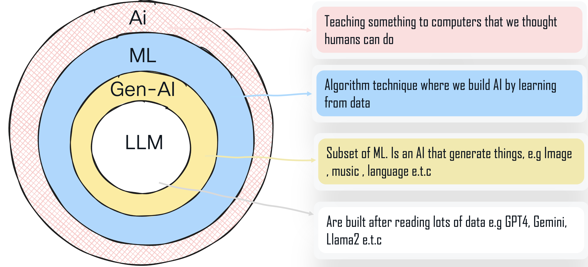{ loading=lazy }

!!! note
     Subset of AI is ML and kind of ML is Gen-AI . LLM e.g GPT are subset of Gen-AI


<p class="eyebrow sub">Module 1 · Task 1B</p>

### Neural Network { #module-1b data-toc-label="1b · Neural Network" data-task="1b" }


#### Introduction


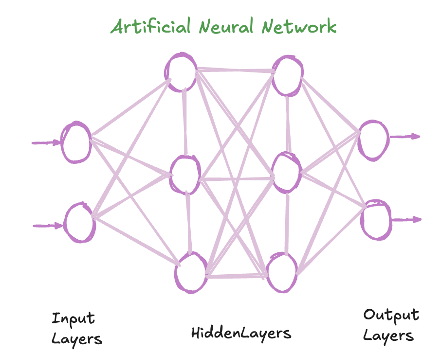{ loading=lazy }

<span class="colour" style="color:red"> Note: The way nodes are connected is called weights </span>

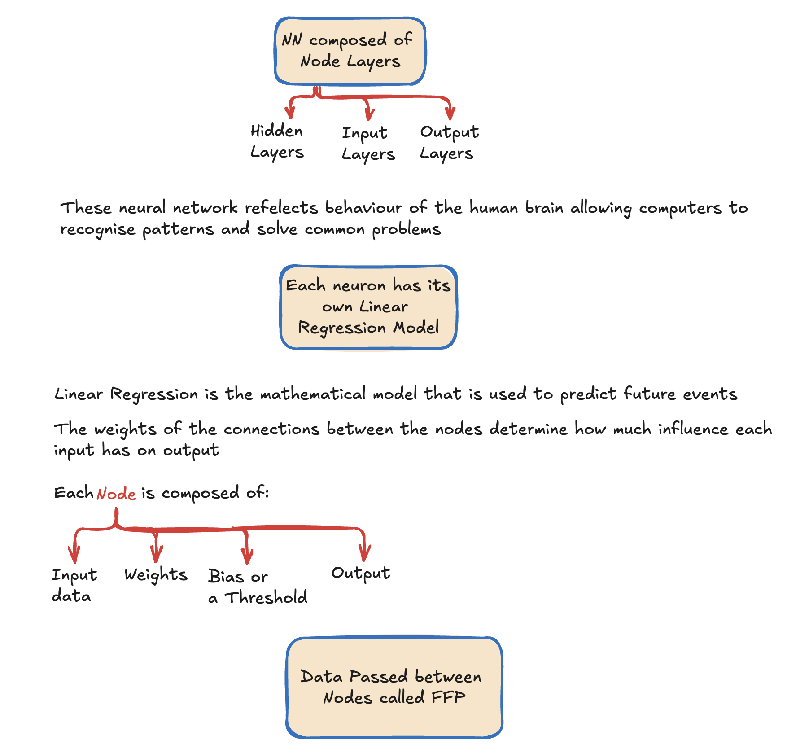{ loading=lazy }

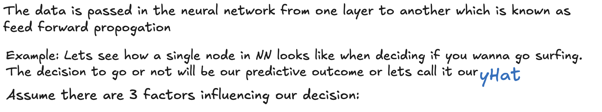{ loading=lazy }

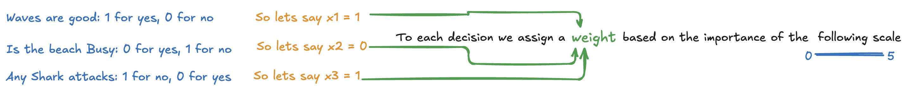{ loading=lazy }

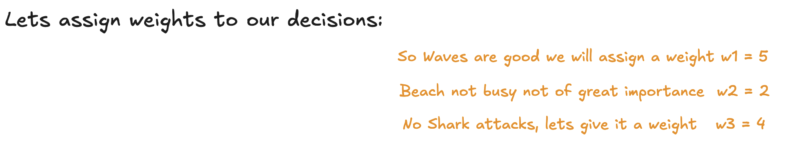{ loading=lazy }

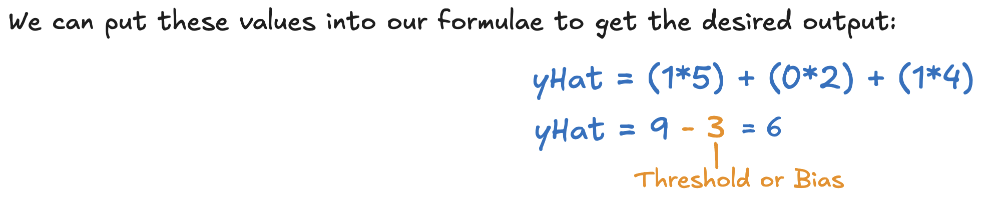{ loading=lazy }

!!! note

    <span class="colour" style="color:red"> Note: Threshold and Bias are random generated values, used in neural networks to help determine neuron activation and adjust outputs. To understand neural networks more comprehensively, here are some foundational papers and articles:

    * <a href="http://neuralnetworksanddeeplearning.com" target="_blank">Neural Networks and Deep Learning by Michael Nielsen</a>

    * <a href="https://medium.com/@theDrewDag/introduction-to-neural-networks-weights-biases-and-activation-270ebf2545aa" target="_blank">Introduction to neural networks: weights, biases and activation</a>

    * <a href="https://spotintelligence.com/2023/03/13/feedforward-neural-networks/" target="_blank">Neural Networks Made Simple</a>

    </span>

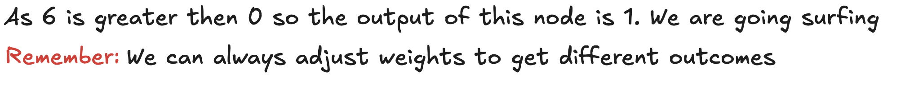{ loading=lazy }

!!! note

    <span class="colour" style="color:red"> Note: Neural Network rely on training data to learn and improve their accuracy over time. We used supervised learning to train the NN algorithm. 
    There are multiple types of Neural network other than the Feed Forward Network that we have defined here. Example: CNN: Convolutional Neural Network is a unique architecture for identifying patterns
    like image recognition, or RNN: Recurrent Neural Network, that uses time series data to make prediction about future events like sales forecasting. </span >

<p align="right"> 👉 When you're ready, click the <strong>"Tokenization"</strong> Task on the left. </p>


<p class="eyebrow">Module 2</p>

## Tokenization { #module-2 data-toc-label="Module 2 · Tokenization" }


<p class="eyebrow sub">Module 2 · Task 2A</p>

### Tokenization { #module-2a data-toc-label="2a · Tokenization" data-task="2a" }


#### Introduction


#### 1. Background


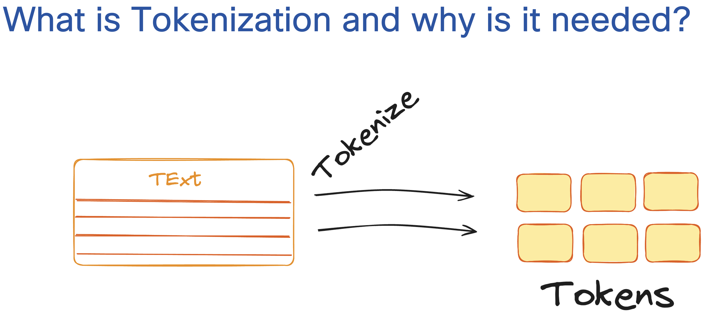{ loading=lazy }

* Language models have a limit on how much text they can handle at once, known as their context window. While these limits are expanding, research shows that LLM's often perform better when provided with less, but more relevant, information. However, selecting the most relevant information is straightforward for humans but challenging for computers. 

A common approach to manage large amounts of data is to break it down into smaller, more manageable parts; this is a process often referred to as Tokenization or Chunking. Tokenization is a key step in this process, where raw text is divided into smaller units, called tokens, which can then be processed by a neural network.

#### 2. Types of Tokenization


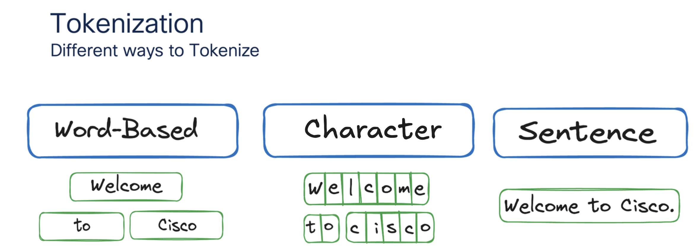{ loading=lazy }

In order to do this you need to pick a chunking/Tokenization strategy. Just to name a few:

* Word-Based: A simple and straightforward method that most of us would propose is to use word-based tokens, splitting the text by spaces.

* Character based tokenization: Individual words are considered as tokens . Lot of computing resources needed as now e.g for a 3 word serentence where you might need 3 tokens now 15 to 20 tokens needed 

* Sentence Based: We need a .(fullstop) for it to work 

<span class="colour" style="color:red"> Note: We've all heard of GPT and OpenAI. They utilize a tokenization method called Byte Pair Encoding (BPE), which is a middle ground between word-based and character-based tokenization. In BPE, words are broken down into smaller character sequences that the model encountered during training, allowing it to make informed predictions. </span>

!!! Note

    <a href="https://huggingface.co/learn/nlp-course/en/chapter6/5" target="_blank">More Info for Byte-Pair Encoding tokenization</a>

#### 3. Why do we need Tokenization or Text Splitting?


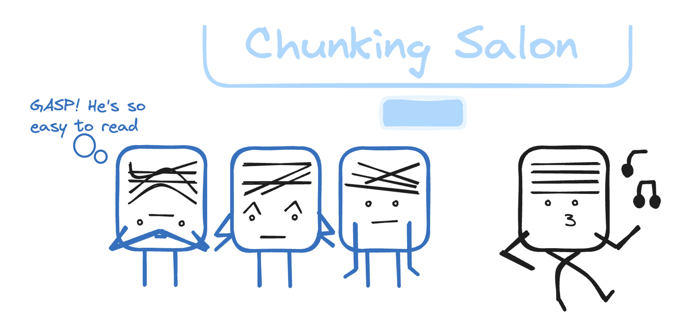{ loading=lazy }

Historically, applications perform better when they are provided with your own data. However, you can't feed unlimited data to your LLMs due to two key limitations:

* Context window limit: LLMs have a finite context window for processing data.

* Signal-to-noise ratio (SNR): LLMs perform better when the SNR is high, meaning the information provided is useful, relevant, and clear. Clear, unambiguous instructions help the model deliver more accurate and detailed results, while ambiguous or complex inputs can lead to less accurate or incomplete outputs.

As noted, chunking or splitting refers to breaking your data into smaller, manageable pieces.

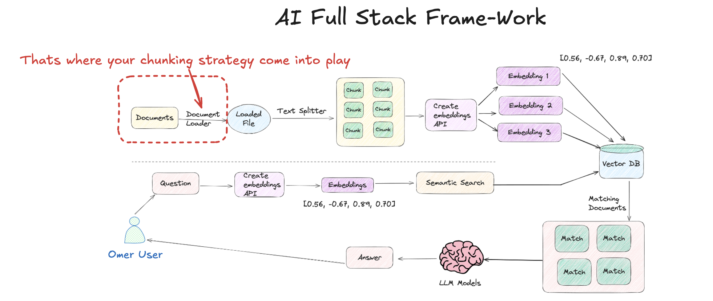{ loading=lazy }

<p class="eyebrow sub">Module 2 · Task 2B</p>

### Tokenization LAB { #module-2b data-toc-label="2b · Tokenization LAB" data-task="2b" }


#### Log into the Lab Environment


#### 1. Lab Steps


!!! warning "Session Timeout"
    When using Google Colab, if your notebook is **idle for too long**, the session will **time out**, requiring you to **re-run all the cells from the start**.

* Open  <a href="https://colab.research.google.com/" target="_blank">Google Colab</a> and create a new notebook. Click on "File" > "New notebook". 
    
!!! note
    Please refer to the [following section](../index.md#module-1) to create Google Colab account.

{ loading=lazy }

* Make sure you are connected to a runtime. For this task, you can use the CPU as the runtime environment.

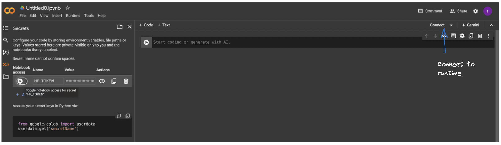{ loading=lazy }

<span class="colour" style="color:red">Reminder: </span>Whenever you want to copy the code in Google Colab and run it, be sure to click on + Code to add a new code cell.

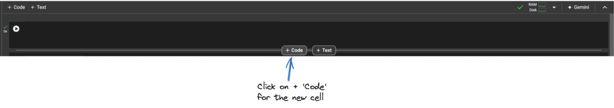{ loading=lazy }

<span class="colour" style="color:red">Reminder: </span>Click the play button to the left of the code, or use the keyboard shortcut "Command/Ctrl+Enter" while the cell is selected.

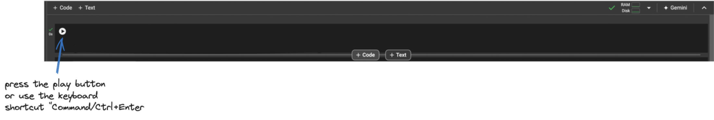{ loading=lazy }


##### 1. Manual testing for Chunking/Tokenization


<span class="colour" style="color:green">We will create Chunks of 35 characters, so first 35 characters as chunk 1 ,next 35 characters chunk2 and so on </span>

```py linenums="1"
# Manual Splitting
text = """Cisco hosts multiple events, including Cisco Live and WebexOne, which bring together industry professionals for in-person and virtual experiences. These events focus on AI collaboration, customer experience, and the latest innovations.
They feature a variety of activities such as insightful breakout sessions, technical training courses, hands-on labs, inspiring keynotes, epic entertainment, a solutions showcase and expo, customer awards, meet-the-experts sessions, 1:1 executive meetings, a partner program, and more!"""

# Create a list that will hold your chunks
chunks = []

chunk_size = 35 

# Run through the a range with the length of your text and iterate every chunk_size you want
for i in range(0, len(text), chunk_size):
    chunk = text[i:i + chunk_size]
    chunks.append(chunk)

print(chunks)
```

!!! note
    The image below is provided to highlight the code and help you understand how chunking works. Not an actual output from print(chunks) command.

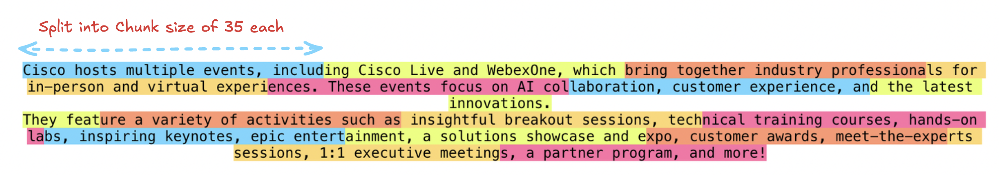{ loading=lazy }

!!! note
        
    Please note that the image above is not generated directly from our code. It has been included as a visual aid to help you better understand the concept of tokenization and chunking.  The text contained a total of 522 characters, divided into 15 chunks. Problem with the above chunking technique is that it got split at 'includ'. How do we know when to chunk? Before we look into that. Lets look into Langchain Splitter.

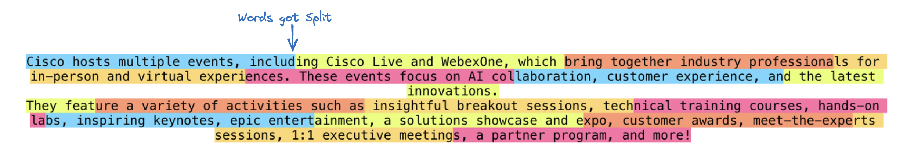{ loading=lazy }

##### 2. LangChain Text Splitter using overlap


!!! note

    To proceed with this Task(Task3), use the same Colab notebook. Simply add a new code cell by clicking the '+ Code' button and paste the code below.

* Let's retrieve the langchain library from the Python Package. In the example below, we'll configure the chunk_overlap parameter, which ensures that our chunks are blended together. Meaning the end of chunk 1 will overlap with the beginning of chunk 2. Please copy the below command in Colab and press **run** to execute each cell individually.

```py linenums="1"
!pip install langchain langchain-text-splitters
```

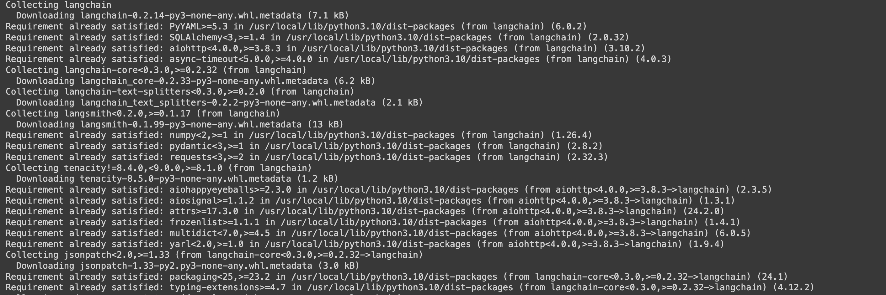{ loading=lazy }


``` py linenums="1"
text = """Cisco hosts multiple events, including Cisco Live and WebexOne, which bring together industry professionals for in-person and virtual experiences. These events focus on AI collaboration, customer experience, and the latest innovations. They feature a variety of activities such as insightful breakout sessions, technical training courses, hands-on labs, inspiring keynotes, epic entertainment, a solutions showcase and expo, customer awards, meet-the-experts sessions, 1:1 executive meetings, a partner program, and more!"""
```

``` py linenums="1"

from langchain_text_splitters import CharacterTextSplitter

text_splitter = CharacterTextSplitter(chunk_size=35, chunk_overlap=3, separator='', strip_whitespace=False) # seprate means you split by character

a = text_splitter.create_documents([text])

a

```
!!! note
    Seprators are characters sequence you wanna split on. The image below is provided to highlight the code and help you understand how chunking works.

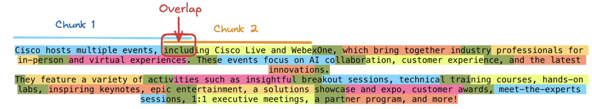{ loading=lazy }

In the above cell, the LangChain text splitter divides a long piece of text into smaller chunks of 35 characters each. Instead of splitting by words or sentences, it splits character by character because the separator is set to an empty string.

A key feature here is the use of a `chunk_overlap` of 3 characters. This means that the end of one chunk is repeated at the beginning of the next chunk. This overlap helps preserve continuity between chunks, so important context is not lost when the text is broken apart. Without overlap, information at the boundaries of chunks could be cut off, which can reduce understanding when these chunks are later processed by language models.

Overall, this approach ensures that the text is split into manageable pieces while still maintaining enough shared context between them for better downstream performance.

##### 3. Recursive Character Text Splitting


In the previous example, we used Character Splitting, where the text was divided based on a fixed number of characters. Specifically, the text was split into chunks of 35 characters each, regardless of whether a word or sentence was cut in the middle.

However, with **Recursive Text Splitting (RTS)**, the process is more flexible. Instead of cutting the text at an exact character position every time, RTS tries to split the text using its natural structure first, which helps create chunks that are easier to read and more meaningful.

**How RTS Works**

Rather than blindly splitting at a fixed character count, RTS looks for the best places to break the text by checking a series of separators in order. It typically starts with larger logical boundaries, such as:

* `\n\n`: double newlines for paragraph breaks
* `\n`: single newlines for line breaks
* ` `: spaces to keep whole words together
* `""`: individual characters if no other separator works

This process is called **recursive splitting** because the splitter keeps trying smaller separators until the text fits within the desired chunk size.

!!! info "Important Clarification"
    Although RTS uses the structure of the text, it can still take a `chunk_size` parameter. In the example below, `chunk_size=35` does **not** mean the text is blindly cut every 35 characters. Instead, it means that **35 characters is the maximum target size** for each chunk. The splitter will try to keep each chunk within that limit while splitting at the most natural boundary possible.

!!! note
    To proceed, use the same Colab notebook you created earlier. Simply add a new code cell by clicking the '+ Code' button and paste the code below.

``` py linenums="1"
text = """Cisco hosts multiple events, including Cisco Live and WebexOne, which bring together industry professionals for in-person and virtual experiences. These events focus on AI collaboration, customer experience, and the latest innovations. They feature a variety of activities such as insightful breakout sessions, technical training courses, hands-on labs, inspiring keynotes, epic entertainment, a solutions showcase and expo, customer awards, meet-the-experts sessions, 1:1 executive meetings, a partner program, and more!"""
```

```py linenums="1"
from langchain_text_splitters import RecursiveCharacterTextSplitter
text_splitter = RecursiveCharacterTextSplitter(chunk_size = 35, chunk_overlap = 0)
# how many chunks we have
print(len(text_splitter.create_documents([text])))

text_splitter.create_documents([text])
```

**Why This Approach is Useful**

In the above example, the splitter avoids breaking words in the middle by using spaces as one of the separators. This helps keep related words together and makes each chunk more natural and easier for a language model to understand. As a result, the chunks are not only limited in size, but they also preserve more context than simple character-based splitting.

!!! tip "Key Takeaway"
    * **CharacterTextSplitter** cuts text based on a fixed number of characters.
    * **RecursiveCharacterTextSplitter** also uses a size limit, but it tries to split the text at meaningful boundaries first.
    * This makes the chunks more **logical, readable, and context-aware**.

!!! note "Recommendation"
    If you are new to AI and text chunking, **Recursive Text Splitting (RTS)** is often a better starting point because it usually produces cleaner and more useful chunks than basic character splitting.
    

##### 4. Document Level Splitting


So far, we've been working with splitting regular text. But what if we have markdown files or PDF or Python documentation? There's a better way to handle those cases, and that's where specialized document splitting comes into play.

##### 5. PDF with Table


PDFs often contain structured content such as tables, headings, paragraphs, lists, and images. This makes them more complex than plain text files, and simple character-based splitting methods may not work effectively.Before performing any chunking, it is important to first extract and identify the different elements within the document. This ensures that structured data especially tables are preserved and handled correctly. 
        
We'll accomplish this using the <a href="https://unstructured.io/" target="_blank">Unstructured library</a>, which is specifically designed for handling such tasks. If you have a large collection of PDFs, <a href="https://unstructured.io/" target="_blank">Unstructured</a> is an excellent tool to manage them efficiently.

!!! note
    There are multiple libraries available for handling PDF extraction, but in this lab guide, we will use the <a href="https://unstructured.io/" target="_blank">Unstructured</a> library.

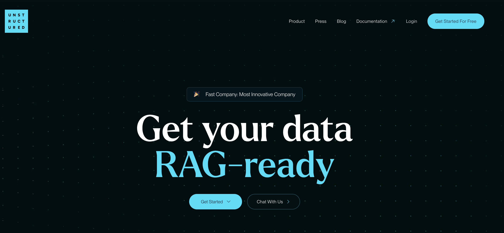{ loading=lazy }

!!! note
        
    Please remember to let each cell finish executing before moving on to the next one.

* Install relevant libraries including <a href="https://unstructured.io/" target="_blank">Unstructured</a>


```py linenums="1"
!pip install scikit-learn langchain_community unstructured[all-docs] unstructured pdfminer pdfminer.six pdf2image pillow_heif opencv-python unstructured_inference pytesseract unstructured_pytesseract python-dotenv openai
```

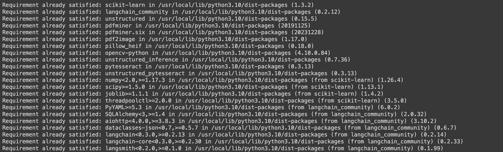{ loading=lazy }

!!! note
    You will be asked to restart your notebook. Click on Restart Session.

```py linenums="1"
!apt-get install -y poppler-utils && apt-get install -y tesseract-ocr
```

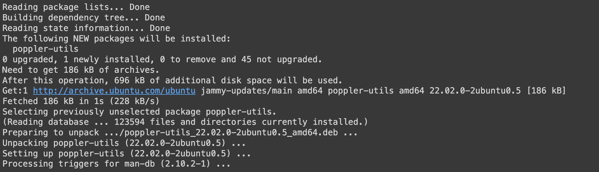{ loading=lazy }

* We will update nltk to version 3.10.4

```py linenums="1"
!pip install --upgrade nltk
```
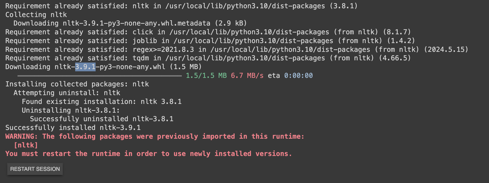{ loading=lazy }

* Let's load our PDF files into Google Colab. For this example, we can use the Cisco Financial Results. Please [Download the file here](../assets/static/CiscoReport.pdf){:target="_blank" download="CiscoReport.pdf"} as we will be using in the next step. You can open the pdf to go through the file. 

* In Google Colab, click on the Folder tab. Right click and select New Folder to create a folder named "data."

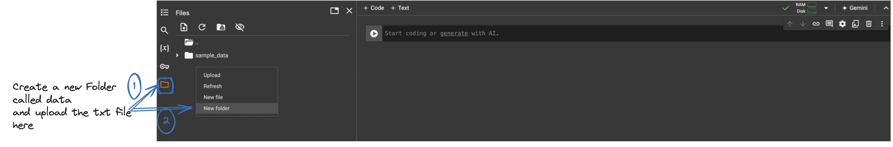{ loading=lazy }

* On your newly created 'data' folder, click [...] then select Upload.

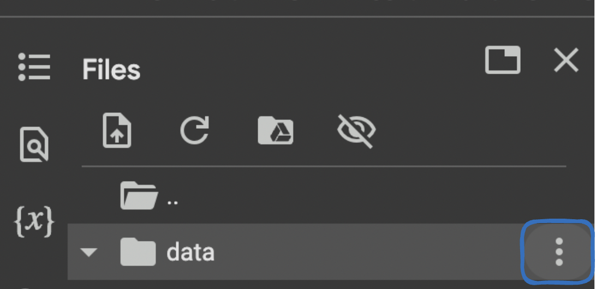{ loading=lazy }

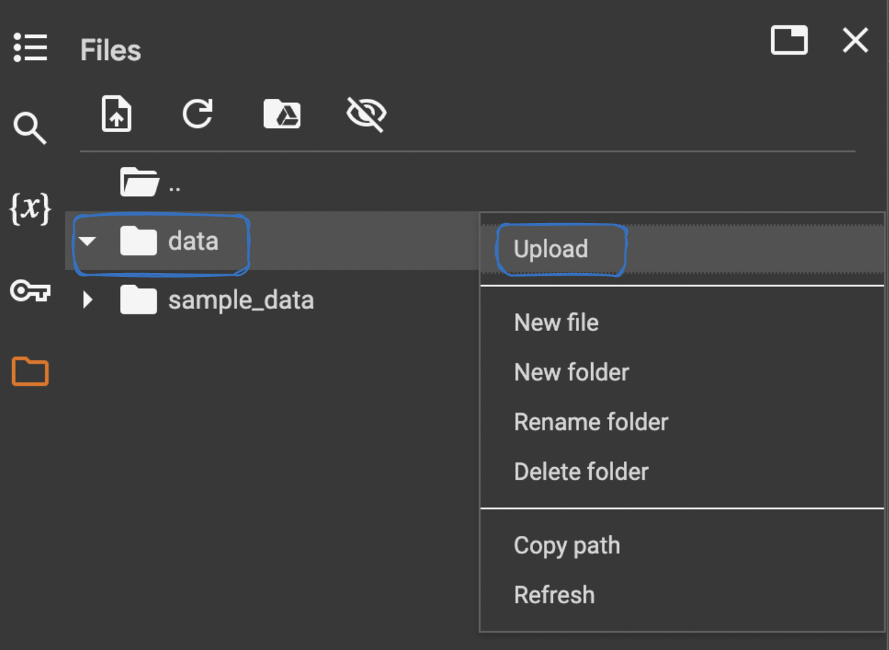{ loading=lazy }

* Choose your CiscoReport.pdf file and click Open

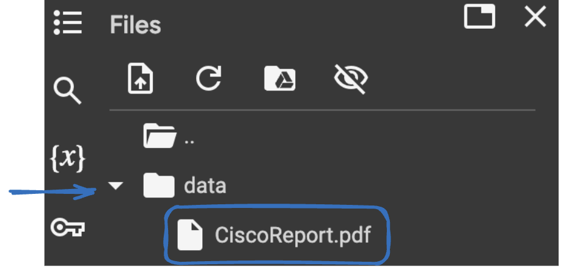{ loading=lazy }

* We'll use the following code from the Unstructured library to demonstrate how tables can be extracted

!!! note
    <Your-File-Path> In the below code filename, is the relative path where your PDF is uploaded. To get the correct file path, click on the 'data' folder, select your PDF file, click on [...] and choose Copy Path. Example: filename = "/content/data/CiscoReport.pdf"

```py linenums="1"

import os
from unstructured.partition.pdf import partition_pdf
from unstructured.staging.base import elements_to_json

# Let's load up our PDF and then partition it.
filename = "<Your-File-Path>"# Use relative path since the file is in the same directory.
# Extracts the elements from the PDF
elements = partition_pdf(
    filename=filename,
    extract_images_in_pdf=True,
    strategy="hi_res",
    infer_table_structure=True,
    hi_res_model_name="yolox"
)
# Let's look at our elements
elements
```

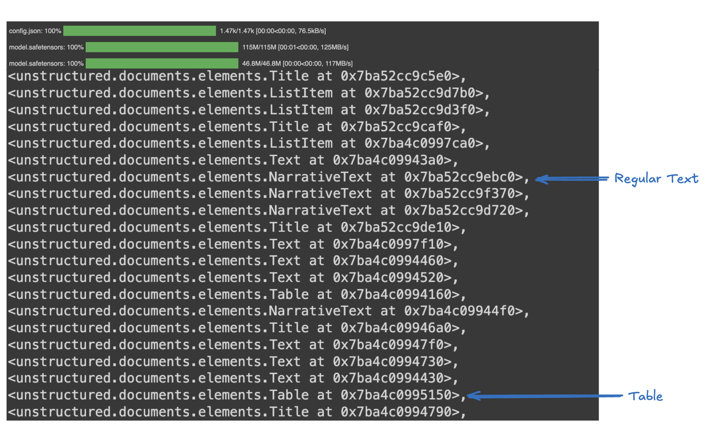{ loading=lazy }

* The elements output contains many different extracted components from the PDF, such as titles, paragraphs, list items, images, and tables. Since the exact position of a table can vary from one PDF to another, it is better to search the extracted elements programmatically rather than assuming the table will always appear at a fixed index. So lets run the below script:

```py linenums="1"
from collections import Counter

# Show how many elements of each type were extracted
element_types = [type(el).__name__ for el in elements]
print(Counter(element_types))

# Find all table elements and print their index
table_indexes = []

for i, el in enumerate(elements):
    if type(el).__name__ == "Table":
        table_indexes.append(i)
        print(f"Table found at index: {i}")

print("All table indexes:", table_indexes)
```

We can now see where the first "table" field is defined. Example elements[45]

```py linenums="1"
elements[45].metadata.text_as_html
```

!!! note
    If you're working with PDFs in AI pipelines, combining Unstructured (for extraction) with LangChain (for chunking and retrieval) is a powerful approach.

<span class="colour" style="color:green">OUTPUT - Example</span>

!!! note
    You can copy the below HTML snippet or use the actual HTML output you received from your element.

```html
'<table><thead><tr><th>Revenue</th><th>$8.51 - $8.53 Billion</th><th>$34.5 - $34.7 Billion</th></tr></thead><tbody><tr><td>Y/Y Growth</td><td>~10%</td><td>~10%</td></tr><tr><td>FX Impact)</td><td>no impact</td><td>no impact</td></tr><tr><td>GAAP Operating Margin</td><td></td><td>~11.4%</td></tr><tr><td>Non-GAAP Operating Margin’)</td><td></td><td>~28.0%</td></tr><tr><td>GAAP Earnings per Share?)</td><td>$0.79 - $0.80</td><td>$2.67 - $2.69</td></tr><tr><td>Non-GAAP Earnings per Share()</td><td>$1.89 - $1.90</td><td>$7.41 - $7.43</td></tr><tr><td>Operating Cash Flow Growth (Y/Y)°)</td><td></td><td>16% - 17%</td></tr><tr><td>Current Remaining Performance Obligation Growth (Y/Y)</td><td>~10%</td><td></td></tr></tbody></table>'
```

* Tables are straightforward for humans to read, but they aren't as easy for language models to interpret. Language models are typically trained on HTML tables, so when you pass HTML-formatted tables to an LLM, it will better understand the structure and content. You can paste the HTML into an <a href="https://codebeautify.org/htmlviewer" target="_blank">HTML viewer</a> to see how it looks.

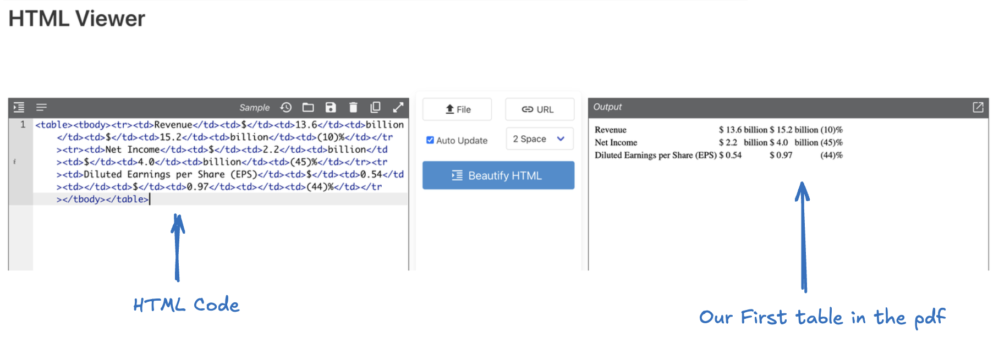{ loading=lazy }

!!! note
    That's how you handle tables within a PDF. Please note that the image above may appear slightly different.
        


###### 6a. Multi-Modal (Text + Images)


What if a PDF or other document contains images? How can you extract them? We'll use the Unstructured library again to handle this.

!!! note

    To proceed, use the same Colab notebook you created earlier. Simply add a new code cell by clicking the '+ Code' button and paste the code below.

###### 6b. Multi-Modal (Extract Images from PDF)


* Install relevant libraries 

```py linenums="1"
from typing import Any
from pydantic import BaseModel
from unstructured.partition.pdf import partition_pdf  
```

```py linenums="1"

# Make sure to use the correct PATH where you saved the downloaded file in the previous step.
filepath = "/content/data/CiscoReport.pdf"
# Get elements
raw_pdf_elements = partition_pdf(
    filename=filepath,

    # Using pdf format to find embedded image blocks
    extract_images_in_pdf=True,

    # Use layout model (YOLOX) to get bounding boxes (for tables) and find titles
    infer_table_structure=True,

    # Specifies the strategy to be used for chunking the text. In our case, it will chunk the text based on titles found in the document.
    chunking_strategy="by_title",
                
    # Sets a hard limit on the number of characters allowed in each chunk. 
    max_characters=4000,
    # This function will attempt to create a new chunk after every 3,800 characters, allowing some flexibility while chunking.
    new_after_n_chars=3800,
    # If a chunk has fewer than 2,000 characters, the function will 
    # attempt to combine it with neighboring text blocks to create a larger, more meaningful chunk.
    combine_text_under_n_chars=2000
)
```

!!! note
    After extracting images from the PDF, the files are saved locally in the figures folder. To analyze one of these images with a multimodal model, we need to send the image in a format the model can understand.
    Since the image is stored locally in the Colab environment and does not have a public URL, a convenient approach is to convert it to base64 and include it in the request as a data URL. This allows the model to process the image directly.
    A vision-capable model such as gpt-4o (or similar image-enabled models) can then generate a description or summary of the extracted image. This is especially useful when working with documents that contain both text and visuals.
    Also if you get a warning it's just an informational message from the unstructured library letting you know that you haven't explicitly specified a language for text processing, so it's defaulting to English.
    If you want to remove the warning and be explicit, you can pass the languages parameter like this: languages=["eng"] after the combine_text_under_n_chars=2000.

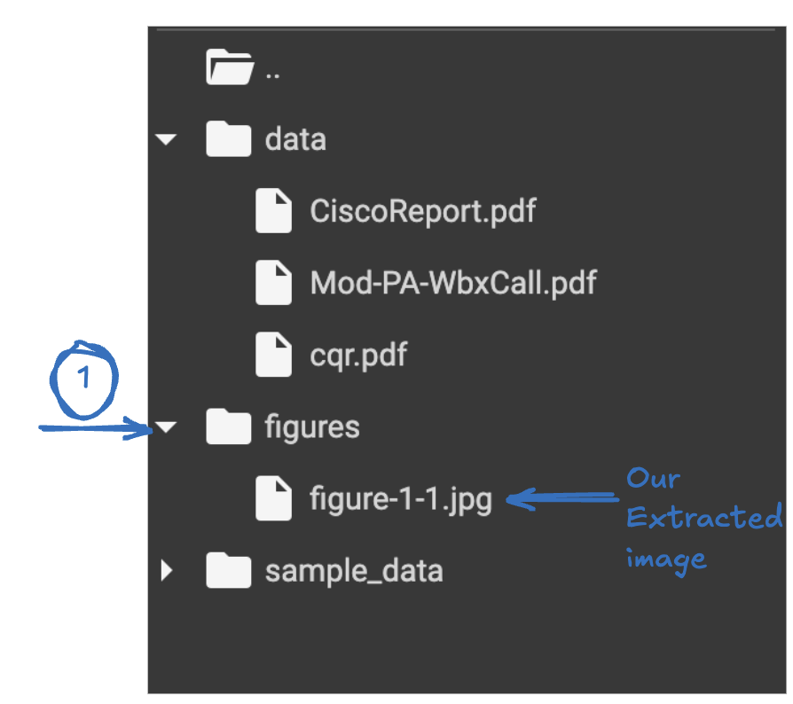{ loading=lazy }

* You can view the image by double clicking it 

!!! note
     After extracting images from a PDF or any other source, you can use the below method to send them to a multimodal model like GPT-4o to understand and generate insights about the images. This approach allows you to combine textual and visual data for a richer understanding of the content.

**Set OpenAI Token: MultiModal**

!!! note
    The OpenAI API keys have already been **pre-generated and provided** to you in your `.txt` file. You can skip the steps below and go straight to adding the key in Colab Secrets.

??? info "Optional: Create Your Own OpenAI API Key (click to expand)"

    If you'd like to use your own key instead of the one provided, follow these steps:

    * Browse to the <a href="https://platform.openai.com/api-keys" target="_blank">OpenAI API Keys page</a>
    * Click **Create new secret key**. The key is automatically generated
    * Save the API Key securely. You'll need it in the next steps
    * Use default settings when creating the key

    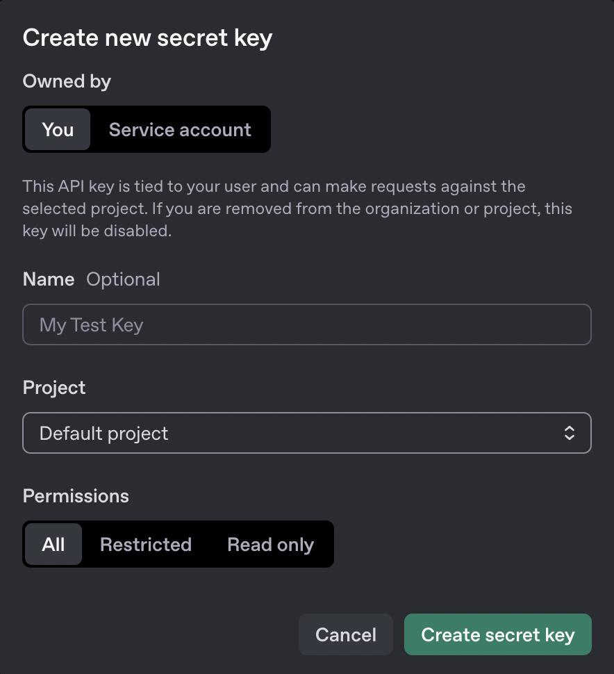{ loading=lazy }

    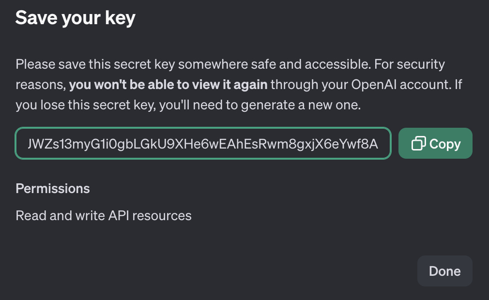{ loading=lazy }

* Within your existing Google Colab notebook navigate to the new “Secrets” section in the sidebar.

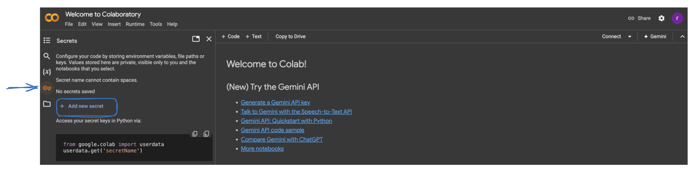{ loading=lazy }

* Click on “Add a new secret.” Enter the name example: OPENAI_API_KEY and value of the secret(the API key sent to the tmedemouserX account or the .txt file you have downloaded). Note: The name is permanent once set. 

* The list of secrets is global across all your notebooks.

* Use the “Notebook access” toggle to grant or revoke access to a secret for each notebook.

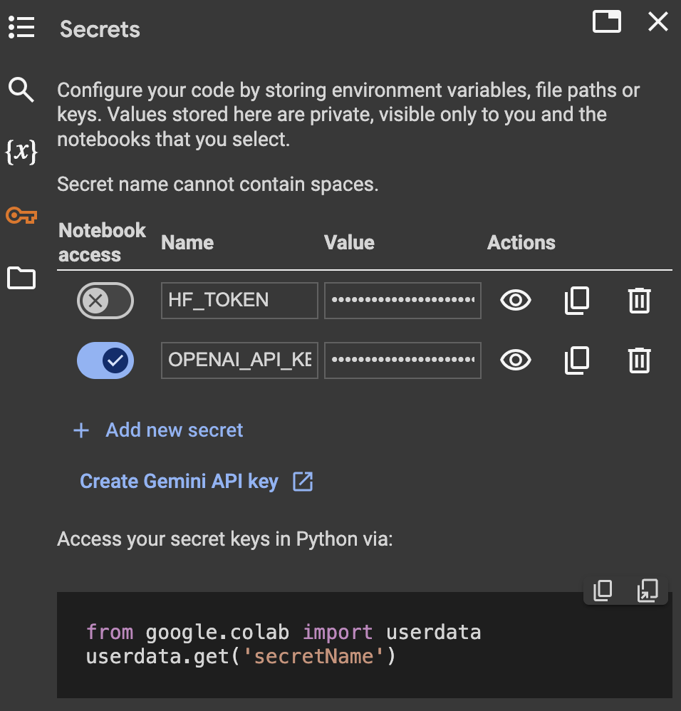{ loading=lazy }

!!! important
    Since ChatOpenAI has been deprecated in LangChain, we will use the langchain-openai package instead. Run the following command to update:

```py linenums="1"
!pip install -U langchain-openai
```

!!! important 
    Let's import and load the envoirnment variables in the same notebook

```py linenums="1"
from langchain_openai import ChatOpenAI
# from langchain.chat_models import ChatOpenAI
# from langchain.schema.messages import HumanMessage
from langchain_core.messages import HumanMessage
import os
from dotenv import load_dotenv
from PIL import Image
import base64
import io
# load_dotenv()
```

!!! important 
    Incorporating Secrets into your Code.  We'll use this later in the lab. Since GPT-5 was recently released, feel free to switch from GPT-4o to GPT-5.

```py linenums="1"
import os
from google.colab import userdata
os.environ['OPENAI_API_KEY'] = userdata.get('OPENAI_API_KEY')
llm = ChatOpenAI(model="gpt-4o")
```

!!! important
    Function to Convert Image to Base64:

```py linenums="1"
# Function to convert image to base64
def image_to_base64(image_path):
    with Image.open(image_path) as image:
        buffered = io.BytesIO()
        image.save(buffered, format=image.format)
        img_str = base64.b64encode(buffered.getvalue())
        return img_str.decode('utf-8')

image_str = image_to_base64("/content/figures/figure-1-1.jpg")
```

!!! note
    This is the image that was extracted from our data and saved in the **Figures** folder.

* Lets see our  base64-encoded image

```py linenums="1" 
print(image_str)
```
<span class="colour" style="color:orange">Output: Our base64-encoded string </span>

```
/9j/4AAQSkZJRgABAQAAAQABAAD/2wBDAAgGBgcGBQgHBwcJCQgKDBQNDAsLDBkSEw8UHRofHh0aHBwgJC4nICIsIxwcKDcpLDAxNDQ0Hyc5PTgyPC4zNDL/2wBDAQkJCQwLDBgNDRgyIRwhMjIyMjIyMjIyMjIyMjIyMjIyMjIyMjIyMjIyMjIyMjIyMjIyMjIyMjIyMjIyMjIyMjL/wAARCAB1AOkDASIAAhEBAxEB/8QAHwAAAQUBAQEBAQEAAAAAAAAAAAECAwQFBgcICQoL/8QAtRAAAgEDAwIEAwUFBAQAAAF9AQIDAAQRBRIhMUEGE1FhByJxFDKBkaEII0KxwRVS0fAkM2JyggkKFhcYGRolJicoKSo0NTY3ODk6Q0RFRkdISUpTVFVWV1hZWmNkZWZnaGlqc3R1dnd4eXqDhIWGh4iJipKTlJWWl5iZmqKjpKWmp6ipqrKztLW2t7i5usLDxMXGx8jJytLT1NXW19jZ2uHi4+Tl5ufo6erx8vP09fb3+Pn6/8QAHwEAAwEBAQEBAQEBAQAAAAAAAAECAwQFBgcICQoL/8QAtREAAgECBAQDBAcFBAQAAQJ3AAECAxEEBSExBhJBUQdhcRMiMoEIFEKRobHBCSMzUvAVYnLRChYkNOEl8RcYGRomJygpKjU2Nzg5OkNERUZHSElKU1RVVldYWVpjZGVmZ2hpanN0dXZ3eHl6goOEhYaHiImKkpOUlZaXmJmaoqOkpaanqKmqsrO0tba3uLm6wsPExcbHyMnK0tPU1dbX2Nna4uPk5ebn6Onq8vP09fb3+Pn6/9oADAMBAAIRAxEAPwD3+iiigAoopKAFopKWgCKVtkTP6DNeT3Gs39xeG6+0yK2cqFbAUegFeq3P/HtL/un+VeNjpXqZbCMuZtHzmfVZx5Ixdtz1fQrx9R0a3uZBh2BDY7kHGf0rUrD8Jf8AItWn/Av/AEI1t9K86qkqkku57mGk5UYSe7SHUUZpKg3FooooAKKKKACiiigAooooAY5wpPpXk13rN7dXxuftDoQ3yBWICjsMV6vL/q2+leMn7x+tenlkIycm0fO59UnFQUXbc9U8PXsmpaLBcSgeYcq2O5Bxn9K1RzWB4M/5FuD/AH3/APQjW/0rgrJRqSS7ntYSTlQhKW7SHUUlLWZ0BRRRQAUUUUAFFJuHrS0ANP8AKue8SeIG0VY44Yw88oJG77qgd66GuC8e/wDIQtf+uZ/nXThKcalZRlsefmdadHDSnB2ZpeHPFEuqXJtLmNBLtLI6cA47YrrK8y8Hf8jFF/uN/KvSx2p42lGnVtHYzynEVK+H5qju07DLn/j1l/3T/KvGe1ey3P8Ax6y/7h/lXjXauzK9pfI83iD4qfz/AEPT/CX/ACLVr/wL/wBCNblYfhL/AJFq1/4F/wChGtyvOr/xZerPdwn8CHojnvEmvto0MaQxq88udu48KB3PrVPw74ol1S6+y3UaLKVLIyZAOOxFZ3jz/j/tP+ubfzrN8Jf8jHb/AEb/ANBNd8cPTeF52tTxKuOrRzD2Sfu3Sseo0UUV5Z9IFFN3D1p1ACVgeI/EA0WJEjj8yeUEqD0AHc1v1wXj3/j+tP8Acb+YrowlONSqoy2ODMq86GHlOG5c0DxXNf3y2l4iB5M7HjBAzjOCK7HFeU+Gf+Rjs/8AfP8A6Ca9VrTHUo06iUVbQwyjEVK9Fuo7tMST/Vt9K8XP3j9a9ok/1bfSvFz94/WurK95fI8/iD/l38/0PS/Bv/Itwf77/wDoRrf71geDf+Rbg/33/wDQjW/Xn4j+LL1PcwX+7w9EYXiLXf7FtUZEDzSkhFPTjqTWX4f8Vz6hfrZ3scYaTOx4wQMjnBBJqDx/9+x/7af+y1heGv8AkY7L/fP/AKCa7qWGpywrm1rqeLicdWhj1Ti/dulb1PVRS0lLXln0gUUhIoyPWgLnj02p3txctcPcy+YW3ZViMfT0r07Qrt73RrWeXmRl+Y+pBxmvJq9T8L/8i5Z/7p/ma9jMqcYwjZHy2R1ZyrTUne6v+JsmuB8e/wDIQtf+uZ/nXfGuA8e/8hC1/wCuR/nXHgP46PUzn/dJfL8yj4O/5GKL/cb+VemV5n4O/wCRii/3G/lXplXmX8b5GWQ/7s/Vkdz/AMesv+4f5V4z2r2a5/49Zf8AcP8AKvGe1b5XtL5HFxB8VP5/oen+Ev8AkWrX/gX/AKEa3Kw/CX/ItWv/AAL/ANCNbledW/iy9We/hP4EPRHA+Pf+Qhaf9c2/nWb4S/5GO3+jfyNaXj3/AJCFp/1zb+dZ3hL/AJGOD6N/KvXp/wC5/JnzFf8A5GnzR6fUcz+XE74ztUnFSVDdf8esv+4f5V4i3PrJu0WeS3GqXt1cNcyXMokY5+VyNv09BXpfh+6kvtDtZ5WzIykMfUgkZ/SvKB0FeoeE/wDkXLT6N/6Ea9fMIRVKNl1PmclqzliJqTvdfqbhrg/H3/H9Z/8AXNv5iu8NcH4+/wCP6z/65t/MVxYH+Oj1c4/3SXyMbwz/AMjHZ/75/wDQTXqgryvwx/yMdl/vn/0E16pW2Z/xV6HNkP8AAl6/ohJP9W30rxc/eP1r2iT/AFbfSvFz94/Wtcr3l8jm4g/5d/P9D0vwb/yLcH++/wD6Ea3+9YHg3/kW4P8Aff8A9CNb/evOxH8WXqz3MF/u8PRHD+P/AL1h/wBtP/ZawfDX/Ix2X++f5Gt7x/8AesP+2n/stYXhn/kY7P8A3z/6Ca9bD/7m/RnzOM/5GS9V+h6qKbI21GPoM06mS/6t/wDdNeItz66WkTyO61W9u7t7h7iQOxyArkBfYVL/AG/rH/P9J+f/ANas7tS19PGlTcVdI/PZ163O2pP7zuZ/AkL3fmR3TJATkxBckewP/wBauqtLWOztY7eFdsca7VHtU4o6187Ur1KiSm72Pu6OEo0JOVONmxO9Y2uaDDrcS73Mc0edjjnGexFbVFZwnKEuaL1NatKFWDhNXTOe0LwxDo8jTtKZZyCobGAB7CuhFFLTqVJVJc0ndio0KdGHJTVkQ3P/AB6y/wC4f5V4x2r2l1DoVPQjFeez+CdQS6KwPE0BJw7HG0e4/wAK9DL60KfMpux4udYWrW5HTje1zqfCX/ItWv8AwL/0I1t9ao6XYrp2nQ2ifMI1wT6nqT+dXh1rz6slKba7nsYeDhSjGW6SMjXNCh1mBVdzHKmdjgZxn1HcVW0PwvHpErTvL585G0Nt2hR7CuhPTrQOnWqVaoociehMsJRlV9q4+93FprDIII4NOorM6TjbnwLDLeGWG5MUDHJi2ZI9gc11NnaRWNpHbwLtjjXCirFFaTrVKiSk72OajhKNGTlCNmwrH1rQ4NahVZCUlTOx17Z9R3FbFFTGTg+aO5rUpwqxcJq6ZzWh+E4tKuPtEk3nSjIQ7doX3x610tFFFSpKo+aTuyaNCnQjyU1ZDJP9W30rxg/eP1r2dxlT7159deCtQW8K27RPAzEh2bBUe4/wrvy6tCm5c7sePnWFq1lB043tc6Twb/yLcH+8/wD6Ea3+tUNIsF0zTYbVTu2DlvUnk/rV+uGrJSqSkurPWwsHCjGEt0kZetaLBrNqIpSUdDlJF6qf6is7RPCkelXP2qSczTDIQhdoXPtzzXTGk7VSrVFDkT0FPCUZ1VVlH3l1FoIyMUtFZHScdeeB4J70yw3LRRMctHtzj6GrH/CDaZ6z/wDfyunpa6FiqqSXMcH9m4a7fItRaKKK5zvCiimk4+lAAeKBzWTdeJNJtWKSXiFgcFUy3P4VWXxjo7HBuHX3Mbf4VoqFRq6izmljKEXZzV/U3/wpe1UbHU7PUVY2s6S7cbtp5GfUVezxUNNOzN4yjNc0XdCDpR0HSsy51/TbOd4JrpElT7ykHjjNS2Wq2WolxaTrKUxuwDxmm4TSvbQhV6TlyKSv2uaFFJmkLAVJqB4oHNY9z4n0m1Yo92rMDgiMFsflUCeMNHc4Nw6+7Rt/hWioVWrqLOaWLoRdnNX9Tf8Awpe1U7LULXUEaS1nSVAcEr2NXBUNNOzN4yUleLugpD9KM1Tu9RtLEA3NxHHnpubBP0FCTbsglJRV5OxcPFA571gt4w0dGx9oZvcRtj+VTW3ibSbp1jju1DscBXBXJ/GrdColdxZhHGUJOymr+ptUUUZrM6RKafwqO4uIrWJpZ5FRF5LMcAVjy+LdHjbH2ksf9lGI/lVxpzl8KuY1MRSp/HJL1NwH3FOrCh8V6PMcC7CH/popUfmRitmKZJkDxsGUjIZTkGiVOUfiVh069Op8Ek/QloooqDUKKKKACiikoAjlkWKJpHIVVGST2Fea674kudUneOGRorQHCqDguPU/4V1PjS7aDRfLQkGZwhx6ck/yrzkDJAA9sV6uX0ItOpL5HzOd42amqEHbuA5IA6ngVO1ldom5rWdV9TGQP5V6NoOg2+mWqM0atcsoLueSD6D0Fbe1ewGaqpmajK0Y3RFDIXKClUnZs4rwCfmvv+2f/s1dxjiq8VtDDI8kcSI743MoALY6Z/OrB6V5tar7Wo59z38Jh3h6Kpt3seV+Kf8AkZLv6r/6CK2vAP8Ar7//AHU/9mrF8U/8jHd/Vf8A0EVteAP9fff7qf1r1q/+5/JHzOE/5Gfzf6ncYwRXB+M9XmN7/Z8MjJEigybTgsT2Ptiu9PNeZ+LrZ4PEEsjAhJlVlPY4GD/KuDARjKt7x7GdVJww/udXqY1vbT3UwigiaSQ9FUc1pHwtrQTd9ib6B1z/ADqrpOpSaVfC5jRXOCrK3cHGfp0rtrLxpp9wQlwr27ercr+Yr08TVxFN/u43R4WAw+ErRtVm1Ib4MsrmytLmO5heJjLkBhjIwK6roKiilSVA8bqyMMgqcgipGOFJ9K8SrNzm5PqfW4elGjSUIu6RzPifxEdNjFtakfaZBknrsHr9a8+mmluZWlmkeSRurMck1PqN219qNxctn945I9h2H5VseFNDh1SeSe5y0EJA2f3m9/b/ABr2qUIYWjzy36nyeIq1swxPs4PTp29TCitp7jPkwSSY67EJ/lU9lG8WrWiSoyN56cMMH7wr1qOCOFAkcaqo6BRgCmyW0E2PMiR9pyNyg4Ncssyvdcuh6MMh5bNT1XkSqOB9Kzta1aLSLFp3wzH5Y0/vN6VpV5z41vHm1gWxb93AgwP9o8k/yrjwtH21VRex6eYYl4bDua32Rjahqd3qc5lupi/ov8K/QVWSN5W2xozt1woyav6Hpn9rapHbsSIgN0hHXaP/AK+K9QtbK3soFht4URF7Afzr1cRi4Ya0II+cweX1MdepOVl33bPH3R42KujKw7MMGr+l61e6VMrQSEx5+aJvun/CvTNQ0u11G3MVxErA9D3H0PavLdRs20/UJ7VjkxtgHGMjqD+Rp0MTDFJwkhYvBVcvkqkJadz1TTdQh1GyjuYfusOh6qe4PvV3PWuD8C3pW5uLMn5WXzB7EcH+Y/Ku8ryMRS9lUcD6jA4n6xQjUe/UWiiisDsCiiigDkfHULHS4ZBnCy8/iDXBI2x1bGcEGvXNVsI9S06a0k4Djg+h7H868pvLOexupLeddsiH8CPUe1e1l1SMqbpvdHyeeUJQrqstn+Z61Y3Ud5ZxTwtlHUMKsivKNL1290jKwOrRE5McnI/D0rafx5cmPCWSB/UuSPyxXJUy+qpe7qj0aGdUHTTqaM72l9a5fwnrN5q0t2bllwmzYqjAGc5/lXUVx1KbpycJbnq0K8a9NVIbM8r8U/8AIyXf1X/0EVteAP8AX33+6n9axfFP/IyXf1X/ANBFbXgH/X3/APup/wCzV7Nf/c/kj5XCf8jP5v8AU7mqGqaXa6pb+TdJuAOVYHBU+xq+a5XUfFw07U57N7QuIyMMrdcgHpj3rx6MJzl+73R9PiqtGnD998L0Mu+8D3MQZrO4WVeoVxhvz6fyrmbm1ns5jDcRtG46q3+ea7T/AITy1x/x5TZ+q1y+t6s2sXonMQiVF2KucnHXk17WFliea1VaHy2Pp4FR5qEtexr+DNTmjvxYO26KQEqD/CwGeK79xmNh6ivOfBlnJPri3AU+XApLN2yRgD9T+VekY4rzseoqt7p7WTOcsL7/AHdvQ8YliaCZ4nBDoxUg+oOK7HwLdxolzaMwEjOJFz1YYwcfl+tU/F+iSWt2+oQqWgmOXx/A3+BrmoZpLeZJYXZJEOVZTyK9NqOKoaP/AIc8BSnl+MvJbfij2fIxQfWvPrbxzeRR7bi2imI/iB2H8etOj8Y6jeahbwokcEbyqpwNzYJHc/4V5TwNZbo+hjnOGaVm7vyO/rzLxdGyeIpiejqrD6Yx/SvTR92uZ8W6K+oWq3MC7poQcqBy6+g96MFVVOsnLZ6FZth5V8M1HdanM+ELuO11wLIQBKhjBPY5BH8q9KVjk14uMqe4IP5Guhs/GWoWsSxSqk6qMAtkN+YruxmDnVlzwPHyrM4YeDpVdujPRywC5NeVeIbtLzXbqaMgpuCqR3wAM1a1HxXqF/G0S7YI2GCEPzEfWsNEaR1RAWZjgKByT6VWCwkqLc57kZpmMMUlSpbXOm8DwM+syTAfKkJBPuSMfyNeh4rB8MaOdK0797g3ExDv7eg/Ct/Nebi6qqVXJbHv5Zh5UMPGMt9xaKKK5j0AooooAQ1maro1nqsWLiP5l+668Mv0NFFOLad0Z1YRnBqSuee6too0648tZ969BlMH+dZYTPGaKK+koTk6auz4PE04xqtJaHeeCrMW0dxJv3GTbxtxjGf8a63tRRXhYt3rSPsctSWFiebeJLPzNfu28zGSvGP9kVreCbfyJb3592VTtj1oor0Kzf1T5I8fCwj/AGhe3VnZHpXmvim1/wCJ7cyb/vbeMdPlAoorky92qndnivh16mCV561r6PoS6ncBXuCig8gLnP60UV6+InKNJtM+ZwNOM6qUlc9D0/TrbS7bybaMKg5Pqx9Sav8AaiivnZNt6n3kIRhBKKI5IkmjKOoZWHIIyDXF614StYkkuLaVogvJjI3D8OeP1oorbC1JRmrM4swo06lP3lc4502tjOa1NF08z6nbnzduyRW+7nODn1oor3qzapM+Qw8IuutOp6qPu0GiivmT75bHMa54Zs73fcoTBP3ZBw31FcFcW/2eVk37sHGcYoor2cBUk002fK5zRpwneKsTWen/AGudY/NCBj125x+td9onh2z01fNUGWfH+scdPoO1FFTj6ktFfQvJqFNy5mtToBS0UV5B9QFFFFAH/9k=
```

!!! important
    Initializing the Multimodal and sending the Image to GPT-4o for Analysis:

```py linenums="1"
chat = ChatOpenAI(model="gpt-4o", max_tokens=1024)

msg = chat.invoke(
    [
        HumanMessage(
            content=[
                {"type": "text", "text": "Please give a summary of the image provided. Be descriptive"},
                {"type": "image_url", "image_url": {
                    "url": f"data:image/jpeg;base64,{image_str}"
                    }
                },
            ]
        )
    ]
)
```

* Retrieving the Response:

```py linenums="1"
msg.content
```

!!! important
    Output: The response from the model is stored in msg.content, which will contain the descriptive summary of the image.

The image is the logo of Cisco Systems, Inc., commonly known as Cisco. The logo features the company name "cisco" written in lowercase letters in a distinct, modern sans-serif font. Above the text, there is a series of vertical bars of varying heights, which is stylized to resemble the Golden Gate Bridge. The logo is rendered in a light blue color. The design is clean, professional, and easily recognizable, reflecting Cisco's identity as a major tech company specializing in networking hardware, telecommunications equipment, and other high-technology services and products.

!!! note
    The description of your image may vary depending on the image retrieved.
            
<p align="right"> 👉 This concludes the task. Click the <strong>"Embeddings and Vector Database"</strong> Task on the left. </p>


<p class="eyebrow">Module 3</p>

## Embeddings and Vector Database { #module-3 data-toc-label="Module 3 · Embeddings" }


<p class="eyebrow sub">Module 3 · Task 3A</p>

### Embeddings { #module-3a data-toc-label="3a · Embeddings" data-task="3a" }


#### Introduction


#### 1. Introduction


* Vector databases are specialized databases designed to store content like PDFs, blogs, Word documents, images, audio files, and videos as embedding vectors. This enables semantic-based retrieval, meaning the database can understand the meaning and context of the stored data, allowing for more accurate and relevant search results beyond simple keyword matching.

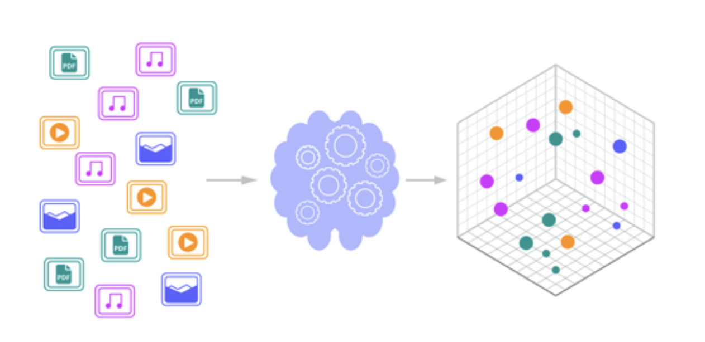{ loading=lazy }

* In the process of a large language model, embedding is generally the first step to convert discrete tokens (like words or subwords) into dense vector representations, which will allow the rest of the network to do the math necessary to predict the next word. Embeddings and vector databases are essential if you are building any kind of an AI product.

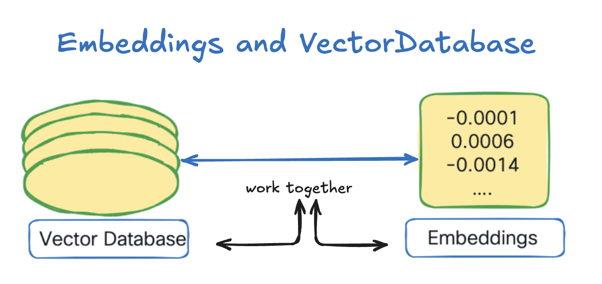{ loading=lazy }

#### 2. What Are Embeddings?


Embeddings are basically data which are converted into an array of numbers called vectors that contain a pattern of relationships and can be used for similarity search. 

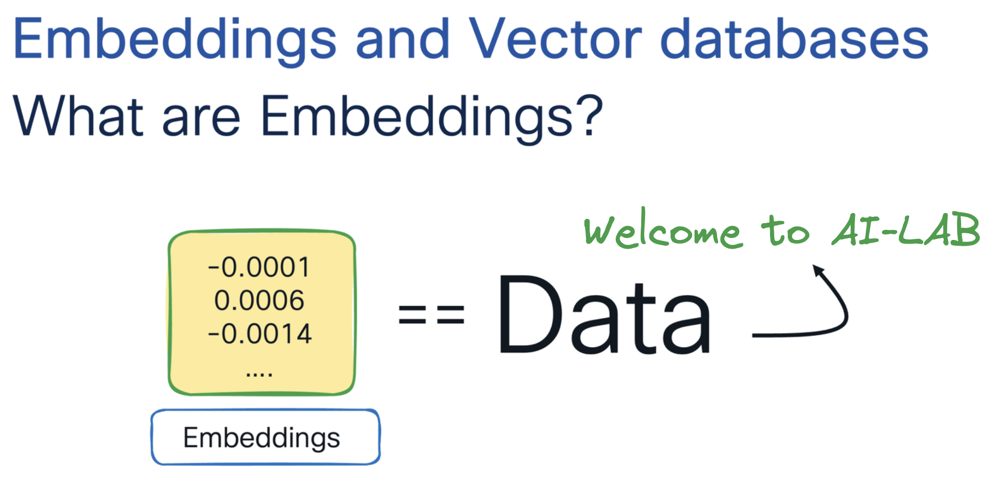{ loading=lazy }


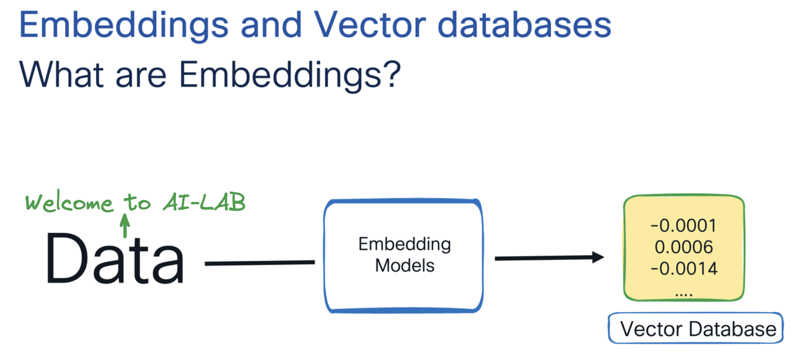{ loading=lazy }

Let's explain this concept using a 2D graph. In this graph, words like "Webex" and "collaboration" are often used in similar contexts, so their embeddings essentially vector representations are positioned close to each other (as shown in green in the below image ). These vectors are numerical arrays that computers can easily interpret.

The advantage of using vectors is that we can find similar items by calculating the distances between their vectors, a process known as nearest neighbor search. However, simply storing these embeddings isn't enough. Performing queries across thousands of vectors can be incredibly slow. To overcome this, the vectors need to be indexed in the vector database. Indexing organizes the vectors in a way that speeds up the search process, allowing for quicker and more efficient retrieval of similar items.

<span class="colour" style="color:red"> Note: In reality vectors can have hundred of dimensions </span>

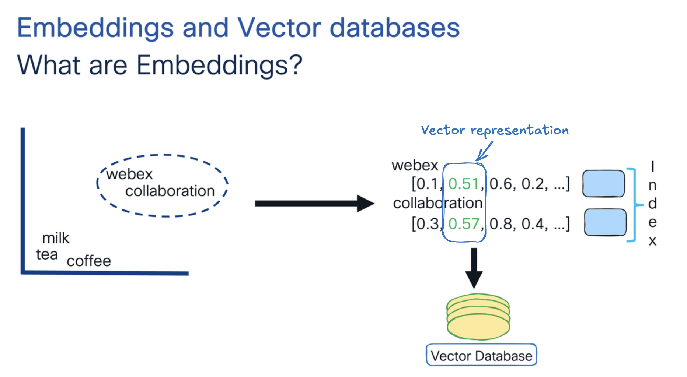{ loading=lazy }

Similarly, images are also broken into vectors, which are arrays of numbers that machines can process. Once these embeddings (both for words and images) are generated, they are stored in a specialized database known as a vector database.

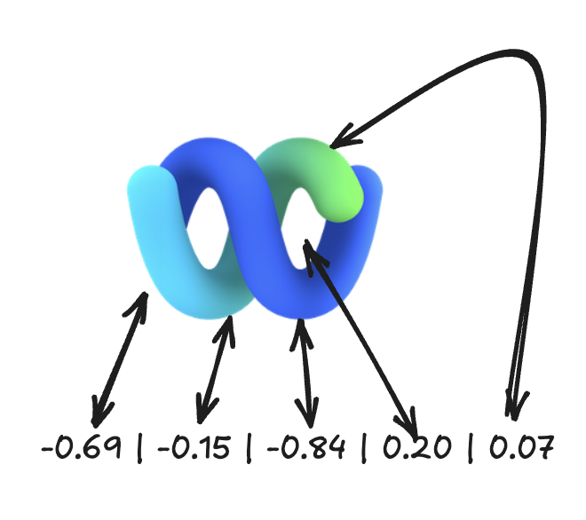{ loading=lazy }

There are numerous embedding models available, such as Google's Word2Vec, CLIP (Contrastive Language-Image Pretraining), and even those provided by OpenAI, which offer excellent capabilities for generating embeddings. However, the challenge is that these models don't include tools for storing and managing those embeddings. This is where vector databases become essential.

!!! note
    In this lab session, we will be using OpenAI embeddings. More info can be found <a href="https://platform.openai.com/docs/guides/embeddings" target="_blank">here</a>

<p class="eyebrow sub">Module 3 · Task 3B</p>

### Vector Databases { #module-3b data-toc-label="3b · Vector Databases" data-task="3b" }


#### Introduction


#### 1. Why Use Vector Databases?


Around 80% of the data we encounter is unstructured, including social media posts, images, and videos. This type of data doesn’t easily fit into traditional relational databases, which is where vector databases come into play.

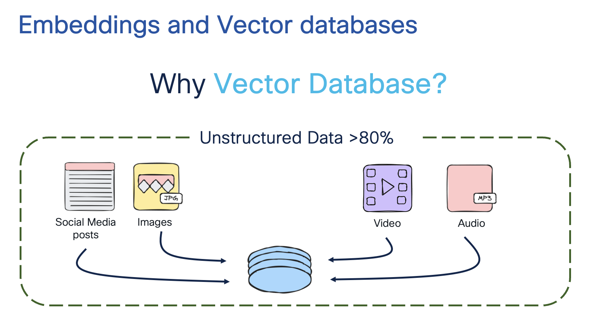{ loading=lazy }

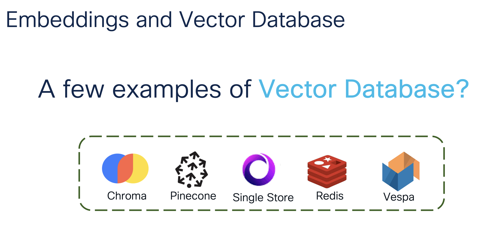{ loading=lazy }

<p class="eyebrow sub">Module 3 · Task 3C</p>

### Understanding the workings of Embeddings and Vector Databases { #module-3c data-toc-label="3c · Understanding the workings of Embeddings and Vector Databases" data-task="3c" }


#### Introduction


#### 1. Practical Example of Embedding Techniques


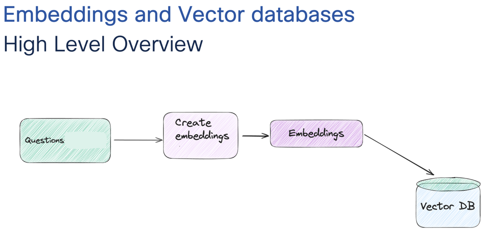{ loading=lazy }

The above image illustrates a high-level overview of how embeddings and vector databases will work together:

* Questions/Input Data: The process begins with a set of questions or inputs that need to be understood or processed.

* Create Embeddings: These questions or inputs are then converted into embeddings.

* Embeddings: Once the embeddings are generated, they are stored temporarily and prepared for the next step. These embeddings are essentially numeric representations that contain the contextual information of the original input.

* Vector Database (Vector DB): The generated embeddings are stored in a vector database(e.g Singlestore). This database is optimized for searching and retrieving embeddings quickly, enabling faster queries when comparing vectors to find similar items.

!!! note
    There are many vector databases, such as Chroma, Faiss, Pinecone e.t.c. However, we will be using Chroma and Pinecone for their ease of use and to help you better understand how embeddings are created.

!!! important
    Please open a new <a href="https://colab.research.google.com/" target="_blank">Google Colab</a> notebook for this section. Click on **"File" > "New notebook"**.

##### 2. LAB

###### 1. Set OpenAI Token


!!! note
    The OpenAI API keys have already been **pre-generated and provided** to you in your `.txt` file. You can skip the steps below and go straight to adding the key in Colab Secrets. We will use the OpenAI key to generate embeddings. More information about OpenAI embeddings can be found <a href="https://platform.openai.com/docs/api-reference/embeddings" target="_blank">here</a>.

??? info "Optional: Create Your Own OpenAI API Key (click to expand)"

    If you’d like to use your own key instead of the one provided, follow these steps:

    * Browse to the <a href="https://platform.openai.com/api-keys" target="_blank">OpenAI API Keys page</a>
    * Click **Create new secret key**. The key is automatically generated
    * Save the API Key securely. You’ll need it in the next steps
    * Use default settings when creating the key

    { loading=lazy }

###### 2. Text to Vectors: OpenAI Embeddings


* Open Google Colab and create a new notebook(as mentioned). Click on "File" > "New notebook".

* Within your new Google Colab notebook navigate to the new “Secrets” section in the sidebar.

!!! note
    If you have already set the OPENAI_API_KEY in the previous step, you can skip this step.                       

{ loading=lazy }

* Click on “Add a new secret.” Enter the name example: OPENAI_API_KEY and value of the secret(the API key in your .txt file). Note: The name is permanent once set. 

* The list of secrets is global across all your notebooks.

* Use the “Notebook access” toggle to grant or revoke access to a secret for each notebook.

{ loading=lazy }

* Once done lets start by installing all the necessary packages

```py
!pip install python-dotenv langchain-openai chromadb langchain_community langchain_chroma
```

* Import all the relevant libraries

``` py linenums="1"
import os
from google.colab import userdata
os.environ['OPENAI_API_KEY'] = userdata.get('OPENAI_API_KEY')
```

* We’ll initialize the OpenAI Embeddings model specifically text-embedding-3-large. This model will convert our text into vectors so we can do smart things like search, match, or retrieve context.

```py linenums="1"
from langchain_openai import OpenAIEmbeddings
embeddings=OpenAIEmbeddings(model="text-embedding-3-large")
embeddings
```

```py linenums="1"
text="Welcome to the basics of GenAI created by Omer Ilyas."
query_result=embeddings.embed_query(text)
query_result   
```     

!!! important
    At this point, we’ve successfully used OpenAI’s text-embedding-3-large model to convert our input text into a numerical embedding.This embedding is just a list of floating-point numbers that represent the meaning of the sentence in a way that machines can understand. These vectors are what power many GenAI use cases, like searching through documents, matching similar content, or retrieving the most relevant context for a question.


🧠 Storing and Retrieving Embeddings with ChromaDB
                
* Now, we’ll use ChromaDB to store the embeddings we just created and later retrieve information based on similarity.
                
!!! note
                
    ChromaDB is an open-source vector database that lets us store text as high-dimensional vectors (embeddings) and run similarity searches over them. This is a key building block in many GenAI applications such as retrieval-augmented generation (RAG), semantic search, and intelligent assistants. 

    One of the beauties of using ChromaDB is that it allows you to build and populate your vector database at runtime, no need to pre-create schemas, tables, or indexes like in traditional databases.
                
* Before storing the data in Chroma, we wrap our input text inside a document object, because "Chroma.from_documents()" expects its input to be a list of document objects and not plain strings.

```py linenums="1"
from langchain_core.documents import Document
docs = [Document(page_content=text)]
docs
```

* Now that we’ve converted our text into a Document, the next step is to store it in a vector database using ChromaDB.

!!! note 
    Langchain have released a new library for chroma you can also use from langchain_chroma import Chroma

```py linenums="1"
from langchain_community.vectorstores import Chroma
db=Chroma.from_documents(docs,embeddings)
db
```

!!! note
    This is a key part of any GenAI or RAG workflow  we need a place to store text as vectors so we can later compare new user queries against it and retrieve relevant context.

* Now that our text is stored in ChromaDB as vectors, we can run similarity searches against it.

```py linenums="1"
                
### Retrieve the results from query vectorstore db
query="who created the basics of GenAI? "
retrieved_results=db.similarity_search(query)
print(retrieved_results)
```

* You should see output like this:

```text
[Document(metadata={}, page_content='Welcome to the basics of GenAI created by Omer Ilyas.')]
```

!!! info "Why didn't it just answer 'Omer Ilyas'?"
    This is expected. At this stage we are only doing **retrieval**, not question answering. ChromaDB turns your question into an embedding, finds the stored document whose embedding is closest in meaning, and returns that document exactly as it was stored. A vector database finds and returns text. It does not read the text or write an answer.

**What we just built: retrieval**

<ol class="flow three">
  <li><b>Your question</b>Who created the basics of GenAI?</li>
  <li><b>Embedding + ChromaDB</b>Find the most similar documents</li>
  <li><b>Retrieved document</b>Welcome to the basics of GenAI created by Omer Ilyas.</li>
</ol>

To get a direct answer, you need a **large language model (LLM)** after retrieval. The LLM reads the retrieved document together with your question and writes the answer. Retrieval followed by generation is the foundation of **Retrieval Augmented Generation (RAG)**, which we add in a later module.

**Where we are going: retrieval + an LLM (RAG)**

<ol class="flow">
  <li><b>Question</b>Who created the basics of GenAI?</li>
  <li><b>ChromaDB</b>Retrieve the matching document</li>
  <li><b>LLM (GPT)</b>Read the document and answer</li>
  <li><b>Final answer</b>Omer Ilyas</li>
</ol>

!!! important

    At this stage, we’ve built a simple yet powerful vector-based retrieval system using OpenAI embeddings (which incur cost) and ChromaDB. We converted plain text into high-dimensional vectors, stored them, and queried them semantically. Instead of relying on exact keyword matches, the system understands the meaning of the query and retrieves the most relevant content.
    However, it’s important to note that this system performs retrieval, not question answering. It returns the most relevant document, and an additional language model would be needed to generate a direct answer (in the later section).
    With just a few lines of code, we’ve created a foundational building block for modern GenAI systems, the ability to store and retrieve knowledge based on context and meaning.

###### 3. Text to Vectors: Hugging Face Embeddings


So far, we’ve used OpenAI embeddings, which are powerful but they come with API costs. The good news? There are many excellent open source alternatives that allow you to generate embeddings at no cost, such as Hugging Face.

!!! note 
    If you've already downloaded the .txt file provided for this lab, it contains your Hugging Face API key.If you're unsure how to retrieve or use it, please refer to the Pre-requisites section at the start of this lab.
                
* While on the same Google Colab notebook, navigate to the new “Secrets” section in the sidebar by clicking the "key icon”

{ loading=lazy }

* Click on “Add a new secret”. Enter the name example: HF_TOKEN and value of the secret under (Huggingface API Key). Note: The name is permanent once set. 

* The list of secrets is global across all your notebooks.

* Use the “Notebook access” toggle to grant or revoke access to a secret for each notebook.

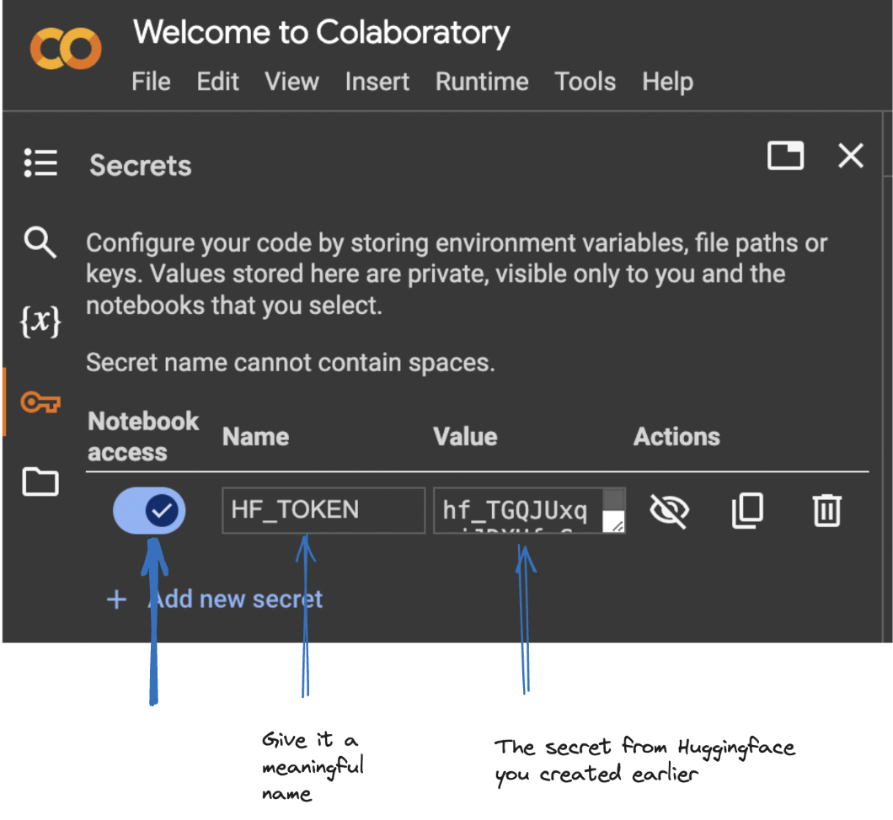{ loading=lazy }

* We will start by installing python packages

```py linenums="1"
!pip install huggingface_hub langchain_huggingface sentence_transformers
                    
```

* Lets import the required modules

```py linenums="1"
import os
from google.colab import userdata
os.environ["HF_TOKEN"] = userdata.get('HF_TOKEN')
```

* lets use emebddings from Huggingface.  More info on Huggingface embeddings can be found <a href="https://docs.langchain.com/oss/python/integrations/text_embedding/index#all-embedding-models" target="_blank">here</a>.

```py linenums="1"
from langchain_huggingface import HuggingFaceEmbeddings
embeddings=HuggingFaceEmbeddings(model_name="all-MiniLM-L6-v2")
```

* Lets convert our text into embeddings

```py linenums="1"
text="Welcome to the basics of GenAI created by Omer Ilyas."
query_result=embeddings.embed_query(text)
query_result
```

!!! note
    In this session, we explored how open source embeddings can be used to convert data into numerical representations specifically, floating-point vectors that machines can process effectively. Earlier, we looked at how OpenAI’s models generate embeddings, providing a straightforward way to represent text data.
    Then, we shifted focus to Hugging Face’s approach, where we used the all-MiniLM-L6-v2 model to create embeddings. This demo a powerful, open-source alternative that is both efficient and accessible. By converting our data into these embeddings, we enable various downstream tasks like similarity search, clustering, and classification. Overall, this hands on experience highlights how embeddings serve as a foundational step in many modern NLP workflows, allowing us to transform raw data into a format that models can understand and utilize effectively.

###### 4. Testing with Pinecone


So far, we used **ChromaDB** to demonstrate the core idea behind vector storage and similarity search. We generated embeddings, stored them in a vector database, and queried them by similarity.

Next, we will do the same concept using **Pinecone**, a purpose-built vector database. As a managed service, Pinecone is designed to **store, index, and search embeddings efficiently**.

In this section, we will generate embeddings for our text, store them in Pinecone, and then query Pinecone with a new question to retrieve the most relevant matches. This is much closer to how vector search is typically implemented in **real-world AI and RAG applications**.

We will create a Free account on PineCone since it provides some credits to set up a trial account.

1. Go to <a href="https://login.pinecone.io/" target="_blank">Pinecone</a>

{ loading=lazy }

2. Click on Sign Up and register using your personal Google account.
                      
3. From the left-hand menu, click on API Keys. You can either use the default API key or create a new one.
                                    
!!! note 
    Copy and save your API key in a secure location (e.g., Notepad or your lab guide’s $keys vault section)
                                    
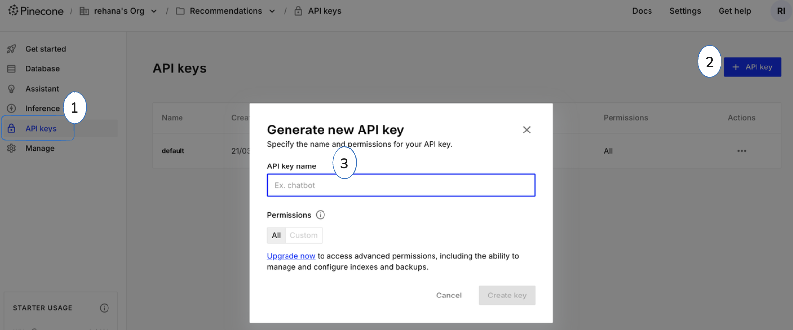{ loading=lazy }
                                    
4. Navigate to Databases → Indexes. You will see indexes (vector tables) created from your script. We will return to this section later in the lab.

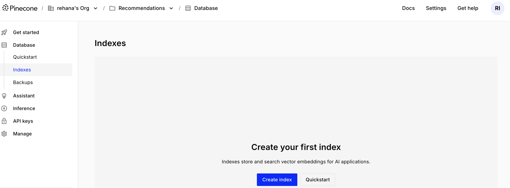{ loading=lazy }
                                 
5. Go back to your existing Google Colab notebook that you used earlier in this task. Ensure your notebook is still connected to runtime resources. Add a New Code Cell
                                    
!!! note 
    Click the + Code button to create a new code cell where we will begin integrating Pinecone
                                    
6. Let's install the Pinecone SDK

```py linenums="1"
!pip install pinecone openai                                                
```

7. Lets set up authentication by loading our OpenAI API key from Colab userdata, then initialize both the OpenAI and Pinecone clients for use in the lab.
                                    
```py linenums="1"
from google.colab import userdata
import os
os.environ['OPENAI_API_KEY'] = userdata.get('OPENAI_API_KEY')
from openai import OpenAI
from pinecone import Pinecone, ServerlessSpec
openai_client = OpenAI(api_key=os.environ['OPENAI_API_KEY'])
pc = Pinecone(api_key="YOUR_API_KEY_FROM_Pinecone")
```

!!! note
    Replace "YOUR_API_KEY_FROM_Pinecone" with your Pinecone key. We enter it manually here for simplicity, but this is not best practice in a production environment secure key management should be used instead.
                                    
8. Lets create embeddings

```py linenums="1"
text = "WebexOne and Cisco Live is an annual in-person and virtual event"
response = openai_client.embeddings.create(
    model="text-embedding-3-small",
    input=text
)
embedding = response.data[0].embedding
dimension = len(embedding)
dimension
```

!!! note
    1536 is the length of the embedding vector returned by the model. It means your text is represented as 1536 numerical features in a high-dimensional space. This fixed size lets the model compare meanings between texts efficiently.

9. Pinecone indexes need a fixed vector dimension and a similarity metric. So we need to create indexes with a dimension and spec.

```py linenums="1"
index_name = "lab-embeddings-demo"
if index_name not in [idx["name"] for idx in pc.list_indexes()]:
    pc.create_index(
        name=index_name,
        dimension=dimension,
        metric="cosine",
        spec=ServerlessSpec(cloud="aws", region="us-east-1")
    )
```

!!! note
    An index in Pinecone is like a table in a database.

10. Lets connect to the index we created.

```py linenums="1"
index = pc.Index(index_name)
```

!!! note
    If you go to Pinecone → Databases → Indexes and refresh the page, you should see your newly created index listed there.
                                    
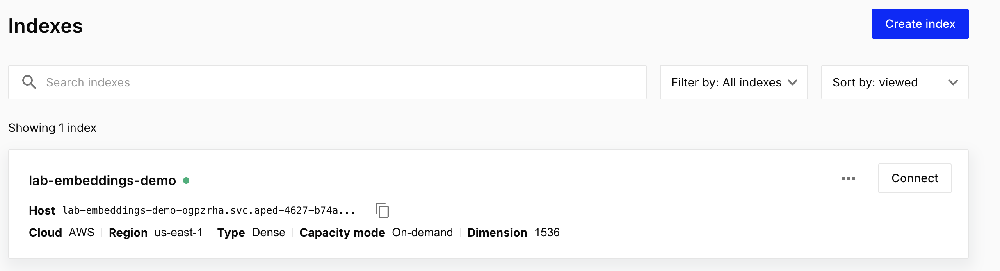{ loading=lazy }

11. lets stores (upserts) our embeddings vector into an index, along with extra information like the original text.

!!! note "What is an upsert?"
    `upsert()` is a command used to store a new vector or update an existing vector in the database. The name combines **update** and **insert**. If no vector with the given `id` exists, Pinecone inserts it. If one already exists, Pinecone replaces its values and metadata. This means you can run the same upsert again without creating duplicates.

```py linenums="1"
index.upsert(
vectors=[
    {
        "id": "webexone-1",
        "values": embedding,
        "metadata": {
            "text": text
        }
    }
        ]
    )
                            
```

!!! note
    With the above command, Pinecone creates a record with the ID `webexone-1`. The record holds the embedding vector, with the original text stored as metadata.

    Click on the index in Pinecone to see your saved embeddings and their metadata.
                                    
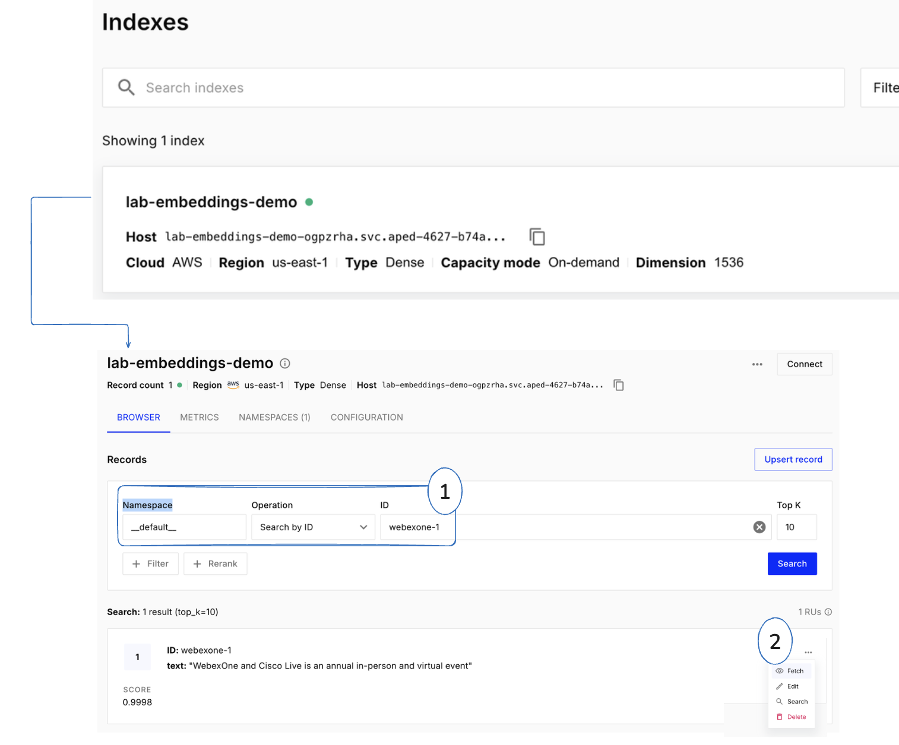{ loading=lazy }
                                    
12. Let's now create an embedding for the query and search the info

```py linenums="1"
query = "Is WebexOne an annual event?"
query_response = openai_client.embeddings.create(
    model="text-embedding-3-small",
    input=query
)
query_embedding = query_response.data[0].embedding
# Query Pinecone 
results = index.query(
vector=query_embedding,
top_k=5,
include_metadata=True
)       
results
```
!!! note
    Pinecone will return the nearest vectors to the query embedding. Each result includes a similarity score and, if stored, metadata such as the original text chunk. The highest-scoring matches are the most semantically relevant pieces of information.

**Conclusion**

In summary, vector databases enable LLMs to simulate long-term memory by storing and retrieving information based on semantic meaning. In this section, we generated embeddings using the OpenAI API and explored how to store and query them using two different vector database solutions: ChromaDB and Pinecone.

With ChromaDB, we stored embeddings and queried them by similarity in just a few lines of code. With Pinecone, we followed a more purpose-built vector database approach by creating an index, upserting embeddings, and performing similarity searches.

This comparison highlights how different vector database solutions can be used to efficiently manage and retrieve embeddings, making it easier to build applications such as semantic search, recommendation systems, and retrieval-augmented generation (RAG).


<p class="eyebrow">Module 4</p>

## Gemini Embedding 2 Multimodal Retrieval { #module-4 data-toc-label="Module 4 · Gemini Embedding 2" }


<p class="eyebrow sub">Module 4 · Task 4A</p>

### Gemini Embedding 2 { #module-4a data-toc-label="4a · Gemini Embedding 2" data-task="4a" }


#### Introduction


> **IMPORTANT 2026 UPDATE:** This lab now uses Google's stable **`gemini-embedding-2`** model, not `gemini-embedding-2-preview`. Gemini Embedding 2 became generally available in April 2026. The model supports text, images, audio, video, and PDFs in a *unified embedding space*. Its API **does not support the `task_type` parameter**. Google instead recommends task instructions in text-only retrieval inputs. We keep the model's default 3,072 dimensions throughout this exercise.

#### 1. Introduction


In the earlier sections of this lab, we explored how embeddings work by converting text into numerical vectors using embedding models. We then stored and queried these embeddings using vector databases such as **ChromaDB** and **Pinecone** to perform semantic search and retrieve relevant information based on meaning.

**The Limitation of Traditional Embeddings**

Traditionally, embedding models have been **modality-specific** separate models were required for different types of data. For example, one model would handle text embeddings, while a completely different model would handle images. This works well in isolated scenarios but becomes limiting when dealing with real-world data, where text and images often appear together within the same documents or systems.

**What is Gemini Embedding 2?**

Recently, Google introduced **Gemini Embedding 2**, a new generation of embedding models designed to be **natively multimodal**. Unlike traditional approaches, Gemini Embedding 2 allows both text and images to be represented within a **single, unified embedding space**.

!!! info "Learn More"
    Read the full announcement from Google: <a href="https://blog.google/innovation-and-ai/models-and-research/gemini-models/gemini-embedding-2/" target="_blank">Gemini Embedding 2</a>

This means that different types of data can be compared, searched, and retrieved together without needing separate models or complex pipelines to bridge the gap between modalities.

**What Does This Enable?**

* Search for **images using text queries**
* Find **visually similar images** across datasets
* Work with documents that contain **both textual and visual information**
* Build more advanced AI systems that understand **mixed data types**

**How It Connects to This Lab**

You have already learned how to generate embeddings, store them in vector databases, and perform similarity searches. Gemini Embedding 2 builds on these same concepts but **extends them beyond text**, allowing you to work with multimodal data and create more flexible and intelligent applications.

!!! tip "Key Takeaway"
    As AI continues to evolve, multimodal embeddings represent an important step forward. They enable systems to more closely reflect how humans process information by combining text, visuals, and other signals resulting in **richer and more meaningful search and retrieval experiences**.

<div class="gem2-wrapper">
<style>
.gem2-wrapper { background: #0a0e1a; border-radius: 16px; padding: 2rem 1rem; margin: 1.5rem 0; overflow: hidden; border: 1px solid rgba(255,255,255,0.06); box-shadow: 0 8px 30px rgba(0,0,0,0.3); }
.gem2-title { text-align: center; font-size: 1.1rem; font-weight: 700; color: rgba(255,255,255,0.85); margin-bottom: 1.5rem; letter-spacing: 0.02em; }
.gem2-svg { display: block; margin: 0 auto; max-width: 100%; }
.gem2-line { stroke-dasharray: 6 4; animation: dashFlow 1.5s linear infinite; }
.gem2-line-1 { animation-delay: 0s; }
.gem2-line-2 { animation-delay: 0.3s; }
.gem2-line-3 { animation-delay: 0.6s; }
.gem2-line-4 { animation-delay: 0.9s; }
.gem2-line-5 { animation-delay: 1.2s; }
@keyframes dashFlow { to { stroke-dashoffset: -20; } }
.gem2-arrow { stroke-dasharray: 6 4; animation: dashFlow 1.5s linear infinite; }
.gem2-model-box { animation: modelGlow2 3s ease-in-out infinite; }
@keyframes modelGlow2 { 0%, 100% { filter: drop-shadow(0 0 8px rgba(99,102,241,0.2)); } 50% { filter: drop-shadow(0 0 16px rgba(99,102,241,0.4)); } }
.gem2-space-dot2 { animation: drift2 4s ease-in-out infinite alternate; }
@keyframes drift2 { 0% { transform: translate(0,0); opacity:0.6; } 50% { opacity:1; } 100% { transform: translate(4px,-3px); opacity:0.7; } }
.gem2-input-pill { animation: pillPulse 3s ease-in-out infinite; }
.gem2-input-pill:nth-of-type(1) { animation-delay: 0s; }
.gem2-input-pill:nth-of-type(2) { animation-delay: 0.4s; }
.gem2-input-pill:nth-of-type(3) { animation-delay: 0.8s; }
.gem2-input-pill:nth-of-type(4) { animation-delay: 1.2s; }
.gem2-input-pill:nth-of-type(5) { animation-delay: 1.6s; }
@keyframes pillPulse { 0%,100% { opacity:0.8; } 50% { opacity:1; } }
</style>
<div class="gem2-title">Multimodal Input</div>
<svg class="gem2-svg" viewBox="0 0 750 200" xmlns="http://www.w3.org/2000/svg">
  <!-- Input pills -->
  <g class="gem2-input-pill"><rect x="10" y="8" width="90" height="28" rx="14" fill="rgba(255,255,255,0.04)" stroke="rgba(255,255,255,0.1)" stroke-width="1"/><circle cx="30" cy="22" r="5" fill="#818cf8"/><text x="42" y="26" fill="rgba(255,255,255,0.7)" font-size="11" font-weight="600" font-family="monospace">Text</text></g>
  <g class="gem2-input-pill"><rect x="10" y="46" width="90" height="28" rx="14" fill="rgba(255,255,255,0.04)" stroke="rgba(255,255,255,0.1)" stroke-width="1"/><circle cx="30" cy="60" r="5" fill="#34d399"/><text x="42" y="64" fill="rgba(255,255,255,0.7)" font-size="11" font-weight="600" font-family="monospace">Image</text></g>
  <g class="gem2-input-pill"><rect x="10" y="84" width="90" height="28" rx="14" fill="rgba(255,255,255,0.04)" stroke="rgba(255,255,255,0.1)" stroke-width="1"/><circle cx="30" cy="98" r="5" fill="#f472b6"/><text x="42" y="102" fill="rgba(255,255,255,0.7)" font-size="11" font-weight="600" font-family="monospace">Video</text></g>
  <g class="gem2-input-pill"><rect x="10" y="122" width="90" height="28" rx="14" fill="rgba(255,255,255,0.04)" stroke="rgba(255,255,255,0.1)" stroke-width="1"/><circle cx="30" cy="136" r="5" fill="#fbbf24"/><text x="42" y="140" fill="rgba(255,255,255,0.7)" font-size="11" font-weight="600" font-family="monospace">Audio</text></g>
  <g class="gem2-input-pill"><rect x="10" y="160" width="90" height="28" rx="14" fill="rgba(255,255,255,0.04)" stroke="rgba(255,255,255,0.1)" stroke-width="1"/><circle cx="30" cy="174" r="5" fill="#3b9eff"/><text x="42" y="178" fill="rgba(255,255,255,0.7)" font-size="11" font-weight="600" font-family="monospace">Docs</text></g>
  <!-- Lines from inputs to model -->
  <line x1="100" y1="22" x2="270" y2="95" class="gem2-line gem2-line-1" stroke="#818cf8" stroke-width="1.5" opacity="0.5"/>
  <line x1="100" y1="60" x2="270" y2="95" class="gem2-line gem2-line-2" stroke="#34d399" stroke-width="1.5" opacity="0.5"/>
  <line x1="100" y1="98" x2="270" y2="100" class="gem2-line gem2-line-3" stroke="#f472b6" stroke-width="1.5" opacity="0.5"/>
  <line x1="100" y1="136" x2="270" y2="105" class="gem2-line gem2-line-4" stroke="#fbbf24" stroke-width="1.5" opacity="0.5"/>
  <line x1="100" y1="174" x2="270" y2="110" class="gem2-line gem2-line-5" stroke="#3b9eff" stroke-width="1.5" opacity="0.5"/>
  <!-- Embedding Model box -->
  <g class="gem2-model-box">
    <rect x="270" y="65" width="140" height="70" rx="12" fill="rgba(99,102,241,0.12)" stroke="rgba(99,102,241,0.4)" stroke-width="1.5"/>
    <text x="340" y="95" text-anchor="middle" fill="#818cf8" font-size="13" font-weight="700" font-family="monospace">Embedding</text>
    <text x="340" y="112" text-anchor="middle" fill="#818cf8" font-size="13" font-weight="700" font-family="monospace">Model</text>
    <text x="340" y="128" text-anchor="middle" fill="rgba(255,255,255,0.3)" font-size="9" font-family="monospace">Gemini Embedding 2</text>
  </g>
  <!-- Arrow from model to space -->
  <line x1="410" y1="100" x2="510" y2="100" class="gem2-arrow" stroke="rgba(255,255,255,0.25)" stroke-width="1.5"/>
  <polygon points="508,95 518,100 508,105" fill="rgba(255,255,255,0.25)"/>
  <!-- Unified Embedding Space -->
  <rect x="520" y="20" width="210" height="165" rx="12" fill="rgba(255,255,255,0.02)" stroke="rgba(255,255,255,0.08)" stroke-width="1"/>
  <line x1="625" y1="20" x2="625" y2="185" stroke="rgba(255,255,255,0.04)" stroke-width="1"/>
  <line x1="520" y1="102" x2="730" y2="102" stroke="rgba(255,255,255,0.04)" stroke-width="1"/>
  <!-- Dots in space -->
  <circle cx="560" cy="50" r="4" fill="#818cf8" class="gem2-space-dot2" style="animation-delay:0s"/>
  <circle cx="610" cy="75" r="4" fill="#818cf8" class="gem2-space-dot2" style="animation-delay:0.5s"/>
  <circle cx="575" cy="110" r="4" fill="#34d399" class="gem2-space-dot2" style="animation-delay:1s"/>
  <circle cx="660" cy="55" r="4" fill="#34d399" class="gem2-space-dot2" style="animation-delay:1.5s"/>
  <circle cx="640" cy="130" r="4" fill="#f472b6" class="gem2-space-dot2" style="animation-delay:0.3s"/>
  <circle cx="600" cy="90" r="4" fill="#fbbf24" class="gem2-space-dot2" style="animation-delay:0.8s"/>
  <circle cx="680" cy="100" r="4" fill="#3b9eff" class="gem2-space-dot2" style="animation-delay:1.3s"/>
  <circle cx="650" cy="45" r="4" fill="#fbbf24" class="gem2-space-dot2" style="animation-delay:0.6s"/>
  <circle cx="555" cy="140" r="4" fill="#f472b6" class="gem2-space-dot2" style="animation-delay:1.1s"/>
  <circle cx="700" cy="70" r="4" fill="#3b9eff" class="gem2-space-dot2" style="animation-delay:0.4s"/>
  <circle cx="690" cy="150" r="4" fill="#818cf8" class="gem2-space-dot2" style="animation-delay:0.7s"/>
  <circle cx="570" cy="70" r="4" fill="#fbbf24" class="gem2-space-dot2" style="animation-delay:1.4s"/>
  <text x="625" y="178" text-anchor="middle" fill="rgba(255,255,255,0.3)" font-size="9" font-weight="600" font-family="monospace">Unified Embedding Space</text>
</svg>
</div>

<p class="eyebrow sub">Module 4 · Task 4B</p>

### Gemini Embedding 2: LAB { #module-4b data-toc-label="4b · Gemini Embedding 2: LAB" data-task="4b" }


!!! important
    Please open a new <a href="https://colab.research.google.com/" target="_blank">Google Colab</a> notebook for this section. Click on **"File" > "New notebook"**.

!!! warning "GPU Required"
    Make sure you are connected to a **GPU runtime**. Go to **Runtime > Change runtime type** and select **GPU** as the hardware accelerator.

!!! note "Prerequisites"
    You need a **Gemini API key** to complete this lab. You can get one for free at <a href="https://aistudio.google.com" target="_blank">Gemini Ai Studio</a>. Use your **personal Gmail account** to sign up and generate a key. Once you log in to AI Studio, click **Dashboard** to get your API key.

 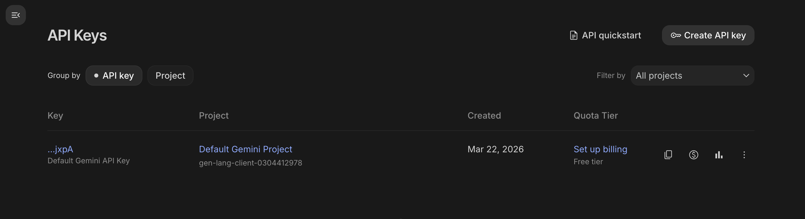{ loading=lazy }

!!! tip "Save to Key Vault"
    Once you have your Gemini API key, open the **`$ keys`** panel (bottom-right) and save it for easy access across all lab pages.


**Step 1: Install dependencies**

Run the following in a Colab cell:

```py
!pip install -q google-genai numpy matplotlib Pillow requests gTTS
```

!!! tip "What just happened?"
    We installed the Google GenAI SDK, numerical utilities, plotting and image tools, and Google Text-to-Speech (gTTS) to generate sample spoken narrations.

---

**Step 2: Configure your Gemini API key**

Run the cell below. When prompted, paste your Gemini API key and press **Enter**.

```py linenums="1"
import os
import getpass

if not os.environ.get("GEMINI_API_KEY"):
    os.environ["GEMINI_API_KEY"] = getpass.getpass("Enter your Gemini API key: ")

GEMINI_API_KEY = os.environ["GEMINI_API_KEY"]
print("✅ API key configured")
```

!!! tip "What just happened?"
    We made the key available to the notebook without printing it. For repeated labs, you can instead configure it through **Colab Secrets** and load it from `google.colab.userdata`.

---

**Step 3: Initialize Gemini and set the embedding model**

```py linenums="1"
from google import genai
from google.genai import types
from PIL import Image
from IPython.display import Audio, display
import matplotlib.pyplot as plt
import numpy as np
from pathlib import Path
import time
import requests

client = genai.Client(api_key=GEMINI_API_KEY)
MODEL = "gemini-embedding-2"   # ✅ Stable model, not preview
DIMENSIONS = 3072             # Default; Google also recommends 1536 or 768

print("✅ Gemini client initialized")
print("📌 Model:", MODEL)
```

!!! tip "What just happened?"
    We initialized the API client and selected the current stable embedding model. The model returns numbers, **not a chatbot response**.

!!! warning "Important change"
    Do not use `task_type="RETRIEVAL_QUERY"` or `task_type="RETRIEVAL_DOCUMENT"` with Gemini Embedding 2. That parameter is not supported.

---

**Step 4: Download destination photos**

We'll use six destinations. For reliable cross-modal results, the photos must actually show the location they represent. We try two public photo URLs for each destination, validate the downloaded images, and explicitly report failures rather than silently substituting misleading fake photos.

```py linenums="1"
from io import BytesIO

Path("data/images").mkdir(parents=True, exist_ok=True)
Path("data/audio").mkdir(parents=True, exist_ok=True)

image_sources = {
    "paris": [
        "https://cdn.pixabay.com/photo/2018/04/25/09/26/eiffel-tower-3349075_640.jpg",
        "https://images.pexels.com/photos/338515/pexels-photo-338515.jpeg?w=480",
    ],
    "grand_canyon": [
        "https://cdn.pixabay.com/photo/2015/09/21/14/24/grand-canyon-949517_640.jpg",
        "https://images.pexels.com/photos/2437299/pexels-photo-2437299.jpeg?w=480",
    ],
    "kyoto": [
        "https://cdn.pixabay.com/photo/2019/07/21/07/12/temple-4352273_640.jpg",
        "https://images.pexels.com/photos/5169056/pexels-photo-5169056.jpeg?w=480",
    ],
    "great_barrier_reef": [
        "https://cdn.pixabay.com/photo/2016/11/20/08/33/coral-1842158_640.jpg",
        "https://images.pexels.com/photos/3100361/pexels-photo-3100361.jpeg?w=480",
    ],
    "machu_picchu": [
        "https://cdn.pixabay.com/photo/2012/04/26/22/48/machu-picchu-43387_640.jpg",
        "https://images.pexels.com/photos/2929906/pexels-photo-2929906.jpeg?w=480",
    ],
    "sahara": [
        "https://cdn.pixabay.com/photo/2016/11/14/04/14/sahara-1822485_640.jpg",
        "https://images.pexels.com/photos/1001435/pexels-photo-1001435.jpeg?w=480",
    ],
}

def download_photo(key, urls):
    path = Path(f"data/images/{key}.jpg")
    if path.exists():
        try:
            with Image.open(path) as im:
                im.verify()
            return str(path)
        except Exception:
            path.unlink()
    for url in urls:
        try:
            response = requests.get(url, timeout=20, headers={"User-Agent": "Mozilla/5.0"})
            response.raise_for_status()
            im = Image.open(BytesIO(response.content)).convert("RGB")
            im.save(path, "JPEG")
            print(f"✅ {key}")
            return str(path)
        except Exception as exc:
            print(f"⚠️ {key}: trying another image source ({type(exc).__name__})")
    raise RuntimeError(
        f"Could not download an image for {key}. Upload a real destination photo "
        f"to {path} in Colab, then rerun this cell."
    )

image_paths = {key: download_photo(key, urls) for key, urls in image_sources.items()}
print("🎉 Six destination photos are ready")
```

!!! tip "What just happened?"
    You now have a folder containing six photos. Each photo will be embedded as an image.

!!! warning "If a download fails"
    Use Colab's file browser to upload a real photograph under the expected filename. Don't use a blank gradient as a substitute, because it would distort retrieval results.

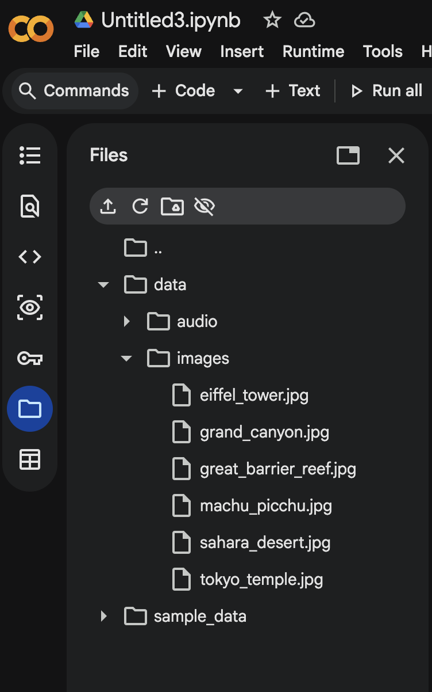{ loading=lazy }

---

**Step 5: Create the destination knowledge base**

```py linenums="1"
destinations = {
    "paris": {
        "name": "Paris, France",
        "description": "Romantic European city with the Eiffel Tower, the Louvre, French cuisine, art museums, and Seine River cafes.",
        "tags": ["europe", "romance", "culture", "food"],
    },
    "grand_canyon": {
        "name": "Grand Canyon, USA",
        "description": "Immense red rock canyon carved by the Colorado River with spectacular hiking and rafting adventures.",
        "tags": ["north_america", "nature", "hiking"],
    },
    "kyoto": {
        "name": "Kyoto, Japan",
        "description": "Historic Japanese city with ancient temples, shrines, bamboo groves, gardens, and traditional tea ceremonies.",
        "tags": ["asia", "culture", "temples"],
    },
    "great_barrier_reef": {
        "name": "Great Barrier Reef, Australia",
        "description": "Tropical coral reef with colourful fish and sea turtles, perfect for snorkeling and diving in warm ocean waters.",
        "tags": ["oceania", "marine", "snorkeling"],
    },
    "machu_picchu": {
        "name": "Machu Picchu, Peru",
        "description": "Ancient Incan stone ruins perched high in the Andes Mountains with terraced hillsides and mountain trekking.",
        "tags": ["south_america", "history", "mountains"],
    },
    "sahara": {
        "name": "Sahara Desert, Africa",
        "description": "Vast golden sand dunes under star-filled skies, camel treks, desert oases, and nomadic culture.",
        "tags": ["africa", "desert", "adventure"],
    },
}

for key, destination in destinations.items():
    destination["image"] = image_paths[key]
    print("🌍", destination["name"], "→", destination["image"])
```

!!! tip "What just happened?"
    We created six structured records containing readable descriptions, image paths, and tags. The *records themselves are not embeddings yet*. The next steps convert their content into vectors.

---

**Step 6: Generate audio narrations with gTTS**

```py linenums="1"
from gtts import gTTS

audio_narrations = {
    "paris": "Visit Paris for the Eiffel Tower, the Louvre, French cuisine, and romantic river cruises.",
    "grand_canyon": "Explore the Grand Canyon, a vast red rock landscape famous for hiking and rafting.",
    "kyoto": "Discover Kyoto, with ancient temples, bamboo gardens, and traditional tea ceremonies.",
    "great_barrier_reef": "Discover the Great Barrier Reef with tropical fish, coral reefs, and snorkeling.",
    "machu_picchu": "Visit Machu Picchu, the ancient Incan citadel high in the Andes Mountains.",
    "sahara": "Travel through the Sahara Desert with sand dunes, camel treks, and starlit skies.",
}

for key, narration in audio_narrations.items():
    audio_path = Path(f"data/audio/{key}.mp3")
    if not audio_path.exists():
        gTTS(text=narration, lang="en").save(str(audio_path))
    destinations[key]["audio"] = str(audio_path)
    print("🔊", audio_path)
```

!!! tip "What just happened?"
    gTTS converted written narration into MP3 audio. gTTS **generates speech**. Gemini Embedding 2 will **embed the resulting audio**. These are two different tasks. gTTS requires network access, but not a Gemini API key.

{ loading=lazy }

---

**Step 7: Preview the multimodal content**

```py linenums="1"
fig, axes = plt.subplots(2, 3, figsize=(13, 8))
for ax, (key, dest) in zip(axes.flat, destinations.items()):
    ax.imshow(Image.open(dest["image"]))
    ax.set_title(dest["name"])
    ax.axis("off")
plt.tight_layout()
plt.show()

print("🔊 Sample narration: Paris")
display(Audio(destinations["paris"]["audio"]))
```

!!! tip "What just happened?"
    You inspected the original data: photos you can see and audio you can hear. **No embedding calculations have happened yet.** Visually confirm that each image broadly matches its destination.

---

**Step 8: Create helper functions to embed text, images, and audio**

```py linenums="1"
# Important: Gemini Embedding 2 does NOT accept a task_type argument.
# For TEXT-only search, Google recommends formatting document and query text.

def embed_text_document(title, description):
    formatted = f"title: {title} | text: {description}"
    result = client.models.embed_content(
        model=MODEL,
        contents=formatted,
        config=types.EmbedContentConfig(output_dimensionality=DIMENSIONS),
    )
    return np.asarray(result.embeddings[0].values, dtype=float)


def embed_text_query(question):
    formatted = f"task: search result | query: {question}"
    result = client.models.embed_content(
        model=MODEL,
        contents=formatted,
        config=types.EmbedContentConfig(output_dimensionality=DIMENSIONS),
    )
    return np.asarray(result.embeddings[0].values, dtype=float)


def embed_image(image_path):
    image_bytes = Path(image_path).read_bytes()
    result = client.models.embed_content(
        model=MODEL,
        contents=[types.Part.from_bytes(data=image_bytes, mime_type="image/jpeg")],
        config=types.EmbedContentConfig(output_dimensionality=DIMENSIONS),
    )
    return np.asarray(result.embeddings[0].values, dtype=float)


def embed_audio(audio_path):
    audio_bytes = Path(audio_path).read_bytes()
    result = client.models.embed_content(
        model=MODEL,
        contents=[types.Part.from_bytes(data=audio_bytes, mime_type="audio/mpeg")],
        config=types.EmbedContentConfig(output_dimensionality=DIMENSIONS),
    )
    return np.asarray(result.embeddings[0].values, dtype=float)


def cosine_sim(a, b):
    # Cosine similarity can range from -1 to +1.
    return float(np.dot(a, b) / (np.linalg.norm(a) * np.linalg.norm(b)))

print("✅ Four helper functions ready")
```

!!! info "What each helper does"
    * `embed_text_document` transforms a destination description into a vector.
    * `embed_text_query` transforms a user's text search into a vector.
    * `embed_image` transforms an actual photo into a vector.
    * `embed_audio` transforms an MP3 recording directly into a vector.
    * `cosine_sim` compares the direction of two vectors, where **+1 means aligned, 0 means orthogonal, and −1 means opposite directions**. These similarity scores are **not probabilities**.

!!! warning "2026 API change"
    `task_type` was used in older embedding APIs. Gemini Embedding 2 uses task-specific *text formatting* instead. In this lab, text descriptions use `title: ... | text: ...` and text queries use `task: search result | query: ...`. Image and audio embeddings don't need those text instructions.

---

**Step 9: Generate all 18 embeddings**

```py linenums="1"
embedding_db = {}

for key, dest in destinations.items():
    print(f"🔄 Embedding {dest['name']}...")

    text_vector = embed_text_document(dest["name"], dest["description"])
    time.sleep(1)
    image_vector = embed_image(dest["image"])
    time.sleep(1)
    audio_vector = embed_audio(dest["audio"])
    time.sleep(1)

    embedding_db[key] = {
        **dest,
        "text_embedding": text_vector,
        "image_embedding": image_vector,
        "audio_embedding": audio_vector,
    }
    print("✅ Dimensions:", len(text_vector), len(image_vector), len(audio_vector))

print("🎉 Destinations:", len(embedding_db))
print("📊 Total stored vectors:", len(embedding_db) * 3)
```

!!! tip "What just happened?"
    Six destinations × three modalities = **18 embeddings**. All use Gemini Embedding 2 and are the same vector length, allowing us to compare them. The `embedding_db` variable is simply a **Python dictionary**, not a production vector database. Calls incur API usage and can be delayed or rate-limited. The one-second pauses are a modest teaching precaution, not a guarantee against limits.

??? info "What does a 3,072-dimensional embedding mean? (click to expand)"
    Each item has 3,072 numerical values describing its position in a learned semantic space. Each number is not a human-readable label such as “beach” or “mountain.” You can also request **768 or 1,536 dimensions** for smaller vectors. All vectors you compare must use compatible dimensions and the same embedding model.

---

**Step 10: Build a multimodal similarity search function**

For each destination, we compare the query with its text, image, and audio vector. The exercise averages all three scores, but this is a **simple teaching heuristic**. In a real product, you may tune modality weights, select the best match per modality, or use learned ranking.

```py linenums="1"
def search_destinations(query_embedding, top_k=3, modalities=("text", "image", "audio")):
    results = []
    for key, dest in embedding_db.items():
        scores = {
            modality: cosine_sim(query_embedding, dest[f"{modality}_embedding"])
            for modality in modalities
        }
        results.append({
            "key": key,
            "name": dest["name"],
            "description": dest["description"],
            "image_path": dest["image"],
            "audio_path": dest["audio"],
            "modality_scores": scores,
            "avg_score": float(np.mean(list(scores.values()))),
        })
    return sorted(results, key=lambda x: x["avg_score"], reverse=True)[:top_k]


def display_search_results(query_label, results):
    print("\n🔎 Query:", query_label)
    fig, axes = plt.subplots(1, len(results), figsize=(5 * len(results), 4))
    if len(results) == 1:
        axes = [axes]
    for position, (ax, result) in enumerate(zip(axes, results), 1):
        ax.imshow(Image.open(result["image_path"]))
        ax.set_title(f"#{position} {result['name']}\nAverage: {result['avg_score']:.3f}")
        ax.axis("off")
        print(f"#{position} {result['name']}:",
              {m: round(s, 3) for m, s in result["modality_scores"].items()})
    plt.tight_layout()
    plt.show()

print("✅ Similarity search is ready")
```

!!! tip "What just happened?"
    We defined *how to search*. Nothing is being searched until the next step. Cosine similarity ranks related vectors, but a high score does not prove factual correctness or represent a confidence percentage.

---

**Step 11: Search with text**

```py linenums="1"
queries = [
    "I want to see ancient ruins high in the mountains",
    "Where can I go snorkeling in warm tropical water?",
    "A romantic European city with great food and art",
    "A vast empty desert landscape under the stars",
]

for question in queries:
    query_vector = embed_text_query(question)
    results = search_destinations(query_vector, top_k=3)
    display_search_results(question, results)
    time.sleep(1)
```

!!! tip "What just happened?"
    Gemini transformed each question into numbers, then our function compared those numbers with the 18 stored vectors. Expected *semantic* matches include Machu Picchu, Great Barrier Reef, Paris, and Sahara, although **exact rankings are not guaranteed**.

!!! question "Try this"
    For each result, identify which modality (text, image, or audio) contributes most to the score.

---

**Step 12: Search with a new image**

Try a new coral/ocean photograph not already in the destination database. Using a new image illustrates **retrieval by meaning**, rather than looking up the exact same file.

```py linenums="1"
query_urls = [
    "https://cdn.pixabay.com/photo/2017/01/11/15/22/turtle-1972331_640.jpg",
    "https://images.pexels.com/photos/932638/pexels-photo-932638.jpeg?w=480",
]

query_image_path = download_photo("query_coral", query_urls)
display(Image.open(query_image_path))

image_query_vector = embed_image(query_image_path)
results = search_destinations(image_query_vector, top_k=3)
display_search_results("New coral / underwater photograph", results)
```

!!! tip "What just happened?"
    The search query was an **image**, not typed text. Gemini made a vector for that photograph and compared it with the stored descriptions, photos, and narrations. Great Barrier Reef would be a sensible top result, but check the actual output.

!!! warning "If the download fails"
    Upload a real coral-reef photo named `query_coral.jpg` in `data/images`, and rerun the cell.

---

**Step 13: Search with audio (without transcription)**

```py linenums="1"
spoken_request = "I want to see beautiful coral reefs and tropical fish while snorkeling."
query_audio_path = "data/audio/query_snorkeling.mp3"

gTTS(text=spoken_request, lang="en").save(query_audio_path)
display(Audio(query_audio_path))

audio_query_vector = embed_audio(query_audio_path)
results = search_destinations(audio_query_vector, top_k=3)
display_search_results("Spoken snorkeling request", results)
```

!!! tip "What just happened?"
    We generated a spoken query with gTTS and sent the **MP3 bytes**, not a transcript, to Gemini Embedding 2. Gemini turned the audio into a vector that can be compared with stored **text, photos, and audio**. The expected destination is Great Barrier Reef, but inspect the rankings yourself.

---

**Optional Bonus: Embed text + image together (a new useful capability)**

Gemini Embedding 2 can combine multiple modalities in one request to create **one aggregated embedding** for a single item. This can be useful when a photo and its caption should be interpreted together.

```py linenums="1"
paris = destinations["paris"]
paris_image = Path(paris["image"]).read_bytes()

result = client.models.embed_content(
    model=MODEL,
    contents=[
        "A travel destination featuring the Eiffel Tower and Parisian culture",
        types.Part.from_bytes(data=paris_image, mime_type="image/jpeg"),
    ],
    config=types.EmbedContentConfig(output_dimensionality=DIMENSIONS),
)

combined_vector = np.asarray(result.embeddings[0].values)
print("✅ One combined text + image embedding:", len(combined_vector), "dimensions")
```

!!! tip "What just happened?"
    Instead of producing a separate vector for the text and another for the photo, Gemini returned **one vector representing both inputs together**. This is different from Step 9, where we deliberately stored separate vectors to show each modality's influence. For this multi-part input, we do **not** add the text-only retrieval prefix.

---

**Summary: What you should remember**

| Concept | Meaning |
| --- | --- |
| Embedding | Numeric representation of content used for similarity comparisons |
| Gemini Embedding 2 | One hosted embedding model supporting text, image, audio, video and PDFs |
| Unified vector space | Vectors from supported modalities can be compared |
| Cosine similarity | Compares the directions of vectors; possible values −1 to +1 |
| `embedding_db` | A temporary in-memory Python dictionary in this exercise |
| Pinecone / ChromaDB | Vector databases you could use to persist and query vectors at larger scale |
| LLM | A separate model that can turn retrieved information into a written answer |
| RAG | Retrieval followed by generation with an LLM |

!!! tip "The big takeaway"
    We've built a multimodal search engine. We don't need the user to type exact keywords. The model transforms descriptions, images, and audio into comparable embeddings. Our simple search compares vectors and ranks destinations. To build an assistant that writes an answer, we'd add an LLM after retrieval.

**Further learning / official documentation**

* <a href="https://ai.google.dev/gemini-api/docs/embeddings" target="_blank">Google Gemini API embeddings</a>
* <a href="https://ai.google.dev/gemini-api/docs/models/gemini-embedding-2" target="_blank">Stable Gemini Embedding 2 model</a>
* <a href="https://blog.google/innovation-and-ai/models-and-research/gemini-models/gemini-embedding-2-generally-available/" target="_blank">Google's April 2026 general availability announcement</a>
* <a href="https://blog.google/innovation-and-ai/technology/developers-tools/embeddinggemma-2/" target="_blank">New EmbeddingGemma 2 (October 2026)</a>, for a separate local-model follow-up lab

<p align="right"> 👉 This concludes the task. Click the next **Task** on the left to continue. </p>

<p class="eyebrow sub">Module 4 · Task 4C</p>

### BONUS LAB: EmbeddingGemma 2 { #module-4c data-toc-label="4c · BONUS: EmbeddingGemma 2" data-task="4c" }

!!! info "New model: announced 6 October 2026"
    Google DeepMind introduced **EmbeddingGemma 2** on **6 October 2026**. It is a compact, open-weight **740-million-parameter** multimodal embedding model based on Gemma 4. It embeds text, code, images, audio and video into a shared **768-dimensional** space. Unlike the hosted **Gemini Embedding 2** API you just used, EmbeddingGemma 2 can run **locally**, with model weights downloaded to your Colab runtime or your own computer. It is released under the Apache 2.0 license.

    * <a href="https://blog.google/innovation-and-ai/technology/developers-tools/embeddinggemma-2/" target="_blank">Official announcement</a>
    * <a href="https://developers.googleblog.com/en/embeddinggemma-2-the-developer-guide/" target="_blank">Official getting-started guide</a>

#### Introduction: Why should we try another embedding model?

So far, our Gemini Embedding 2 exercise sent text, images and audio through **Google's hosted API**. This bonus task demonstrates a different deployment choice: **run an embedding model yourself**. This task creates its own small examples, so it doesn't need any data from [Task 4B](#module-4b), and you can focus on what changed.

**Key differences**

| | Gemini Embedding 2 | EmbeddingGemma 2 |
|---|---|---|
| How we run it | Hosted Gemini API | Download weights and run locally |
| Model identifier | `gemini-embedding-2` | `google/embeddinggemma-2` |
| Default vector dimensions | 3,072 | 768 |
| Need a Gemini API key? | Yes | No Gemini API key required |
| Hardware | API handles inference | Colab GPU recommended for this full multimodal exercise |
| Multimodal inputs | Text, image, audio, video and PDFs | Text/code, images, audio, video and interleaved inputs |

!!! warning "Important"
    These are **different models and different embedding spaces**. Do not compare their vectors directly, even if you reduce them to the same number of dimensions. Re-embed both documents and queries with the model you are searching with.

---

**Step 1: Prepare your Colab runtime**

!!! important "Do not open a new notebook"
    Continue in the **same Google Colab notebook you used for Task 4B**. Add the new cells for this task below the Task 4B cells.

    That notebook is already connected to the **GPU runtime** you set up in Task 4B, so you don't need to change anything. The full multimodal model can be much slower on CPU.

!!! tip "What just happened?"
    We are allocating compute to run the model locally. Unlike the Gemini API, the model's calculations happen within this runtime.

---

**Step 2: Install the libraries**

!!! note "Local model setup (EmbeddingGemma 2)"
    Unlike Gemini Embedding 2, which runs on Google's cloud through an API, **EmbeddingGemma 2 runs locally within your Google Colab environment.**

    This means we need to install the necessary libraries and download the model onto the Colab runtime before we can generate embeddings.

    **Please note:**

    * The installation and initial model download may take several minutes, depending on your Colab environment and network connection.
    * The model is downloaded when we load it in a later step, not during the `pip install` command.
    * Make sure you have selected a **GPU runtime** in Google Colab for better performance.
    * Once the model is loaded, subsequent embeddings can be generated locally without making calls to the Gemini API.
    * If you restart or disconnect from your Colab runtime, you may need to load or download the model again.

    **Key takeaway:** We're setting up our own embedding model rather than relying on Google's cloud API. This gives us greater control over where and how our data is processed.

Run this in a Colab code cell:

```py
%pip install -q "sentence-transformers>=6.1.0" transformers Pillow soundfile
```

After it finishes, run this in a new Colab code cell:

```py
%pip install --no-cache-dir --force-reinstall "numpy==2.2.6"
```

!!! note
    If Colab asks you to restart the runtime after upgrading packages, restart it, then continue with Step 3.

!!! tip "What just happened?"
    `sentence-transformers` provides a convenient way to download EmbeddingGemma 2 and turn our content into vectors. `transformers` supplies the underlying model implementation.

---

**Step 3: Load EmbeddingGemma 2**

```py linenums="1"
import torch
from sentence_transformers import SentenceTransformer

MODEL_ID = "google/embeddinggemma-2"

# Use bfloat16 on supported GPUs; float32 elsewhere.
# Avoid float16 with this model.
dtype = (torch.bfloat16 if torch.cuda.is_available()
         and torch.cuda.is_bf16_supported() else torch.float32)

local_model = SentenceTransformer(
    MODEL_ID,
    model_kwargs={"torch_dtype": dtype},
)

print("✅ Loaded:", MODEL_ID)
print("📐 Default embedding dimension:", local_model.get_sentence_embedding_dimension())
```

!!! success "Expected"
    Embedding dimension **768**. This is still a substantial model and may require a GPU and download time. By disabling the audio encoder, we avoid loading components not needed in this exercise.

!!! tip "What just happened?"
    The model weights were downloaded and loaded onto your Colab runtime. From now on, embedding calculations happen there, rather than being sent to the Gemini API.

---

**Step 4: Create two sample documents (no Task 4B data needed)**

```py linenums="1"
places = {
    "Machu Picchu": "Ancient Inca stone ruins high in the Andes mountains of Peru.",
    "Great Barrier Reef": "Tropical underwater coral reefs, colourful fish and snorkelling in Australia.",
}

# These are the searchable document embeddings.
local_text_vectors = {
    name: local_model.encode(
        description,
        prompt_name="Document",
        normalize_embeddings=True,
    )
    for name, description in places.items()
}

print("✅ Created", len(local_text_vectors), "document embeddings")
```

!!! tip "What just happened?"
    We created two small travel descriptions and converted them to vectors using the local model. `Document` tells the model these inputs are content to be searched.

---

**Step 5: Ask a question and retrieve a matching document**

```py linenums="1"
import numpy as np

question = "Where can I explore ancient ruins high in the mountains?"
question_vector = local_model.encode(
    question,
    prompt_name="SearchQuery",
    normalize_embeddings=True,
)

ranked = sorted(
    [
        (name, float(np.dot(question_vector, vector)))
        for name, vector in local_text_vectors.items()
    ],
    key=lambda item: item[1],
    reverse=True,
)

for name, score in ranked:
    print(f"{name}: {score:.3f}")
```

!!! success "What to look for"
    **Machu Picchu** should normally be the stronger match. The exact scores are model-dependent.

!!! tip "What just happened?"
    The question was embedded locally and its vector was compared with both saved document vectors. We used a dot product, which gives cosine similarity when both vectors are normalized. This is **retrieval**, not an LLM-generated answer.

---

**Step 6: Bonus: create an image locally and search it with text**

This image is a simple illustration, not a real travel photograph. We create it in Colab using Pillow, so there is no external image URL or file from Task 4B to download. The goal is to demonstrate cross-modal similarity, not to benchmark model accuracy.

```py linenums="1"
from PIL import Image, ImageDraw
from IPython.display import display

# Draw a simple mountain scene in memory.
img = Image.new("RGB", (512, 320), (130, 190, 230))
draw = ImageDraw.Draw(img)
draw.polygon([(0, 285), (150, 90), (310, 285)], fill=(95, 110, 105))
draw.polygon([(170, 285), (340, 70), (512, 285)], fill=(75, 95, 95))
draw.polygon([(105, 148), (150, 90), (194, 148)], fill="white")
draw.polygon([(291, 132), (340, 70), (389, 132)], fill="white")
draw.rectangle([(0, 285), (511, 319)], fill=(55, 125, 65))
img.save("mountains.png")
display(img)

# Embed the image using the same local model.
image_vector = local_model.encode(
    {"image": "mountains.png"},
    normalize_embeddings=True,
)

# Compare two text queries against the one image embedding.
queries = [
    "Snow-capped mountain peaks",
    "Colourful tropical coral reef underwater",
]

for query in queries:
    query_vector = local_model.encode(
        query, prompt_name="SearchQuery", normalize_embeddings=True
    )
    score = float(np.dot(query_vector, image_vector))
    print(f"{query}: {score:.3f}")
```

!!! success "What to look for"
    The mountain query should plausibly score higher than the coral-reef query, although a synthetic drawing may not behave as reliably as a real photograph. If it doesn't, discuss that as a useful model-evaluation result rather than a lab failure.

---

**What just happened? Understanding your results**

Congratulations! You have successfully demonstrated multimodal embeddings running locally with EmbeddingGemma 2.

In this exercise, you:

1. Created a simple snow-capped mountain illustration using Python and Pillow.
2. Converted the image into a numerical embedding using the locally loaded EmbeddingGemma 2 model.
3. Converted two text descriptions into embeddings using the same model.
4. Compared the image embedding with each text embedding using cosine similarity.

**Example results from the lab**

| Text description | Example similarity score |
|---|---|
| Snow-capped mountain peaks | 0.727 |
| Colourful tropical coral reef underwater | 0.528 |

Your actual scores may differ. In this example, the snow-capped mountain description scores higher, which is the sensible match for the illustration.

!!! info "Why does this matter?"
    You did not manually label the image as a mountain for the model. The model processed the image pixels into a vector, and processed each text description into a vector in a shared embedding space. This lets us compare different types of content directly: **cross-modal semantic similarity**.

!!! warning "Important"
    These numbers are **similarity scores, not accuracy percentages or probabilities**. A score of 0.727 does not mean the model is 72.7% certain. It means that, in this comparison, the mountain description is more similar to the image embedding than the coral-reef description. If both scores are unexpectedly close, that's an opportunity to discuss the limitations of simple synthetic illustrations and model evaluation.

**Why is this useful in a real application?**

Imagine a collection of thousands of images. Someone types “snow-covered mountains” and the application returns matching photos, even when no one manually assigned those exact words as tags. The same technique can support product image search, visual document discovery and multimodal RAG retrieval.

Because this exercise uses EmbeddingGemma 2 locally, the embeddings are generated in the Colab runtime rather than by sending the image to the hosted Gemini embedding API. (Colab itself is cloud-hosted. Running in Colab is not the same as running on your own laptop.)

!!! tip "Key takeaway"
    One locally loaded multimodal embedding model can represent both images and text in a shared vector space, making text-to-image retrieval possible.

!!! question "Optional discussion question"
    What would change if we stored embeddings for three different images and then searched them using a single text query? We could rank and return the closest image instead of only comparing one image against two descriptions.

---

**Quick troubleshooting**

| Problem | What to do |
|---|---|
| `NameError: local_model is not defined` | Step 3 did not complete in this runtime. Rerun Step 3. Do not install everything again unless packages are missing. |
| `NameError: local_text_vectors is not defined` | Rerun Step 4, then Step 5. |
| NumPy import error (`_blas_supports_fpe`) | Stop and start a fresh Colab runtime, then run only the two installation cells in Step 2. Restarting without correcting conflicting installed packages may not be enough. |
| Out of GPU memory | Confirm a GPU is selected, close other notebooks using GPU memory, and make sure `config_kwargs={"audio_config": None}` is present. A CPU runtime may be very slow. |
| Cannot access model weights | Visit <a href="https://huggingface.co/google/embeddinggemma-2" target="_blank">huggingface.co/google/embeddinggemma-2</a> to check access terms and authentication. |

---

**Wrap-up: What you should remember**

* **Gemini Embedding 2:** embeddings are generated by a hosted Google API.
* **EmbeddingGemma 2:** the model runs in your Colab runtime (or your own machine), after its weights are downloaded.

Both models generate vectors rather than final written answers, and their embedding spaces must not be mixed. This bonus is intentionally small and doesn't depend on Task 4B data, so it still works even after your runtime restarts.

!!! question "Think about it"
    Why might an organisation prefer to generate embeddings on its own infrastructure rather than send documents to a hosted API?

**References**

* <a href="https://ai.google.dev/gemma/docs/embeddinggemma/model_card_2" target="_blank">EmbeddingGemma 2 model card</a>
* <a href="https://developers.googleblog.com/embeddinggemma-2-the-developer-guide/" target="_blank">EmbeddingGemma 2 developer guide</a>


<a class="next-card" href="../part-3/">
  <span class="nc-k">Next · Part 3</span>
  <span class="nc-t">Retrieval Augmented Generation</span>
  <span class="nc-u">Part 3 →</span>
</a>
