## About this lab { #about data-toc-label="About this lab" }

In [Part 2](../part-2/index.md) you turned text, images and audio into embeddings and searched them in vector databases. In this part you put that to work: you learn why **context windows** limit what an LLM can see, then build **Retrieval Augmented Generation (RAG)** pipelines that ground answers in real documents, first with your own vector store, then with Gemini's managed **File Search**, and finally with images in **Multimodal RAG**.

### Lab at a glance { #glance data-toc-label="Lab at a glance" }

<div class="glance build" markdown>

| | Module | What you do |
|---|---|---|
| 1 | [Context Windows and RAG](#module-1) | Build Retrieval Augmented Generation pipelines to ground LLM responses with real data |
| 2 | [RAG through File Search Tool](#module-2) | Use Gemini's managed File Search to build RAG pipelines without managing your own vector database |
| 3 | [Multimodal RAG](#module-3) | Go beyond text with vision models, image analysis, and multimodal retrieval |

</div>

### How to use this guide { #how-to data-toc-label="How to use this guide" }

Each part of the lab lives on **one page**. Scroll down and work through it in order.

- The **TREE** on the left shows where you are. The progress bar under it fills up as you scroll.
- Press <kbd>J</kbd> / <kbd>K</kbd> to jump to the next or previous section.
- When you finish a task, click **Mark complete** at the end of it. You get a ✓ in the tree, and your progress is saved in this browser.
- Every code block has a **copy** button in its top-right corner. Paste the code into a new Colab cell and run it.
- Click any screenshot to zoom in.

### Key Vault and lab notes { #lab-notes data-toc-label="Key Vault and notes" }

Click **`$ keys`** (bottom-right) to open the **Key Vault**. Paste your Webex Bearer token, Webex Room ID, Hugging Face, LangChain, Pinecone, Gemini and Groq keys there once, and copy them from any page of the lab.

Click **Notes** (bottom-right) to open a scratchpad that stays with you on every part of the lab guide.

!!! warning "Where your keys and notes live"
    The Key Vault and the notes are saved **only in your browser** (localStorage on this device). They are **lost** if you clear your browser data, use a different browser or computer, or open the lab in a private window. On a shared machine, click **Clear All** in the Key Vault and **Clear** in the notes before you log out.

### Your lab proctor { #proctors data-toc-label="Your lab proctor" }

Need help? Raise your hand or reach out to me.

<div class="people" markdown>

<div class="person"><span class="nm">Omer Ilyas</span><span class="rl">Technical Marketing Engineer</span><span class="em">oilyas@cisco.com</span></div>

</div>


<p class="eyebrow">Module 1</p>

## Context Windows and RAG { #module-1 data-toc-label="Module 1 · RAG" }


<p class="eyebrow sub">Module 1 · Task 1A</p>

### Context Windows { #module-1a data-toc-label="1a · Context Windows" data-task="1a" }


#### Introduction


#### Introduction


{ loading=lazy }

* The context window is the limit on how much text the model can keep and process at once. It includes your messages, the model’s replies, and any other text in the conversation. If the conversation gets too long and goes beyond this limit, the model might start to forget what was said earlier.

**Example** 

* For GPT-3.5, the context window limit is approximately 8,000 tokens (one token typically represents about 4 characters on average). If the input text along with previous interactions (if any) exceeds the limit of LLM, the model may not be able to see or remember parts of the text that fall outside this window. This can result in errors or the inability to refer back to earlier parts of the conversation or document. 

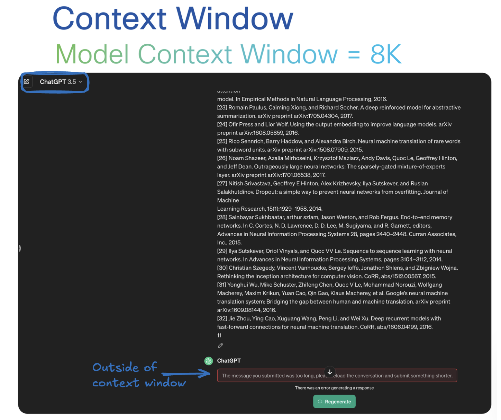{ loading=lazy }

!!! note
    A token can be as small as a piece of a word or as large as a word itself, depending on the language and complexity of the text.

* Consider a model with a context window limit of 8,000 tokens. If we input 6,000 tokens and the model generates a response of 1,500 tokens, the total token count is 7,500. This is within the model's context window, so all information is processed correctly.
Conversely, if the input increases to 10,000 tokens and the response remains at 1,500 tokens, the total becomes 11,500 tokens. This exceeds the model's 8,000-token limit. Consequently, the model might lose context or be unable to respond properly as the excess information falls outside its context window. This demonstrates the importance of managing input size to stay within the model's processing capabilities.

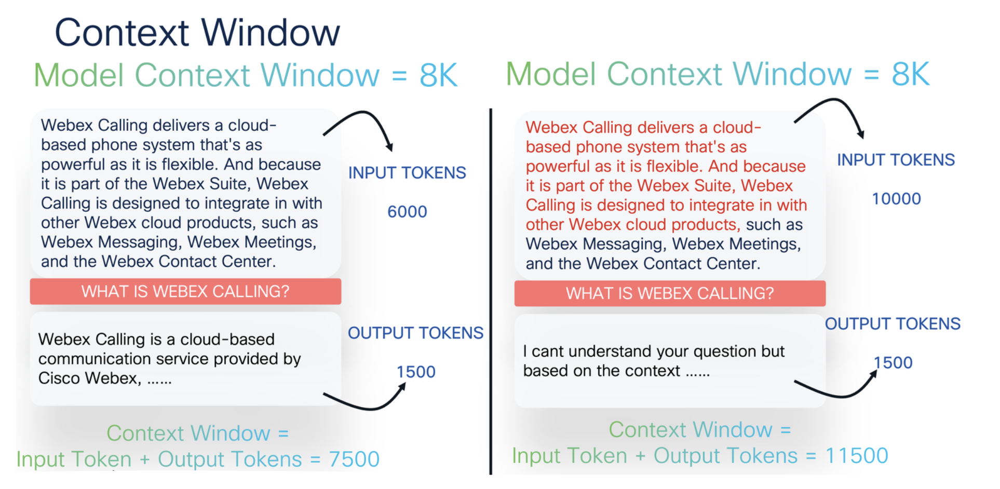{ loading=lazy }

#### How Context window work

    
* In the below example , multiple potential predicted words exist, but the model chooses the words based on the surrounding context and their probability. However, if the context window size increases and the word "Webex" moves out of the window, the model may lose critical context. As a result, the next predicted word might be incorrect, as the model can no longer reference "Webex" to inform its predictions accurately. This highlights the importance of keeping key information within the context window to maintain the accuracy of the model's predictions.

* Additionally, the temperature setting in the model can influence the type of content it generates. Lower temperatures are useful for summarizing or generating more deterministic and concise outputs, while higher temperatures encourage creativity, making the model more suitable for writing stories or poems. Adjusting the temperature allows you to control the balance between predictability and creativity in the model's output.

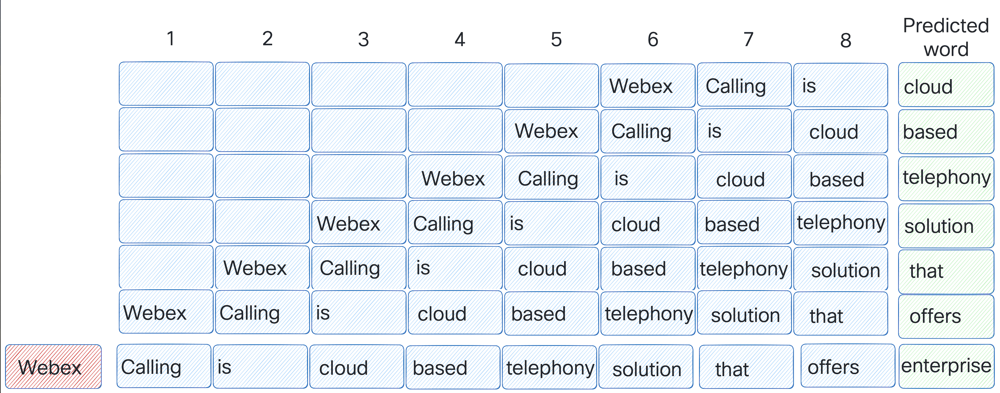{ loading=lazy }

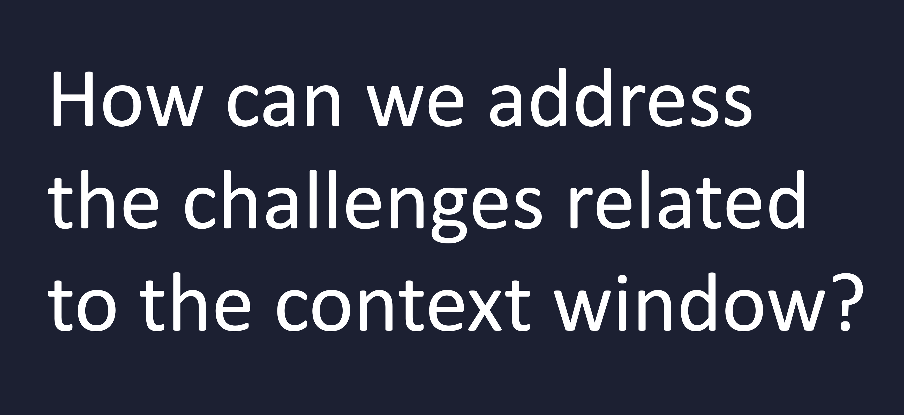{ loading=lazy }

* Thats where RAG come into play

<p class="eyebrow sub">Module 1 · Task 1B</p>

### Retrieval Augmented Generation (RAG) { #module-1b data-toc-label="1b · Retrieval Augmented Generation (RAG)" data-task="1b" }


#### Introduction


#### Introduction


Let's start by understanding what RAGs are before examining how they address context window issues.

RAG = Retrieval Augmented Generation

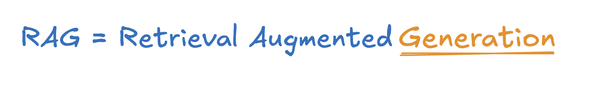{ loading=lazy }

!!! important
    Lets focus on the <span class="colour" style="color:red">Generation </span>part. Generation basically means responding to user query. For example, you might ask the model whether DX or Navigators are compatible with supporting ThousandEyes.

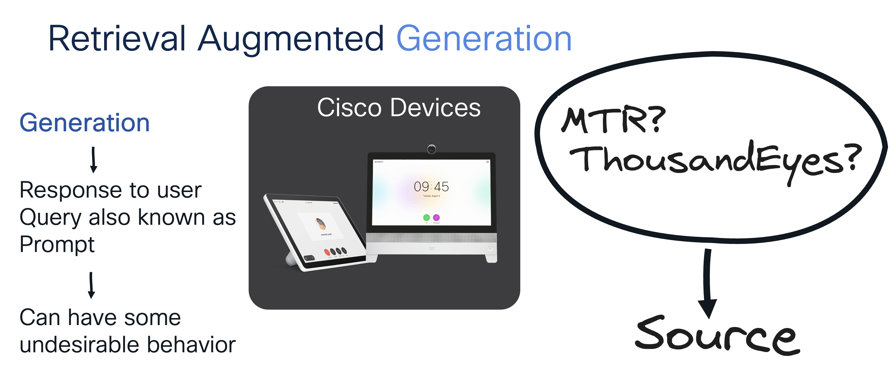{ loading=lazy }

That's an excellent question. LLMs are trained on vast amounts of historical data, so they may recognize that DX and Navigators are well-regarded Cisco products. As a result, the LLM might confidently respond that you can install ThousandEyes on those devices. However, the issue is that the response may lack a verifiable source to back up that claim or the information can be out-of-date  

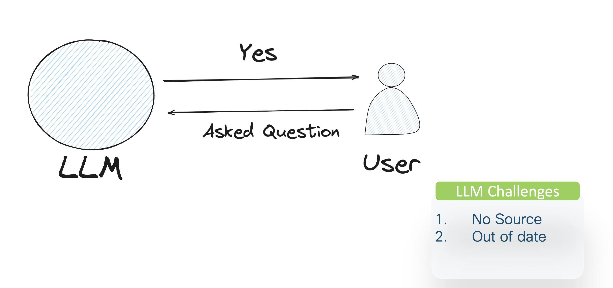{ loading=lazy }

What if, instead of just asking the question, I had first consulted a reputable source and only then informed the user that ThousandEyes can't be installed on those devices? This is where Retrieval-Augmented Generation comes into play. By integrating a knowledge base such as PDFs, CSVs, images, and other resources into the model, we ensure that any time a question is asked, the response is based on the most current and accurate information available.

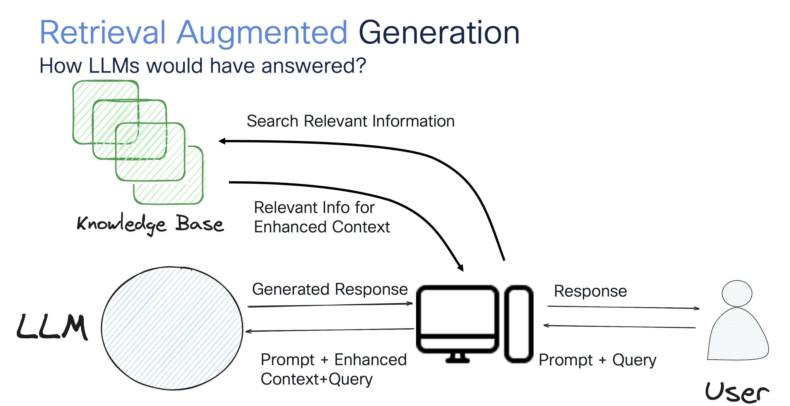{ loading=lazy }


##### How can RAG address the limitations we've seen with the context window?

        
To address the context window limitation, we can use an embedding model to convert relevant text into embeddings and store them in a vector database (covered in the previous section). When a user submits a query, we transform it into an embedding and compare it to the stored embeddings to find the closest match. Once we identify the match, we retrieve that specific chunk of text to respond to the query. This approach effectively overcomes the context window limitation by ensuring that our responses are accurate and contextually relevant.

Now you can see how RAG can address some of the challenges with LLMs. Instead of re-training or fine-tuning the model with new information, we can augment our data sources to retrieve the most up-to-date information. Additionally, LLMs are now instructed to prioritize primary source data before generating responses, making them less likely to hallucinate and encouraging more accurate and reliable outputs.

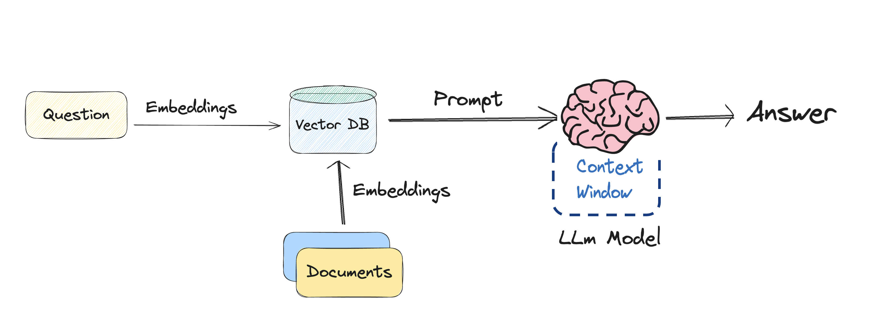{ loading=lazy }


###### What's Happening Under the Hood?


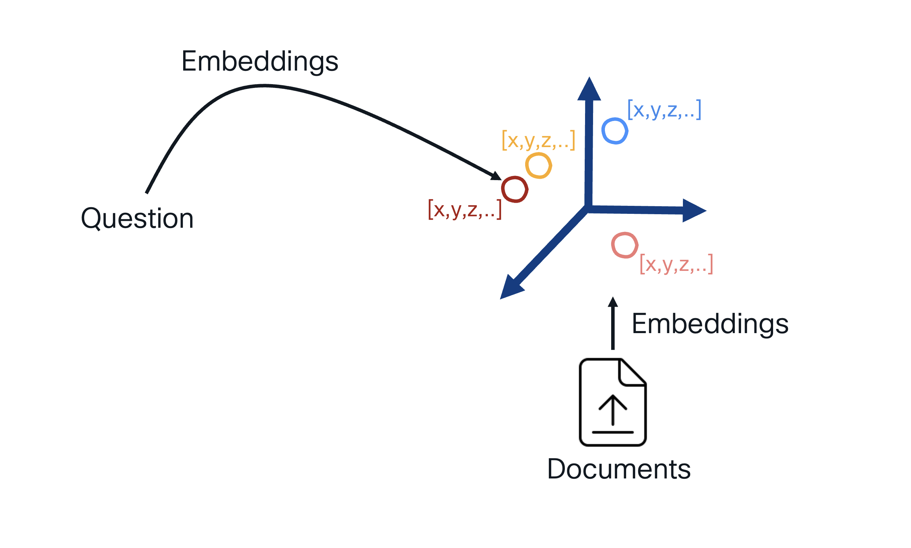{ loading=lazy }

We normally start by taking multiple documents and converting them into embeddings. Imagine these embeddings as points in a 3D space, where each document is projected based on its semantic meaning or content. Documents located near each other in this space contain similar semantic information, which is crucial when we search for or retrieve information.

Now, when we receive a query, we also convert it into an embedding (numerical value). We then perform a similarity search in a multidimensional space, looking for the documents that are closest to our query's embedding. These nearby documents are likely to contain the most relevant information.

Once we've identified these matching documents, we retrieve the relevant sections (or "splits") and feed all this information into the LLM's context window, allowing it to generate a well-informed response.

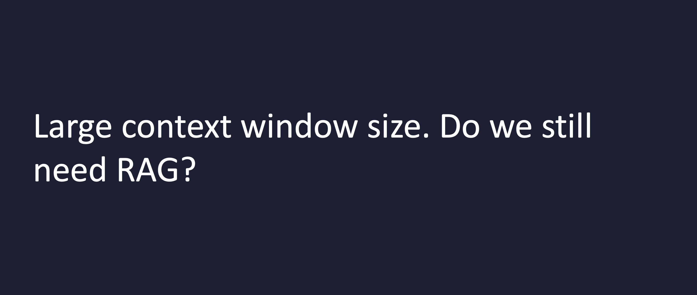{ loading=lazy }

We've seen models like Gemini Pro with a context window size of million, allowing them to retain more information. So, why use RAG? The answer is that RAG remains highly beneficial for sourcing real-time data,fact-checking, and accessing external knowledge that isn't contained within the context window.


###### LAB


!!! important
    Please open a new <a href="https://colab.research.google.com/" target="_blank">Google Colab</a> notebook for this section. Click on **"File" > "New notebook"**.

###### Let's build a quick RAG application


While LLMs (Large Language Models) like GPT's , Llama, Gemini e.t.c possess impressive general knowledge, they don't inherently have access to your data. To connect LLMs with your own data sources, we can use frameworks like <span class="colour" style="color:red">LangChain</span>. These frameworks enable us to leverage our own data by breaking down documents into smaller chunks and storing them as embeddings in vector databases.

This approach allows us to build applications that can effectively use language models. Example: When a user asks a question, we convert it into embeddings, perform a semantic search to find the most relevant answers, and then send both the question and the retrieved information to the LLM to generate a response.

In this section, we'll continue using LangChain, but in the following chapters, we'll explore it in greater depth to gain a more thorough understanding of its functionality.

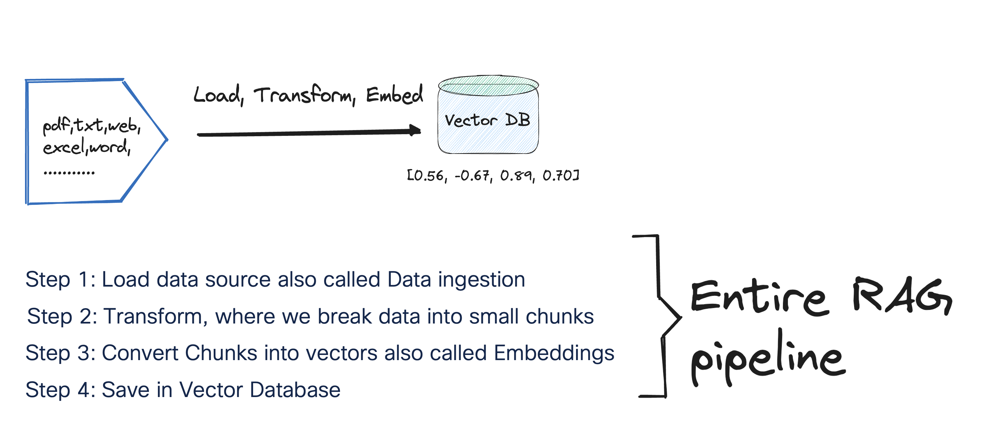{ loading=lazy }

!!! important
    In this section, we will be using a version of <a href="https://www.cisco.com/c/dam/en/us/td/docs/voice_ip_comm/cuipph/MPP/6800-DECT/deployment/CiscoDECT6800DeploymentGuide.pdf" target="_blank">Cisco DECT 6800 Deployment Guide</a>.  For the purposes of this lab, I've modified the original PDF by removing a few pages and saving it as a new file. 

!!! note
    The PDF we are using in this lab can be downloaded from [here](../assets/static/dect.pdf){:target="_blank" download="dect.pdf"}</span>

!!! important
    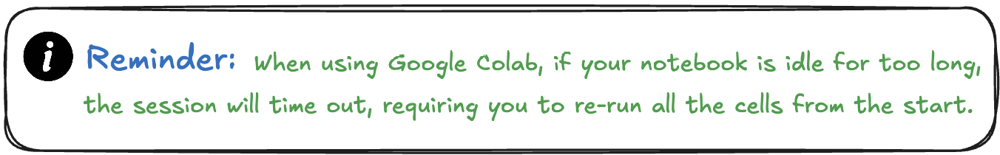{ loading=lazy }

* Open Google Colab and create a new notebook. Click on "File" > "New notebook". Please refer to the [following section](../index.md#module-1) to create Google Colab account.

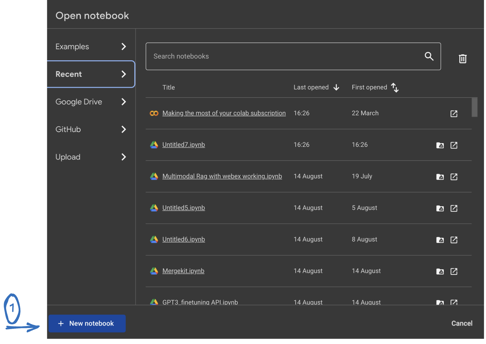{ loading=lazy }

* Make sure you are connected to a runtime.

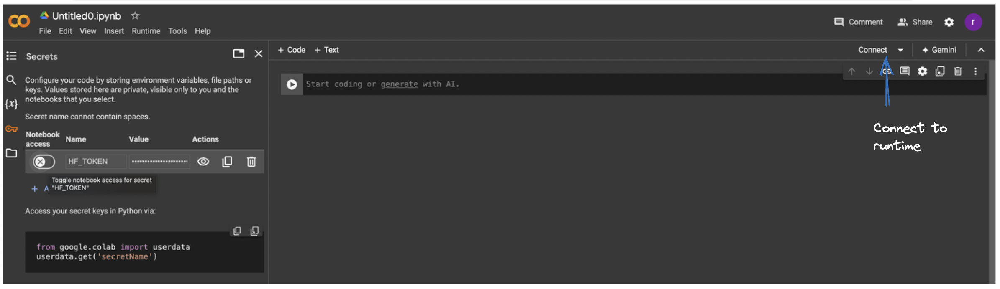{ loading=lazy }

* Within your Google Colab notebook navigate to the new “Secrets” section in the sidebar.

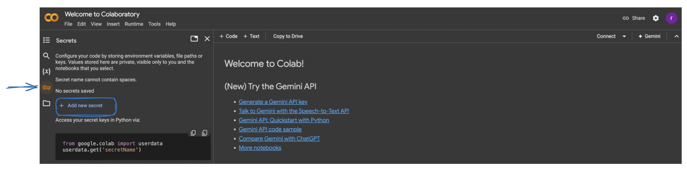{ loading=lazy }

!!! important

    - If not already done, Click on “Add a new secret.” Enter the name example: OPENAI_API_KEY and value of the secret(the API key created earlier). Note: The name is permanent once set. 

    - The list of secrets is global across all your notebooks.

    - Use the “Notebook access” toggle to grant or revoke access to a secret for each notebook.

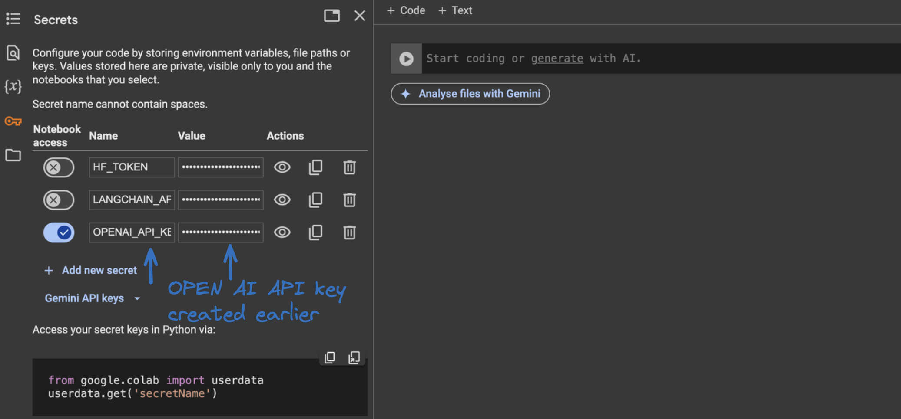{ loading=lazy }

*  Let's load our PDF files into Google Colab. For this example, we can use the [modified DECT guide](../assets/static/dect.pdf){:target="_blank" download="dect.pdf"}

* Within Google Colab, Click on Folder and create a new folder called "data"

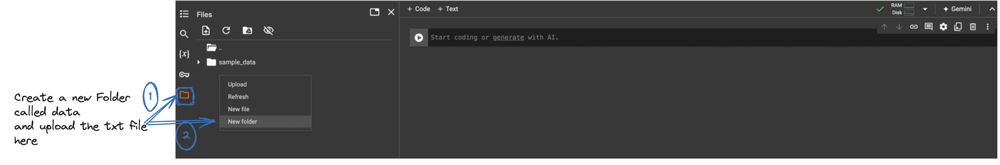{ loading=lazy }

* Click on [...], select Upload. Make sure you choose your dect.pdf file 

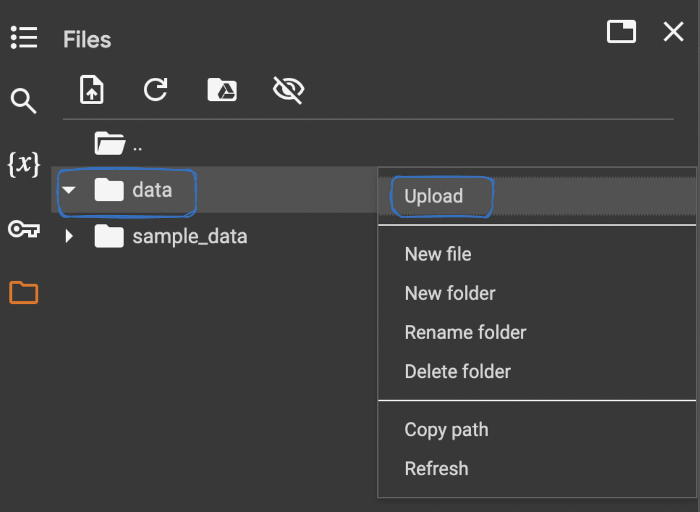{ loading=lazy }

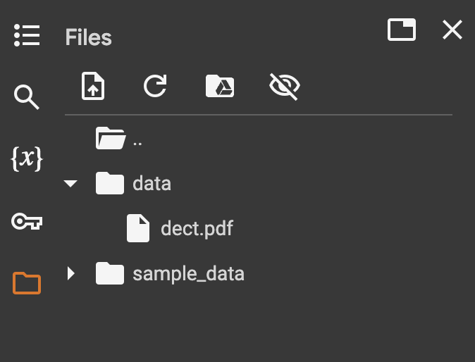{ loading=lazy }

* First let’s install the necessary Python packages. Click "Restart Session", once the below packages are installed.

```py linenums="1"
!pip install langchain langchain_community langchain-openai python-dotenv chromadb pymupdf langchain-text-splitters
```

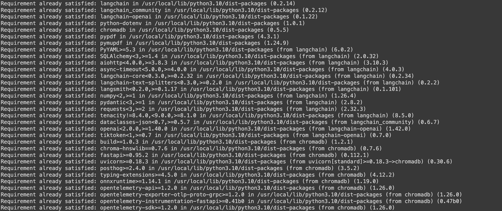{ loading=lazy }

!!! note
    Please remember to let each cell finish executing before moving on to the next one.

* Let's retrieve a OpenAI API key and set it as an environment variable within the Colab environment

```py linenums="1"
import os
from google.colab import userdata
os.environ['OPENAI_API_KEY'] = userdata.get('OPENAI_API_KEY')
```

* Let's import relevant libraries for RAG

```py linenums="1"
# from langchain import hub
import os
# from langchain.text_splitter import RecursiveCharacterTextSplitter
from langchain_text_splitters import RecursiveCharacterTextSplitter
from langchain_community.document_loaders import WebBaseLoader
from langchain_community.vectorstores import Chroma
from langchain_core.output_parsers import StrOutputParser
from langchain_core.runnables import RunnablePassthrough
from langchain_openai import ChatOpenAI, OpenAIEmbeddings
from dotenv import load_dotenv
from langchain_community.document_loaders import PyMuPDFLoader  
```

!!! note
    If you receive any warnings related to langchain_community, or "USER_AGENT environment variable not set", you can safely ignore it. This does not affect functionality, especially in Google Colab.
    or  you can always insert the following command os.environ["USER_AGENT"] = "MyLangChainApp/1.0"

* Next let’s load the data source. This is also known as “Data Ingestion”. Make sure you copy the path where the pdf file is downloaded. 

```py linenums="1"
loader = PyMuPDFLoader("/content/data/dect.pdf")
docs = loader.load()
```

* Transform, where we break data into small chunks. We can use techniques like RecursiveCharacterTextSplitter or tiktoken for tokenizing text.

```py linenums="1"
text_splitter = RecursiveCharacterTextSplitter(chunk_size=1000, chunk_overlap=200)
splits = text_splitter.split_documents(docs)
```

!!! important
    RecursiveCharacterTextSplitter Covered in previous section

* Let's create our embeddings. As discussed in the Embedding section, there are multiple techniques available. In this lab, we will use OpenAI embeddings. By default, the text-embedding-ada-002 model is used, but we can also opt for the text-embedding-3-large model if desired. Once the embeddings are created, they can be stored in a Vector Database. 
While there are various databases available, as covered in the Embeddings and Vector DB section, in our example, we will use the Chroma Vector DB, which can be easily deployed locally on your machine. 
We will also create a retriever by using  retriever = vectorstore.as_retriever() which converts the vector store into a retriever object. This retriever can then be used to find and retrieve documents or data from the vector store that are most relevant to a given query, based on the similarity of their embeddings.

```py linenums="1"
vectorstore = Chroma.from_documents(documents=splits, 
                                    embedding=OpenAIEmbeddings(model="text-embedding-3-large"))

retriever = vectorstore.as_retriever()
```

!!! optional "Optional: for reference only, you don't need to run this"
    We are using Chroma dB but you have options to use other databases as well such as Faiss. 
    Also we can use [embeddings from Ollama](https://python.langchain.com/v0.2/docs/integrations/text_embedding/ollama/), an open-source and cost-free embedding solution. Below is a code snippet for your reference only:

    ```py
    # from langchain_community.embeddings import OllamaEmbeddings
    # embeddings = OllamaEmbeddings()
    ```

!!! note
    More info on Vector Databases can be found <a href="https://python.langchain.com/v0.2/docs/integrations/vectorstores/" target="_blank">here</a>

* At this stage, we've loaded the document, created splits, converted them into embeddings, and stored them in the Vector DB (without passing anything to the LLM yet). Now, let's query the database to ensure we can retrieve the information.

```py linenums="1"
query = "what is the Quick Set up and Installation Process for the Dect phones"
result = vectorstore.similarity_search(query)
print(result[0].page_content)
```

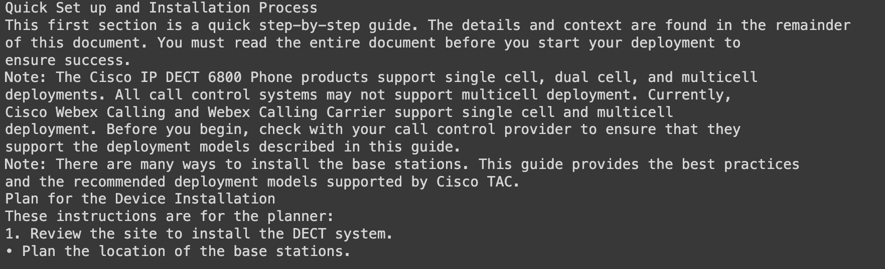{ loading=lazy }

* Let's now create our prompt. There are several ways to do this, you can either craft it manually or use prompts that have already been made available on the LangChain Hub. In this section, I'll demonstrate how to manually create a prompt and use it. 
                    
??? info "Optional: LangChain Hub & API Key (click to expand)"

    To access LangChain Hub, you'll need a LangChain API Key. The key is in your `.txt` file from the start of the lab.

    If you want to create one yourself, browse to <a href="https://smith.langchain.com/" target="_blank">LangSmith</a> and create an account or use the tmedemouserX account to sign in.

    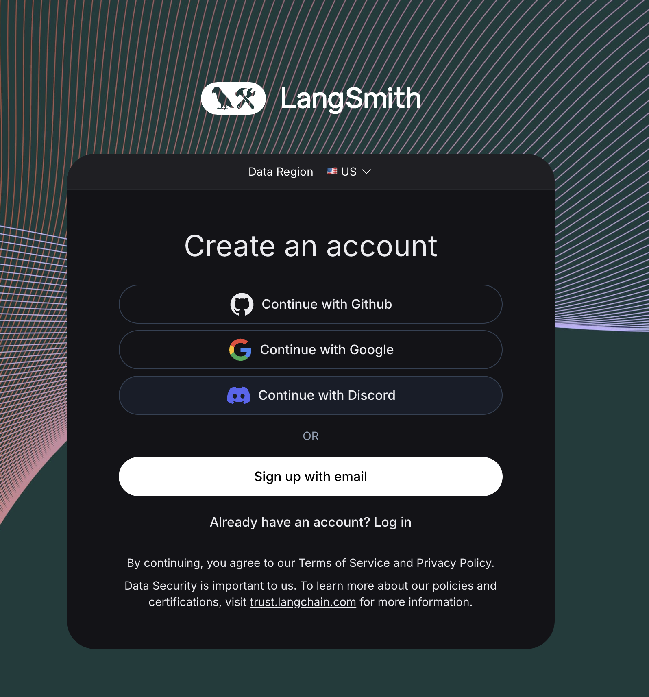{ loading=lazy }

    * Create your API Key

    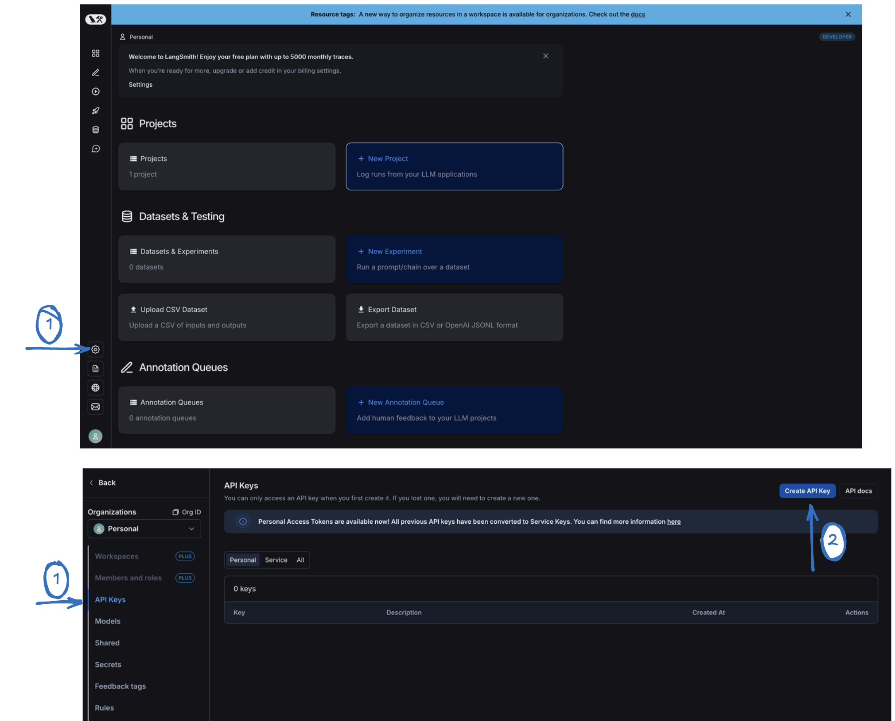{ loading=lazy }

    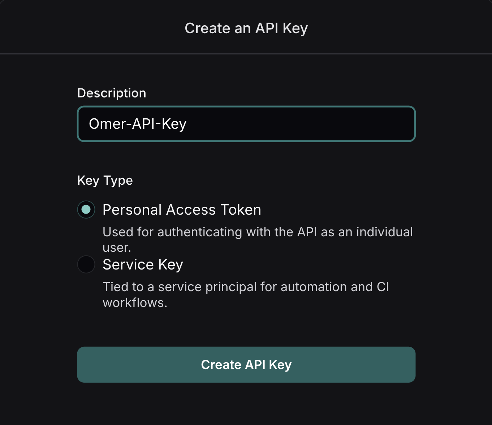{ loading=lazy }

    * Enter LANGCHAIN_API_KEY in the Colab secrets or in the code:

    ```py linenums="1"
    os.environ["LANGCHAIN_API_KEY"] = "PASTE-YOUR-KEY-HERE"
    ```

    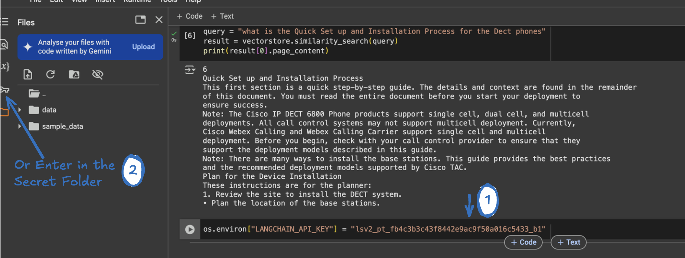{ loading=lazy }

    **Using hub.pull() to load a pre-built prompt:**

    ```py linenums="1"
    #prompt = hub.pull("rlm/rag-prompt")
    #prompt
    ```

    The prompt template looks like this:

    *"You are an assistant for question-answering tasks. Use the following pieces of retrieved context to answer the question. If you don't know the answer, just say that you don't know. Use three sentences maximum and keep the answer concise. Question: {question} Context: {context} Answer:"*

    To retrieve the template message only:

    ```py linenums="1"
    #req1 = prompt.messages[0].prompt.template
    #req1
    ```

* Instead of pulling a pre-built prompt template using hub.pull(), we now define our own custom prompt using ChatPromptTemplate. This gives us full control over the structure of the prompt and ensures it works consistently without relying on external repositories.

```py linenums="1"
from langchain_core.prompts import ChatPromptTemplate
template = """
Answer the question based only on the following context.
If the answer is not in the context, say you don't know.

Context:
{context}

Question: {question}

Answer:
"""
prompt = ChatPromptTemplate.from_template(template)
```


* We can now connect LLMs to our data sources. In this lab, we are using OpenAI models, but feel free to use open-source models if you prefer.

```py linenums="1"
llm = ChatOpenAI(model_name="gpt-4o", temperature=0)
def format_docs(docs):
    return "\n\n".join(doc.page_content for doc in docs)
```

*  Lets use the Retrieval-Augmented Generation (RAG) pipeline to put all together. We will use retriever | format_docs to retrieve relevant documents (or context) related to the input question and formats them. The RunnablePassthrough method will be used to  simply pass the question  without modifying it.


```py linenums="1"
Question = "Quick Set up and Installation Process for dectphone and summarise"
#  Chain that wik take our input question from below
rag_chain = (
    {"context": retriever | format_docs, "question": RunnablePassthrough()}
    | prompt
    | llm
    | StrOutputParser()  # This component parses the LLM's output, typically converting it into a string format for easy use.
)
req = rag_chain.invoke(Question)
print(req)
```

!!! note
    When we pass our question into the rag_chain.invoke() method, it first goes through the retriever component that we set up earlier. The retriever uses the same embedding model, text-embedding-3-large, to transform the  question into an embedding vector. This vector is then compared with the embeddings of documents stored in the Chroma vector store to identify the most relevant ones. Once these relevant documents are retrieved based on the similarity of their embeddings, they are sent along with the original question to the language model (LLM), which then generates a response.</span>

!!! note

    <span style="color:orange">OUTPUT</span>
    To set up and install a DECT phone system, first review the site and plan the location of the base stations, ensuring they are within 50 meters of each other for good coverage. Upgrade the base stations to the latest firmware, configure them according to the Cisco IP DECT 6800 Series Administration Guide, and unpack and prepare the handsets. Finally, mount the base stations, place the handsets in their cradles, and make a few test calls to ensure everything is working correctly.


###### Measuring Vector Similarity Using Cosine Similarity

                        
Cosine similarity is a metric used to measure how similar two vectors are, regardless of their magnitude. It is particularly useful in the context of text analysis, information retrieval, and machine learning, where it is often used to compare the similarity of two text documents, sentences, or any other data that can be represented as vectors. In our code, we will use it to match the similarity between the question we asked and the answer we receive.

* Lets create a function that calculates the cosine similarity between two vectors by using dot product a scalar value. 

```py linenums="1"
# Define the cosine similarity function
import numpy as np
# Define the cosine similarity function
def cosine_similarity(vec1, vec2):
    dot_product = np.dot(vec1, vec2)
    norm_vec1 = np.linalg.norm(vec1)
    norm_vec2 = np.linalg.norm(vec2)
    return dot_product / (norm_vec1 * norm_vec2)
```


* We will now convert the question into an embedding, retrieve the embedding of our question, and the embeddings of the documents retrieved by the retriever.

```py linenums="1"
# Convert the question into an embedding
embedding_model = OpenAIEmbeddings(model="text-embedding-3-large")
question_embedding = embedding_model.embed_query(Question)
retrieved_docs = retriever.invoke(Question)
```

!!! note
    If you receive any warnings related to langchain, you can safely ignore this warning.

* Lets calculate and print similarity between the question and each retrieved document

```py linenums="1"
for doc in retrieved_docs:
    # Assuming your retriever does not provide embeddings directly, re-embed each document
    doc_embedding = embedding_model.embed_query(doc.page_content)
    similarity = cosine_similarity(question_embedding, doc_embedding)
    print(f"Document: {doc.page_content[:100]}...")  # Print a preview of the document
    print(f"Cosine Similarity: {similarity}\n")
```

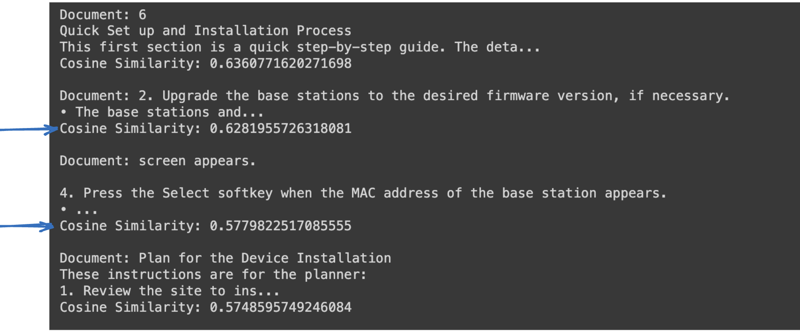{ loading=lazy }

!!! note
    Cosine similarity values range from -1 to 1, where 1 means the vectors are identical, 0 means they are completely different, and values closer to 1 indicate greater similarity. In our example where one similarity score is 0.63 and another is 0.57, the document with a score of 0.63 is more similar to the query than the one with 0.57. Both scores indicate a moderate similarity to the query, but the document with 0.63 contains slightly more relevant information.

---

**What We Built, and How It Differs from the Previous Task**

In the previous task (Embeddings & Vector Database), we learned how to convert text into vectors, store them, and retrieve the most relevant chunks using similarity search. That was **retrieval only** you got back raw document fragments, but no synthesized answer.

In this task, we added the missing piece: an **LLM (GPT-4o)** sitting on top of the retrieval layer. This is what makes it a full **RAG pipeline**:

| | Task 4 (Retrieval Only) | Task 5 (RAG) |
|---|---|---|
| **Input** | A query | A query |
| **Step 1** | Convert query to embedding | Convert query to embedding |
| **Step 2** | Search vector DB for similar chunks | Search vector DB for similar chunks |
| **Step 3** | Return raw chunks to user | Feed chunks + question to LLM |
| **Output** | Raw document fragments | A clear, natural language answer |
| **Hallucination risk** | N/A (no generation) | Low, LLM is grounded in retrieved data |

The cosine similarity scores we just calculated confirm that the retriever is pulling the right context before it ever reaches the LLM. This is critical if the retrieval is bad, the LLM will generate a bad answer no matter how capable it is. **Good retrieval is the foundation of good RAG.**

The pattern we just built load documents, chunk them, embed them, store in a vector DB, retrieve, and pass to an LLM is the same pattern behind virtually every enterprise AI assistant, knowledge base chatbot, and intelligent search system in production today.


<p class="eyebrow">Module 2</p>

## RAG through File Search Tool { #module-2 data-toc-label="Module 2 · File Search" }


<p class="eyebrow sub">Module 2 · Task 2A</p>

### What is Gemini File Search? { #module-2a data-toc-label="2a · What is Gemini File Search?" data-task="2a" }


#### Introduction

In the previous modules, we learned how embeddings work, how to store them in vector databases such as **ChromaDB** and **Pinecone**, and how to retrieve relevant information using semantic search.

We also explored **Gemini Embedding 2** and **EmbeddingGemma 2** to understand how embeddings can work across different types of content and run either in the cloud or locally.

Now we're going to explore another approach: **Gemini File Search**, Google's fully managed Retrieval-Augmented Generation (RAG) service.

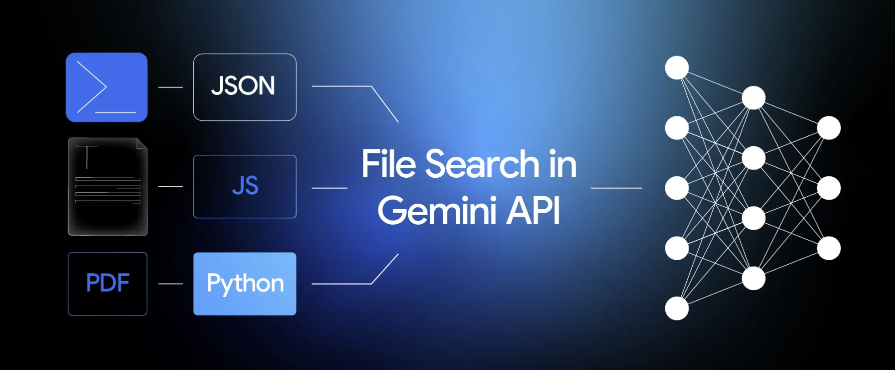{ loading=lazy }

**What is Gemini File Search?**

Google's <a href="https://ai.google.dev/gemini-api/docs/file-search" target="_blank">File Search Tool</a> is a **fully managed RAG service** integrated into the Gemini API.

Instead of building and maintaining the entire RAG pipeline yourself, you upload your documents to a **File Search store**, and Google handles much of the underlying processing automatically.

This includes:

* Splitting documents into smaller chunks
* Generating embeddings
* Indexing and storing searchable information
* Retrieving relevant content when a question is asked
* Providing that information to the Gemini model to generate grounded answers

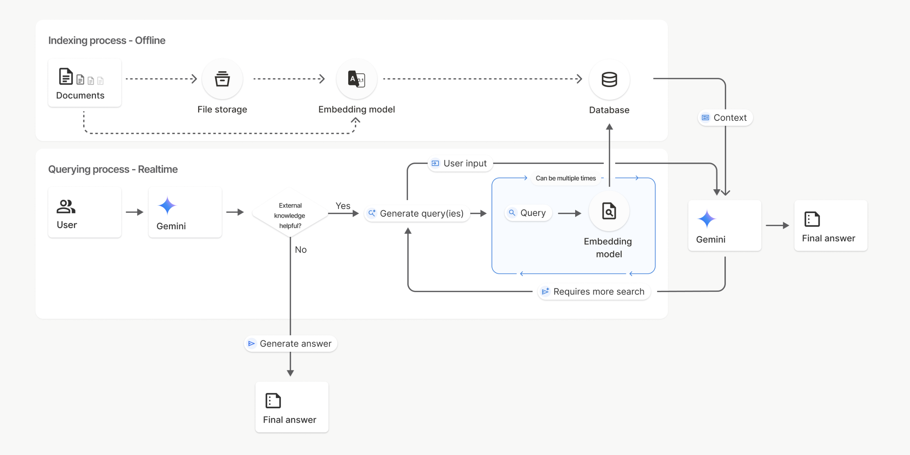{ loading=lazy }

!!! tip "In simple terms"
    You provide the knowledge, ask questions, and Gemini handles the retrieval process.

**How Does This Compare to What We Built Earlier?**

In Module 1, we built our own RAG pipeline using LangChain, ChromaDB, and OpenAI.

That gave us control over the different components. With Gemini File Search, Google manages those components for us.

| Component | DIY RAG (Module 1) | Gemini File Search |
|---|---|---|
| **Document chunking** | Configure a text splitter | Automatically handled, with some configuration options |
| **Embeddings** | Select and call an embedding model | Generated automatically |
| **Vector database** | Configure ChromaDB or Pinecone | Managed internally by Google |
| **Retrieval** | Implement similarity search or a retriever | Managed by File Search |
| **LLM integration** | Connect retrieval to the LLM | Gemini retrieves and generates responses |
| **Infrastructure** | You manage the components | Google manages the retrieval infrastructure |
| **Flexibility** | Greater control and customisation | Simpler setup with less control |

!!! important
    Gemini File Search does **not** replace traditional RAG architectures. It provides another way to build RAG applications, particularly when we want to reduce complexity.

**What's New? Multimodal File Search**

Google has extended File Search to support **Gemini Embedding 2**.

This means File Search can work with text and supported image/multimodal content using a shared embedding space.

For example, imagine uploading a hotel brochure containing descriptions and photographs. A user could ask a question about the hotel's facilities, and the system could retrieve relevant information from the indexed content.

!!! note
    Although the standalone Gemini Embedding 2 model supports text, images, audio, video and PDFs, Gemini File Search currently does **not** support audio or video file formats.

**Why Use Gemini File Search?**

* **Simplicity**: upload documents, let Google index them, and ask questions.
* **No external vector database**: Google manages the searchable index.
* **Managed retrieval**: no need to implement your own vector similarity search.
* **Grounded responses**: Gemini can use retrieved content and provide source citations.
* **Faster development**: spend more time building your application and less time configuring retrieval infrastructure.

**Pricing and Supported Models**

Gemini File Search supports multiple Gemini models, including models in the **Gemini 3** and **Gemini 4** families. Availability depends on the model and API.

File Search also supports two embedding models:

* `gemini-embedding-001`: text-focused embeddings
* `gemini-embedding-2`: multimodal embeddings

| Component | Pricing |
|---|---|
| File Search storage | Free |
| Query-time embeddings | Free |
| Initial indexing with Gemini Embedding 001 | $0.15 per 1 million tokens (paid tier) |
| Initial text indexing with Gemini Embedding 2 | $0.20 per 1 million tokens (paid tier) |
| Retrieved context and answer generation | Charged according to the selected Gemini model |

!!! info "Prices may change"
    These are published rates as of October 2026 and may change. Check Google's official <a href="https://ai.google.dev/gemini-api/docs/pricing" target="_blank">pricing page</a> before deploying production applications. See also: <a href="https://ai.google.dev/gemini-api/docs/tokens" target="_blank">Token info</a>.

!!! tip "Key takeaway"
    **DIY RAG gives us control. Gemini File Search gives us simplicity.**

    Both approaches use the same fundamental concept: retrieving relevant information and providing it to an LLM to generate an answer. The main difference is **who manages the retrieval pipeline**.

In the next exercise, we'll create our own File Search store, upload a document, and ask Gemini questions about its contents.

??? info "Supported File Types (click to expand)"
    **Application types:** `application/pdf`, `application/msword`, `application/json`, `application/sql`, `application/xml`, `application/zip`, `application/vnd.ms-excel`, `application/vnd.jupyter`, `application/vnd.openxmlformats-officedocument.wordprocessingml.document`, `application/vnd.openxmlformats-officedocument.spreadsheetml.sheet`, `application/vnd.openxmlformats-officedocument.presentationml.presentation`, `application/typescript`, `application/dart`, `application/ecmascript`, `application/x-php`, `application/x-powershell`, `application/x-sh`, `application/x-latex`, and more.

    **Text types:** `text/plain`, `text/html`, `text/css`, `text/csv`, `text/javascript`, `text/markdown`, `text/xml`, `text/yaml`, `text/x-python`, `text/x-java`, `text/x-go`, `text/x-rust`, `text/x-c`, `text/x-swift`, `text/x-kotlin`, `text/x-ruby-script`, `text/x-sql`, and many more.

    For the complete list, see the <a href="https://ai.google.dev/gemini-api/docs/file-search" target="_blank">official documentation</a>.
    
##### LAB


###### Let's build a quick Gemini Retrieval Augmented Generation ("RAG") through the File Search tool application


In this lab, we’ll go through the end-to-end workflow of using File Search with a Python script. You’ll learn how to:

1. Create a File Search store
2. Look up an existing store by its display name
3. Upload files into the store
4. Use advanced upload options such as custom chunking and metadata
5. Run a standard RAG-style generation query
6. Clean up by deleting the File Search store when you’re done

!!! important
    In this section, we will be using a version of <a href="https://www.cisco.com/c/dam/en/us/td/docs/voice_ip_comm/cuipph/MPP/6800-DECT/deployment/CiscoDECT6800DeploymentGuide.pdf" target="_blank">Cisco DECT 6800 Deployment Guide</a>. For the purposes of this lab, I’ve modified the original PDF by removing a few pages and saving it as a new file.

!!! note
    The PDF we are using in this lab can be downloaded from [here](../assets/static/Geminidect.pdf){:target="_blank" download="Geminidect.pdf"}

!!! warning "Session Timeout"
    When using Google Colab, if your notebook is **idle for too long**, the session will **time out**, requiring you to **re-run all the cells from the start**.

* Open Google Colab and create a new notebook. Click on "File" > "New notebook". Please refer to the [following section](../index.md#module-1) to create Google Colab account.

{ loading=lazy }

* Make sure you are connected to a runtime. For this task, you can use the CPU as the runtime environment.

{ loading=lazy }

!!! note "Gemini API Key"
    If you already obtained your Gemini API key in **Part 2 · Module 4 (Gemini Embedding 2)**, you can reuse the same key here. If you saved it in the **`$ keys`** panel, click the copy button there to grab it quickly.

??? info "Don't have a Gemini API key yet? (click to expand)"
    You can get one for free at <a href="https://aistudio.google.com/api-keys" target="_blank">Google AI Studio</a>. Use your **personal Gmail account** to sign up and generate a key. For step-by-step instructions, refer to the **Lab Setup** section in <a href="../part-2/#module-4" target="_blank">Part 2 · Module 4: Gemini Embedding 2</a>.

* Within your existing Google Colab notebook navigate to the new "Secrets" section in the sidebar.

{ loading=lazy }

!!! important
    - Click on "Add a new secret." Enter the name **GEMINI_API_KEY** and paste your key as the value. Note: The name is permanent once set.
    - The list of secrets is global across all your notebooks.
    - Use the "Notebook access" toggle to grant or revoke access to a secret for each notebook.

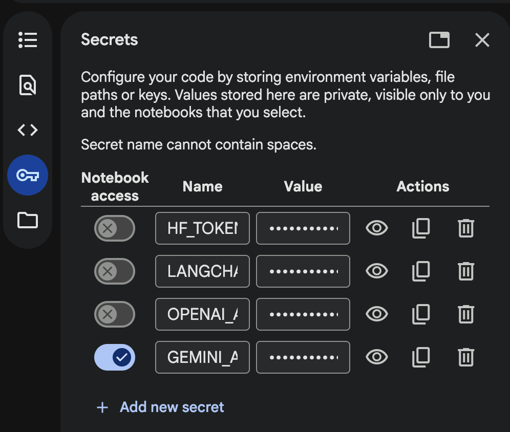{ loading=lazy }

* Let’s load our PDF files into Google Colab. For this example, we can use the [modified DECT guide](../assets/static/Geminidect.pdf){:target="_blank" download="Geminidect.pdf"}

* Within Google Colab, click on Folder and create a new folder called "data"

{ loading=lazy }

* Click on [...], select Upload. Make sure you choose your Geminidect.pdf file

{ loading=lazy }

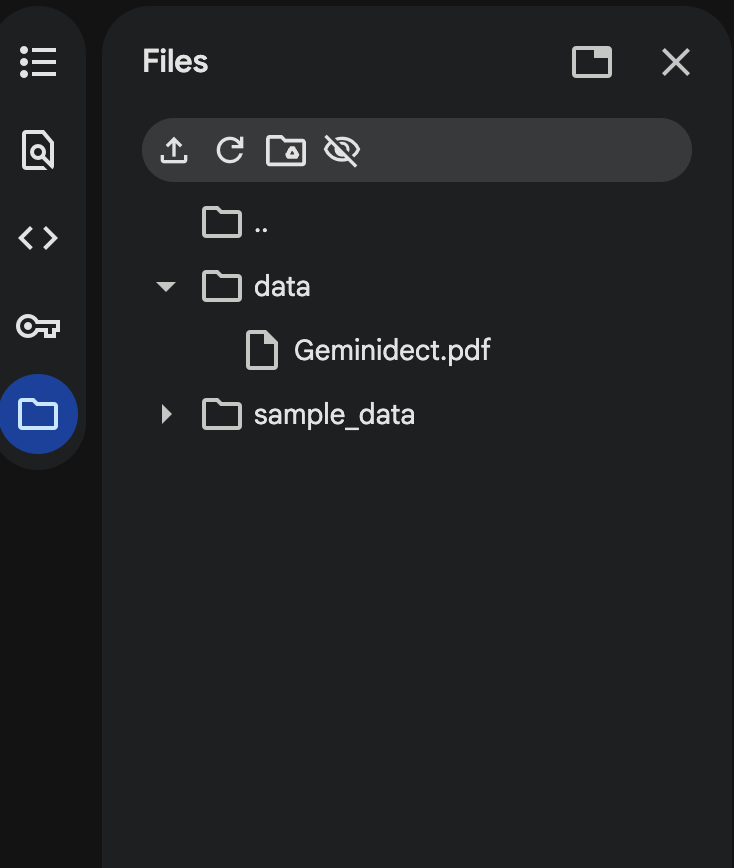{ loading=lazy }

---

**Step 1: Install dependencies**

Run this in a Colab code cell:

```py
%pip install -q google-genai
```

!!! tip "What just happened?"
    We installed the Python SDK used to communicate with the Gemini API. The Gemini model itself is not being downloaded to Colab.

!!! warning "Dependency warning"
    Colab may display a `google-auth` version conflict during installation. That warning does not necessarily mean the SDK failed. Try Step 2 before reinstalling packages. Avoid repeatedly upgrading or downgrading dependencies if imports work.

---

**Step 2: Import libraries and configure the Gemini API key**

```py linenums="1"
from google.colab import userdata
from google import genai
from google.genai import types
import os
import time

api_key = userdata.get("GEMINI_API_KEY")
if not api_key:
    raise ValueError("Add GEMINI_API_KEY in Colab Secrets and enable notebook access.")

client = genai.Client(api_key=api_key)
MODEL = "gemini-2.5-flash"  # Tested with generate_content() in this lab

print("✅ Gemini client ready")
print("🤖 Generation model:", MODEL)
```

!!! tip "What just happened?"
    We created an authenticated Gemini client without displaying the API key. `MODEL` is the generation model used to answer questions. The File Search index has its own embedding configuration.

---

**Step 3: Create or reuse a File Search store**

A **File Search store** is a persistent, server-side collection of indexed document content. We use a distinctive name for this exercise and reuse an existing matching store after a Colab restart.

```py linenums="1"
STORE_DISPLAY_NAME = "Omers-DECT-Task5A"

matching_stores = [
    store for store in client.file_search_stores.list()
    if store.display_name == STORE_DISPLAY_NAME
]

if matching_stores:
    file_search_store = matching_stores[0]
    print("♻️ Reusing existing store")
else:
    file_search_store = client.file_search_stores.create(
        config={"display_name": STORE_DISPLAY_NAME}
    )
    print("✅ Created a new store")

file_search_store_name = file_search_store.name
print("Store display name:", file_search_store.display_name)
print("Store resource ID:", file_search_store_name)

if len(matching_stores) > 1:
    print("⚠️ Multiple stores share this display name; using the first one.")
```

!!! tip "What just happened?"
    The API assigned a resource name such as `fileSearchStores/...`. We don't manually copy or hard-code this ID. A display name is not guaranteed to be unique across stores, so the code warns you if multiple matches exist.

!!! info "Embedding-model choice"
    This beginner exercise uses the store's **default embedding configuration**. For a new store that explicitly uses Gemini Embedding 2, creation can instead specify `"embedding_model": "models/gemini-embedding-2"`. Embedding settings belong to the store and should be chosen before indexing. Don't assume you can change an existing store's embeddings after upload.

---

**Step 4: Verify the store and PDF file**

```py linenums="1"
pdf_path = "/content/data/Geminidect.pdf"

print("📚 Available File Search stores:")
for store in client.file_search_stores.list():
    print(" -", store.display_name, "→", store.name)

if not os.path.isfile(pdf_path):
    raise FileNotFoundError(
        f"PDF not found at {pdf_path}. Upload Geminidect.pdf to Colab's data folder."
    )

print("\n✅ PDF found:", pdf_path)
print("Size (KB):", round(os.path.getsize(pdf_path) / 1024, 1))
```

!!! tip "What just happened?"
    We verified both requirements: a File Search store in Google's service, and a local PDF in the Colab runtime ready for upload.

---

**Step 5: Upload and index the Cisco DECT PDF**

Uploading the PDF triggers chunking, embedding and indexing. We first check whether the document is already in this store, which helps avoid accidental duplicate uploads after a restart.

```py linenums="1"
DOCUMENT_DISPLAY_NAME = "Geminidect.pdf"

existing_docs = list(
    client.file_search_stores.documents.list(parent=file_search_store_name)
)

already_indexed = any(
    getattr(doc, "display_name", None) == DOCUMENT_DISPLAY_NAME
    for doc in existing_docs
)

if already_indexed:
    print("♻️ PDF already indexed in this store; skipping upload.")
else:
    print("📤 Uploading and indexing PDF...", flush=True)

    operation = client.file_search_stores.upload_to_file_search_store(
        file=pdf_path,
        file_search_store_name=file_search_store_name,
        config={"display_name": DOCUMENT_DISPLAY_NAME},
    )

    while not operation.done:
        print("⏳ Indexing in progress...", flush=True)
        time.sleep(5)
        operation = client.operations.get(operation)

    if getattr(operation, "error", None):
        raise RuntimeError(f"Indexing failed: {operation.error}")

    print("✅ Upload/indexing operation finished")

print("\n📑 Documents in the store:")
for doc in client.file_search_stores.documents.list(parent=file_search_store_name):
    print(" -", getattr(doc, "display_name", None), doc.name)
```

!!! tip "What just happened?"
    Google processed your PDF into searchable content. You didn't call an embedding model directly or manage a separate vector index. The loop checks the long-running upload operation until it finishes.

!!! note "Troubleshooting"
    The indexing step can take some time. If you get an indexing error, check the error message and PDF path before retrying. A finished upload operation is not the same as an answered question. Retrieval and generation happen in Step 7.

---

**Step 6: Configure the File Search tool**

```py linenums="1"
file_search_tool = types.Tool(
    file_search=types.FileSearch(
        file_search_store_names=[file_search_store_name]
    )
)

print("✅ File Search tool configured for:", file_search_store_name)
```

!!! tip "What just happened?"
    We told Gemini which store it may retrieve information from. The object does not generate a response. It is passed to the model when we ask a question.

---

**Step 7: Ask a question with `generate_content()`**

```py linenums="1"
question = (
    "What kind of cells do the Cisco IP DECT 6800 Phone products support?"
)

print("🔎 Searching the Cisco DECT guide...", flush=True)
start = time.monotonic()

response = client.models.generate_content(
    model=MODEL,
    contents=(
        "Answer using only the uploaded Cisco DECT guide. "
        "If the information is not in the document, say so. "
        "Keep the answer concise. Question: " + question
    ),
    config=types.GenerateContentConfig(
        tools=[file_search_tool]
    ),
)

print("\n🤖 Gemini answer:\n")
print(response.text or "No text response returned.")
print(f"\n⏱️ Time taken: {time.monotonic() - start:.1f} seconds")
```

!!! tip "What just happened?"
    Gemini used the File Search tool to retrieve relevant context from your indexed PDF and generate a natural-language answer. The retrieved text is not the same thing as the final answer: a retrieval tool finds relevant document material, and the LLM formulates the response.

!!! important
    The exact answer depends on the modified Cisco guide used in this lab. Don't assume the result is correct just because it sounds plausible. Compare it with the PDF.

!!! note "Gemini API availability (503 error)"
    When running this exercise, you may occasionally encounter the following error:

    ```text
    503 UNAVAILABLE: This model is currently experiencing high demand.
    ```

    **Don't worry!** This usually means Google's Gemini service is temporarily experiencing high demand and cannot process your request. It does not necessarily mean there is anything wrong with your code or the document you uploaded.

    **What should you do?**

    1. Try running the query cell again after a short interval.
    2. If the error continues, move on to the next section of the lab.
    3. You can return to this exercise later without uploading or indexing the PDF again, provided your File Search store and indexed document still exist.

    **Important:** There is no need to reinstall libraries, restart Google Colab or recreate your File Search store just because you receive a 503 error.

    **Key takeaway:** When building AI applications that rely on cloud services, temporary API availability issues can occur. Handling these gracefully is an important part of building reliable AI applications.

---

**Step 8: Examine available source information**

Gemini may return grounding details identifying documents or chunks used for the answer. The exact metadata shape can vary by API and model.

```py linenums="1"
if response.candidates:
    grounding = getattr(response.candidates[0], "grounding_metadata", None)
    if grounding:
        print("📚 Grounding/source information:")
        print(grounding)
    else:
        print("ℹ️ No grounding metadata was returned in this response.")
else:
    print("ℹ️ No response candidates were returned.")
```

!!! tip "What just happened?"
    We're inspecting traceability information rather than simply trusting the answer. Not every response includes a friendly page-level citation. For critical use cases, verify claims directly against the source PDF.

**Try another question (optional)**

```py linenums="1"
another_question = "Summarise the main deployment considerations mentioned in the DECT guide."

response2 = client.models.generate_content(
    model=MODEL,
    contents=(
        "Use only the uploaded Cisco DECT guide. "
        "If the guide does not contain the answer, say so. "
        + another_question
    ),
    config=types.GenerateContentConfig(tools=[file_search_tool]),
)
print(response2.text)
```

---

**Step 9: Advanced option: custom chunking (optional)**

Gemini automatically chunks documents, but we can customise the maximum chunk size and overlap during upload. This changes indexing behaviour and is not needed for the main exercise.

```py linenums="1"
# OPTIONAL EXAMPLE: do not run unless you intentionally want
# to upload an additional indexed copy of the PDF.
#
# custom_operation = client.file_search_stores.upload_to_file_search_store(
#     file=pdf_path,
#     file_search_store_name=file_search_store_name,
#     config={
#         "display_name": "Geminidect-custom-chunks.pdf",
#         "chunking_config": {
#             "white_space_config": {
#                 "max_tokens_per_chunk": 200,
#                 "max_overlap_tokens": 20,
#             }
#         },
#     },
# )
```

!!! tip "What just happened?"
    Smaller chunks can influence how much surrounding context the retriever returns. More overlap can preserve context between adjacent chunks but may increase indexing volume. There isn't one best chunk size for every document.

---

**Step 10: Clean up (optional, destructive)**

Your File Search store persists after Colab disconnects. Deleting the store is not required to finish the exercise, but you may want to remove the lab data when finished.

```py linenums="1"
# SAFETY CHECK: Set to True only when you intentionally want
# to permanently delete this lab's File Search store.
DELETE_LAB_STORE = False

if DELETE_LAB_STORE:
    client.file_search_stores.delete(
        name=file_search_store_name,
        config={"force": True}
    )
    print("🗑️ Deleted File Search store:", file_search_store_name)
else:
    print("✅ Store retained:", file_search_store_name)
    print("Set DELETE_LAB_STORE=True only when ready to delete it.")
```

!!! tip "What just happened?"
    We provided a controlled cleanup step without deleting the store automatically. If you delete it, the indexed contents are no longer available for retrieval. You'll need to recreate and reindex the store to repeat the exercise.

---

**What we learned in this module**

In Module 1, we manually loaded a PDF, split it into chunks, generated embeddings, stored them in ChromaDB and connected retrieval to an LLM using LangChain.

In this module, we created a managed File Search store, uploaded the Cisco DECT PDF and asked Gemini to answer using the indexed material. Google managed chunking, embedding, indexing and retrieval. We still had to configure the store, upload the document, choose a generation model, ask a question and assess the answer.

!!! tip "Key takeaway"
    Both DIY and managed RAG can ground responses in external documents. **DIY RAG** offers fine-grained control. **File Search** offers a shorter development path. Neither eliminates the need for evaluation, access control or source verification.

**Troubleshooting checklist**

| Problem | What to check |
|---|---|
| `google-auth` dependency warning | Test imports and client creation before changing versions |
| API key error | Check the Colab Secret is exactly `GEMINI_API_KEY` and notebook access is enabled |
| PDF not found | Confirm `/content/data/Geminidect.pdf` exists. Colab uploads disappear when a runtime is deleted |
| `NameError` after restart | Rerun Steps 2 to 6 to recreate Python variables. The store itself may still exist |
| No documents | Rerun Step 5 and wait for indexing to finish |
| Model unsupported | Check Google's latest File Search documentation for supported model and API combinations. The tested model may be deprecated later |
| Unexpected answer | Inspect grounding details and verify against the PDF |

**Official references**

* <a href="https://ai.google.dev/gemini-api/docs/file-search" target="_blank">Google Gemini API: File Search</a>
* <a href="https://ai.google.dev/gemini-api/docs/pricing" target="_blank">Google Gemini API: Pricing</a>
* <a href="https://aistudio.google.com/api-keys" target="_blank">Google AI Studio: API keys</a>

<p align="right"> 👉 This concludes the task. Click the next **Module** on the left to continue.</p>


<p class="eyebrow">Module 3</p>

## Multimodal RAG { #module-3 data-toc-label="Module 3 · Multimodal RAG" }


<p class="eyebrow sub">Module 3 · Task 3A</p>

### Multimodal RAG { #module-3a data-toc-label="3a · Multimodal RAG" data-task="3a" }


#### Introduction


#### Introduction


In the previous section, we explored RAG systems primarily designed for handling text. However, in real-world scenarios, many documents within organizations contain valuable information in the form of images, tables, and other non-text elements. 

When building a robust RAG system, it's crucial to have the capability to retrieve not just text-based information but also relevant images and other visual data. This multimodal approach significantly enhances the effectiveness of information retrieval. In this section, we will explore methods to retrieve both images and text in response to user queries, enabling a more comprehensive and efficient RAG based system.

#### Three Different approaches for Multimodal RAG


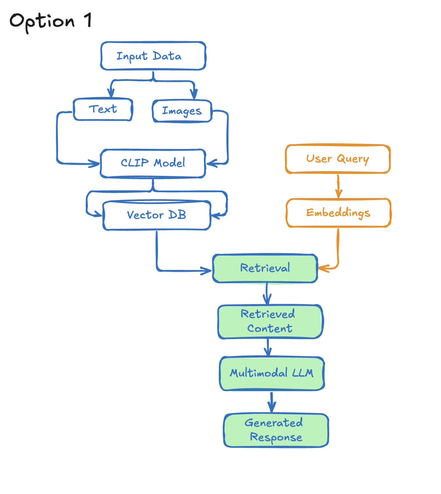{ loading=lazy }

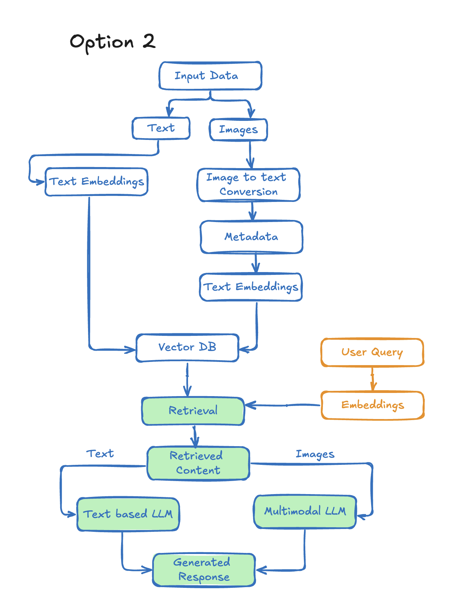{ loading=lazy }

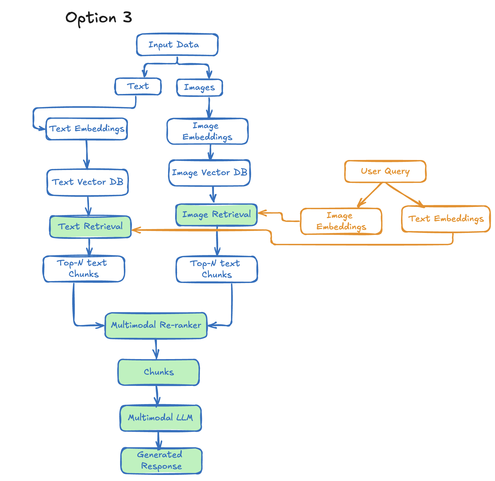{ loading=lazy }

!!! note

    We will be using Option 2 for our lab.

    Embedding for images can be done via CLIP model.

##### Contrastive Language-Image Pretraining - CLIP Model


Unlike other embedding models that focus on a single modality, such as text or images, the <a href="https://openai.com/index/clip/" target="_blank">CLIP (Contrastive Language-Image Pretraining)</a>  was developed by OpenAI in 2021, handles multiple modalities by integrating both text and images.

!!! note
    CLIP models are embedding models, not traditional Large Language Models (LLMs).

The primary function of CLIP (Contrastive Language-Image Pretraining) is to create a shared embedding space where both text and images are represented as vectors. The key idea is to learn representations where images and their corresponding text descriptions are close to each other in this embedding space, while unrelated image-text pairs are far apart. This allows CLIP to perform tasks like image classification, zero-shot learning, and text-to-image retrieval based on the semantic similarity between text and images. So in summary CLIP models create a relationship between images and text.

##### Zero-Shot Learning (ZSL)

    
Zero-Shot Learning (ZSL): This technique enhances the ability of AI systems to classify and recognize objects they have not been explicitly trained on. Instead of relying solely on trained data, ZSL uses auxiliary information to make predictions. For example, in an image classification scenario where a model is trained to recognize dogs and cats, if it encounters an image of a zebra (which the model has never seen before), it can still classify it correctly if it has auxiliary information describing a zebra as an animal with black and white stripes.

Using ZSL, CLIP models can perform tasks they were not specifically trained on, in real-time. Essentially, they have capabilities similar to text-based embedding models. Just as we create chunks of text and use a user query to find similar text chunks, the same concept applies to images using CLIP.

##### OpenCLIP Model

    
It's important to note that the original CLIP model by OpenAI is not publicly available. However, people have taken the concepts from OpenAI's CLIP paper and developed open-source models like OpenCLIP.

!!! note
    <a href="https://github.com/mlfoundations/open_clip" target="_blank">OpenCLIP</a> is an open-source implementation and extension of the original CLIP (Contrastive Language-Image Pretraining) model developed by OpenAI.

##### Different types of Multimodal Embeddings and LLM


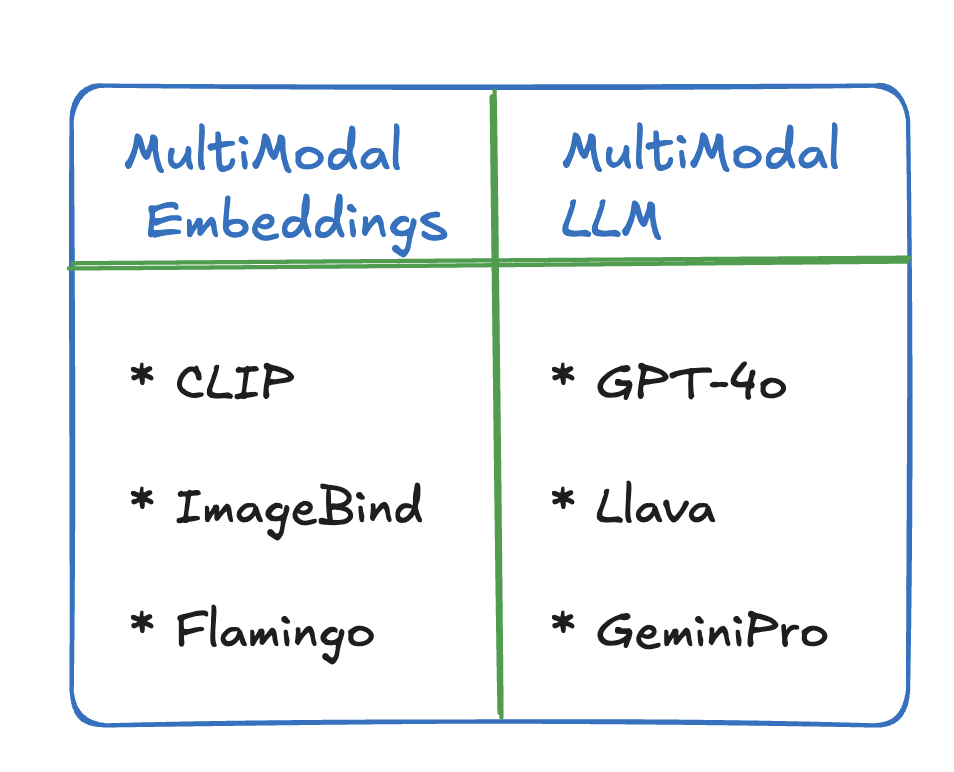{ loading=lazy }

* **Usecases for Multimodal RAG**

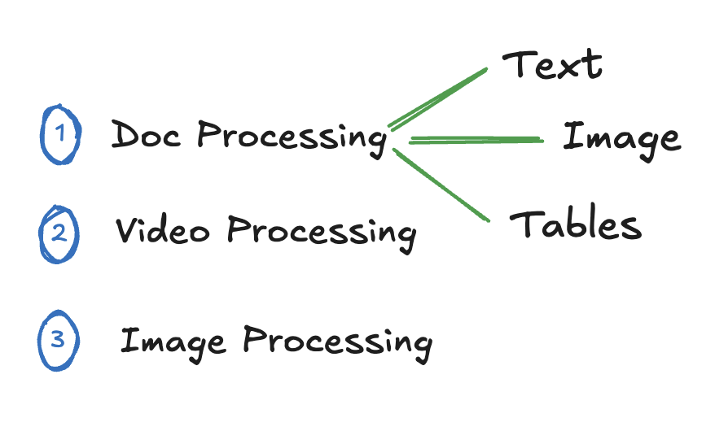{ loading=lazy }

Let’s continue by jumping over to our lab environment!


#### Multimodal RAG


#### Deploy Multimodal RAG


Whenever we develop applications based on Large Language Models (LLMs), handling data is a crucial aspect. As discussed in the previous section (RAG), data injection is the initial step in this process. It's important to note that there are typically three types of data structure.

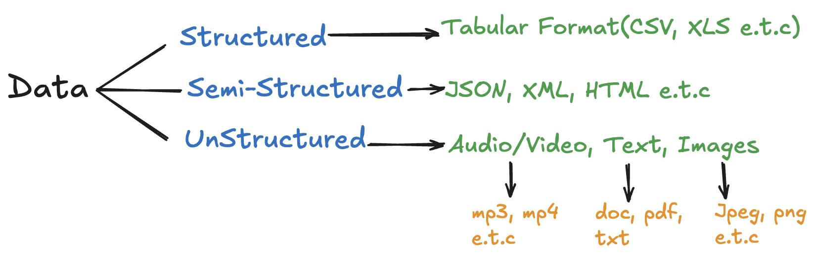{ loading=lazy }

##### Task 1: Log into the Lab Environment

    
{ loading=lazy }

* Open Google Colab and create a new notebook. Click on "File" > "New notebook". Please refer to the [following section](../index.md#module-1) to create Google Colab account.

{ loading=lazy }

* Change Runtime Environment: Click the “Runtime” dropdown menu at the top of the Colab interface.

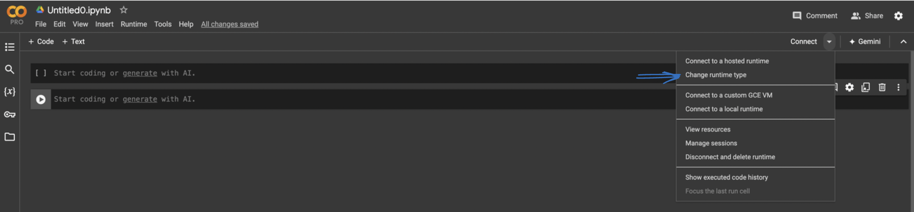{ loading=lazy }

* Select “Change runtime type”: This will open a dialog box where you can configure the runtime environment.

* Select Hardware Accelerator: From the “Hardware accelerator” dropdown menu, choose >> T4 GPU 

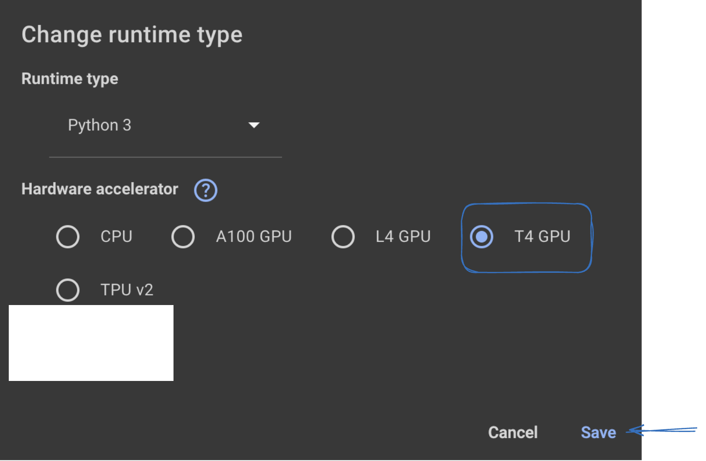{ loading=lazy }

* Save Settings: Click “Save” to apply the changes.

!!! note
    Whenever you want to copy the code in Google Colab and run it, be sure to click on + Code to add a new code cell.

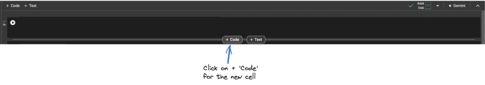{ loading=lazy }

!!! important
    Click the play button to the left of the code, or use the keyboard shortcut "Command/Ctrl+Enter" while the cell is selected.

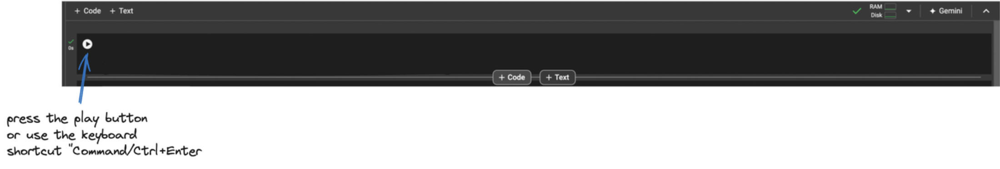{ loading=lazy }


###### Set OpenAI token - MultiModal

            
!!! important
    Optional Step (Information Only) - First, create an account from the [OpenAI official website](https://platform.openai.com/).If you’ve already obtained the token in a previous step or section, you can skip this part. It should be in the .txt file you downloaded at the beginning of the lab. 

* Create a new project API key by browsing to [API Keys web page](https://platform.openai.com/api-keys). Select Create new secret key. The API key is automatically generated. Save the APi Key as we will be using it in the later steps .

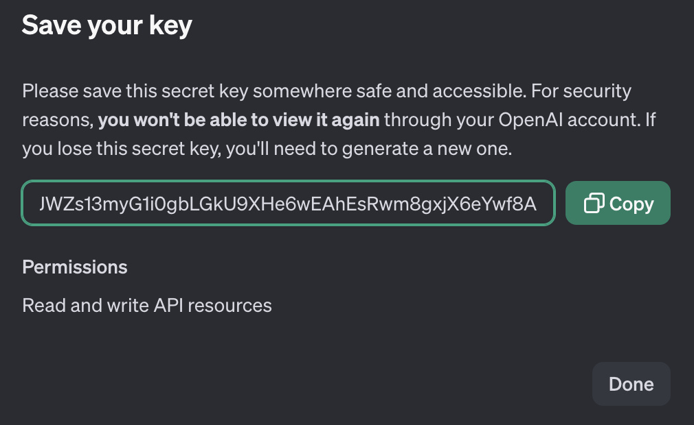{ loading=lazy }

* Within your existing Google Colab notebook navigate to the new “Secrets” section in the sidebar.

{ loading=lazy }

* Click on “Add a new secret.” Enter the name example: OPENAI_API_KEY and value of the secret(the API key created above). Note: The name is permanent once set. 

* The list of secrets is global across all your notebooks.

* Use the “Notebook access” toggle to grant or revoke access to a secret for each notebook.

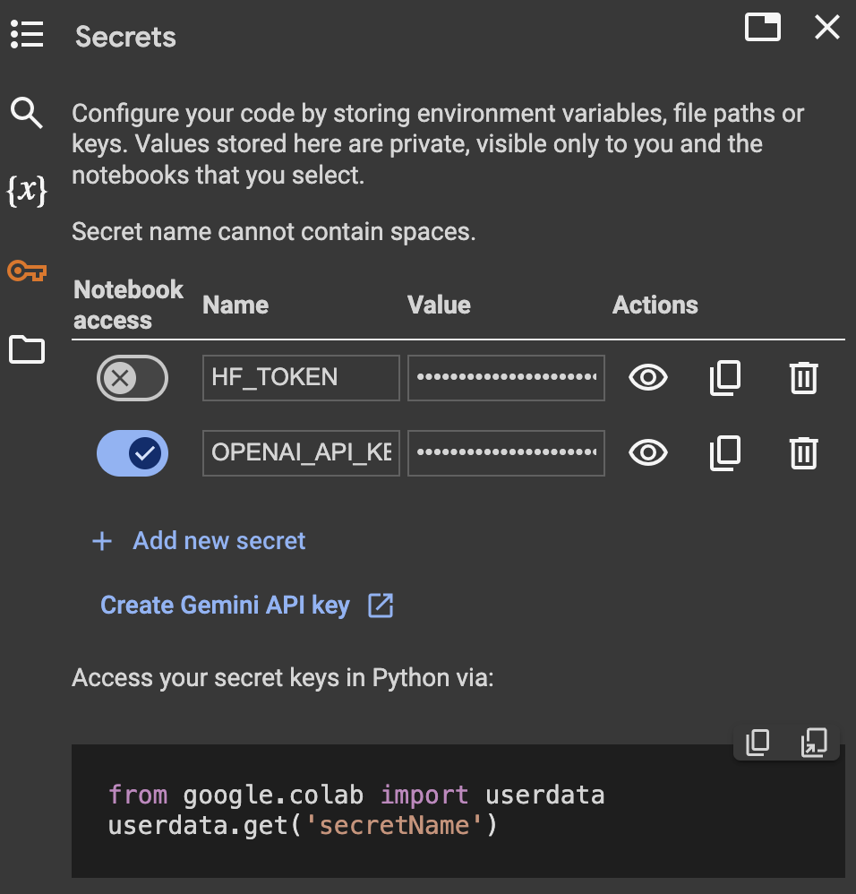{ loading=lazy }


###### Update Google Colab envoirnment and install packages

!!! note
    To avoid errors, overlap, or dependencies from previous tasks, open a new Google Colab notebook for this step. This will ensure a clean environment and prevent any potential issues related to previous work.

PDFs often contain tables and other structured data that can be challenging to split accurately using character-based embedding techniques. For PDFs, it's important to extract and chunk all elements, including tables, effectively. We'll accomplish this using the <a href="https://unstructured.io/" target="_blank">Unstructured</a>, which is specifically designed for handling such tasks. If you have a large collection of PDFs, <a href="https://unstructured.io/" target="_blank">Unstructured</a> is an excellent tool to manage them efficiently.

* Install relevant libraries including <a href="https://unstructured.io/" target="_blank">Unstructured</a> . Unstructured will partition PDF files by first removing all embedded image blocks. Then it will use a layout model (YOLOX) to get bounding boxes (for tables) as well as titles.

```py linenums="1"
!pip install "unstructured[all-docs]" pillow pydantic lxml matplotlib langchain langchain_community chromadb langchain-experimental langchain_openai langchain-text-splitters

```
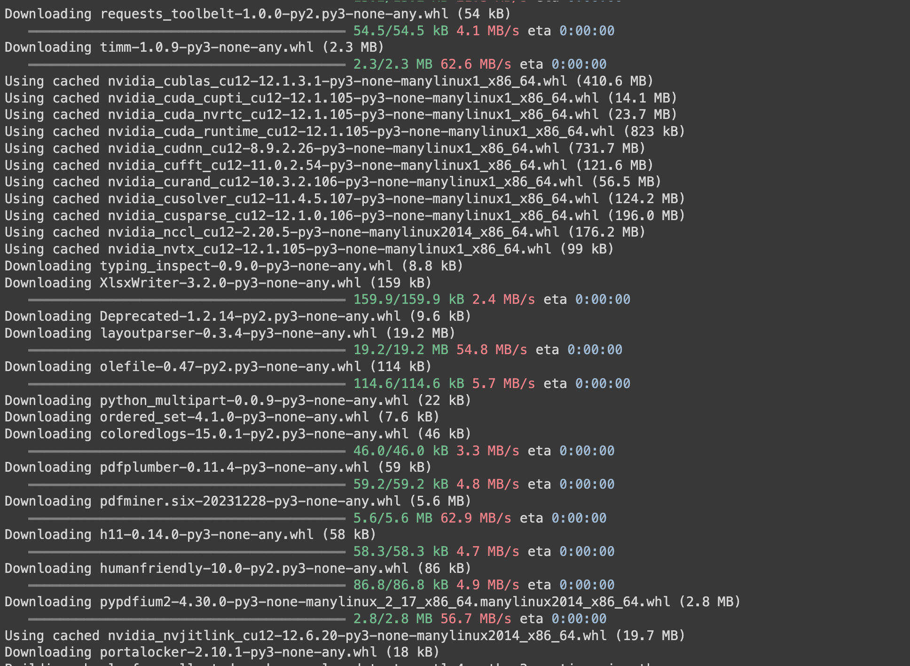{ loading=lazy }

!!! note
    Make sure to RESTART your notebook after installing the packages

* Since Google Colab is built on top of an Ubuntu environment, it's necessary to update the Google Colab environment to ensure we can effectively extract information from images or PDFs for analysis and processing.

```py linenums="1"
!sudo apt-get update
```

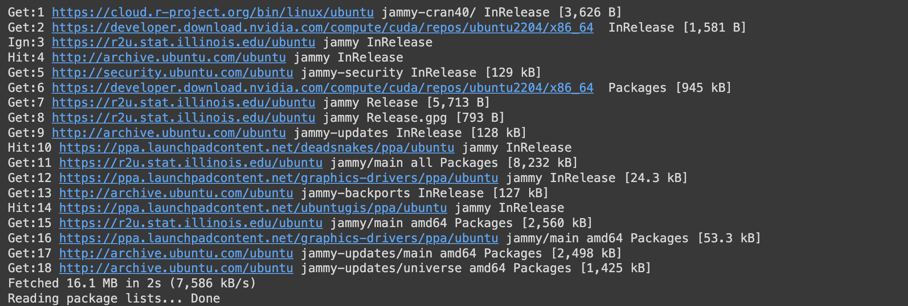{ loading=lazy }

* Poppler-utils will help us extracting info from our pdf

```py linenums="1"
!sudo apt-get install poppler-utils
```

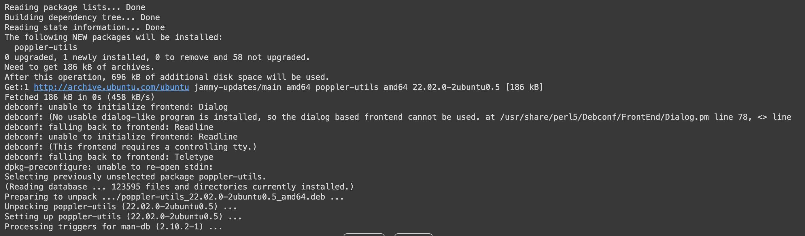{ loading=lazy }

```py linenums="1"
!sudo apt-get install libleptonica-dev tesseract-ocr libtesseract-dev python3-pil tesseract-ocr-eng tesseract-ocr-script-latn
```

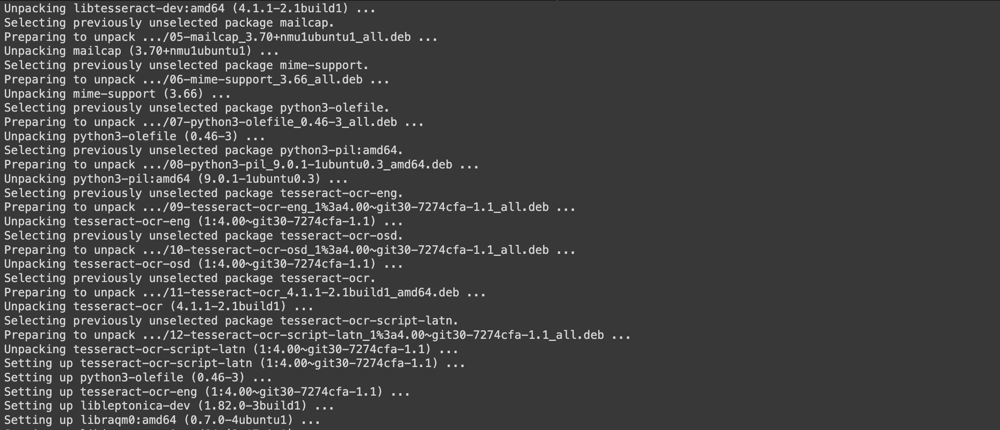{ loading=lazy }

```py linenums="1"
!pip install unstructured-pytesseract
!pip install tesseract-ocr
```

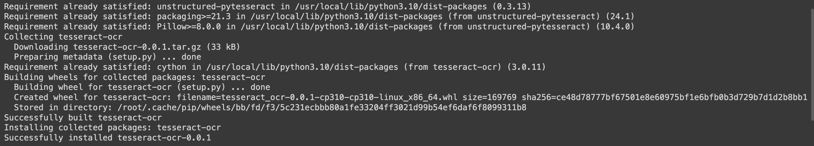{ loading=lazy }

* In Google Colab, I noticed some challenges with the NLTK library, so let's set the path correctly to resolve these issues.

```py linenums="1"
import os
# Set the NLTK_DATA environment variable to the correct path
os.environ['NLTK_DATA'] = '/root/nltk_data'
```

* Let's make sure we have nltk version 3.9.1 or 3.9.3 installed

```py linenums="1"
!pip install --upgrade nltk
```

* Check version of nltk
```
import nltk
print(nltk.__version__)
```

```
import nltk
nltk.download('punkt_tab')
nltk.download('averaged_perceptron_tagger')
nltk.download('averaged_perceptron_tagger_eng')
```

* Let's load our data, by browsing to "PDF with table" tab


###### PDF with table

                
* Let's load our PDF files into Google Colab. For this example, we can use the article titled "Webex Customer Experience Essentials" from the [Webex Help Center](https://help.webex.com/en-us/article/72sb3r/Webex-Customer-Experience-Essentials). You can  [download the modified article here](../assets/static/CX-Essentials.pdf){:target="_blank" download="CX-Essentials.pdf"} as we will be using in the next step.

!!! download
    To save time and speed up processing in this lab, I have modified the CX-Essentials.pdf file by reducing it to only a few pages. You can download this version from the modified link provided above.

* Within Google Colab, Click on Folder and create a new folder called "dat"

{ loading=lazy }

* Click on [...], select Upload

{ loading=lazy }

* Choose your CX-Essentials.pdf file and click Open

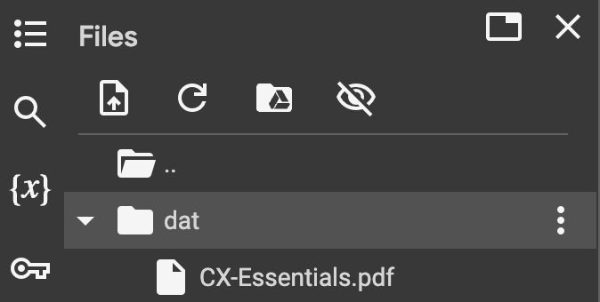{ loading=lazy }

* Let's process our PDF document by splitting it into smaller, manageable chunks based on titles, extracting images, and handling text in a way that ensures the chunks are neither too large nor too small. We will store the extracted elements (text, images, etc.) in the pdf_elements variable, and images are saved in the specified path(image_path). To understand more about <a href="https://docs.unstructured.io/open-source/core-functionality/partitioning#partition-csv" target="_blank">unstructured partition_pdf, click here</a>.

!!! important 
    Unstructured will partition PDF files by first extracting embedded images if specified. It then processes the document's layout, dividing the content into structured elements such as titles, tables, and paragraphs based on the layout and text structure. For more detailed layout analysis, it may use advanced models like YOLOX to identify and extract bounding boxes for elements like tables and titles. This allows for the precise extraction and organization of text and images, making the content more suitable for further analysis and processing.

```py linenums="1"
from unstructured.partition.pdf import partition_pdf
image_path = "./content/images"
pdf_elements = partition_pdf(
    filename="/content/dat/CX-Essentials.pdf",
    chunking_strategy="by_title",
    extract_images_in_pdf=True,
    # extract_image_block_types=["Image", "Table"],
    max_characters=3000, # Sets the maximum number of characters
    new_after_n_chars=2800, # Character threshold after which a new chunk will start. Ensures  chunks are created before the max_characters limit is reached
    combine_text_under_n_chars=2000, #If chunk of text is smaller than 2000 characters, it should be combined with the following chunk to create a more substantial piece 
    image_output_dir_path=image_path
)
```

{ loading=lazy }

!!! note
    This process may take a few minutes to complete as we are extracting information from the PDF.

* You'll also notice that a folder has been created containing all the extracted images.

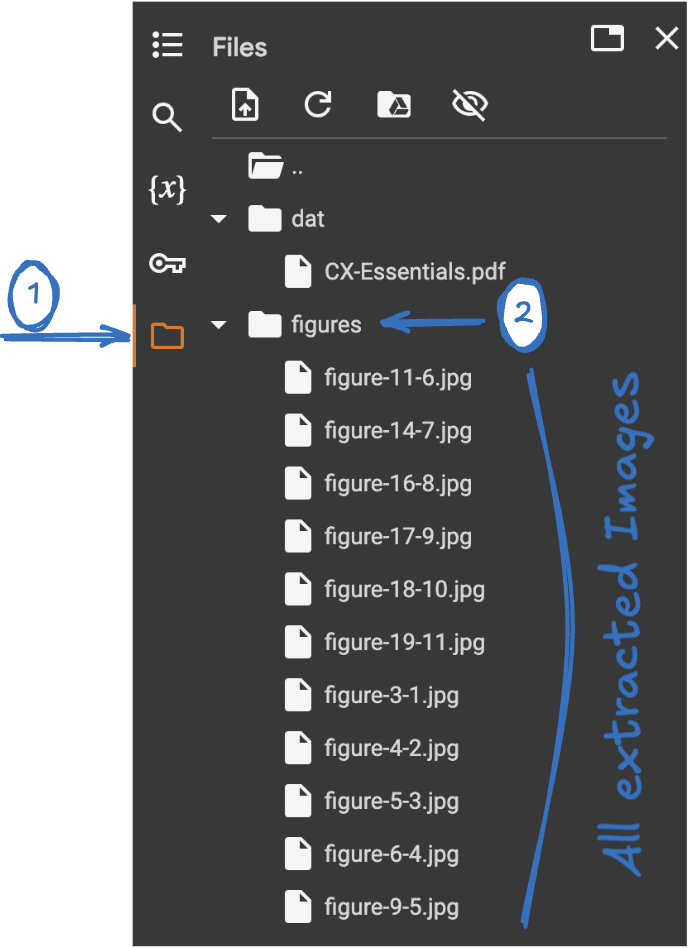{ loading=lazy }

!!! note
    This images might differ in the lab

* To see different elements from our pdf we can look into the variable

```py linenums="1"
pdf_elements
```

!!! important
    Since we are working with a modified CX-Essentials.pdf file, you may notice that there are no pdf_elements or tables.

{ loading=lazy }

* Let's categorize extracted elements from a PDF into two types: text elements and table elements. 

```py linenums="1"
# Categorize elements by type
def categorize_elements(raw_pdf_elements):
    """
    raw_pdf_elements: List of unstructured.documents.elements
    """
    tables = []
    texts = []
    for element in raw_pdf_elements:
        if "unstructured.documents.elements.Table" in str(type(element)):
            tables.append(str(element))
        elif "unstructured.documents.elements.CompositeElement" in str(type(element)):
            texts.append(str(element))
    return texts, tables

texts, tables = categorize_elements(pdf_elements)
```

```py linenums="1"
texts
```

{ loading=lazy }

```py linenums="1"
tables
```

!!! note
    The output will be blank when running the table command as the modified file doesnot have any tables.

{ loading=lazy }


* Let's now create summary from our data by passing the info to Multimodal model

!!! note
    We will be using GPT-4o as our Multimodal to create summary

* Let's retrieve an OpenAI API key and set it as an environment variable within the Colab environment

```py linenums="1"
import os
from dotenv import load_dotenv
from google.colab import userdata
OPENAI_API_TOKEN=userdata.get('OPENAI_API_KEY')
os.environ["OPENAI_API_KEY"] = OPENAI_API_TOKEN
# load_dotenv()
```

* Let's create a summary for our text element

```py linenums="1"
                    
from langchain_core.output_parsers import StrOutputParser
from langchain_core.prompts import PromptTemplate
from langchain_core.messages import AIMessage
from langchain_core.runnables import RunnableLambda
from langchain_core.output_parsers import StrOutputParser
from langchain_core.prompts import ChatPromptTemplate
from langchain_openai import ChatOpenAI


# Generate summaries of text elements
def generate_text_summaries(texts, tables, summarize_texts=False):
    """
    Summarize text elements
    texts: List of str
    tables: List of str
    summarize_texts: Bool to summarize texts
    """

    # Prompt
    prompt_text = """You are an assistant tasked with summarizing tables and text for retrieval. \
    These summaries will be embedded and used to retrieve the raw text or table elements. \
    Give a concise summary of the table or text that is well-optimized for retrieval. Table \
    or text: {element} """
    prompt = PromptTemplate.from_template(prompt_text)
    empty_response = RunnableLambda(
        lambda x: AIMessage(content="Error processing document")
    )
    # Model
    model = ChatOpenAI(temperature=0, model="gpt-4o")
    summarize_chain = {"element": lambda x: x} | prompt | model | StrOutputParser()

    # Initialize empty summaries
    text_summaries = []
    table_summaries = []

    # Apply to text if texts are provided and summarization is requested
    if texts and summarize_texts:
        text_summaries = summarize_chain.batch(texts, {"max_concurrency": 1})
    elif texts:
        text_summaries = texts

    # Apply to tables if tables are provided
    if tables:
        table_summaries = summarize_chain.batch(tables, {"max_concurrency": 1})

    return text_summaries, table_summaries


# Get text, table summaries
text_summaries, table_summaries = generate_text_summaries(
    texts, tables, summarize_texts=True
)
```

* Now Let's create summary for our images 

```py linenums="1"
import base64
import os

from langchain_core.messages import HumanMessage

def encode_image(image_path):
    """Getting the base64 string"""
    with open(image_path, "rb") as image_file:
        return base64.b64encode(image_file.read()).decode("utf-8")

def image_summarize(img_base64, prompt):
    """Make image summary"""
    model = ChatOpenAI(temperature=0, model="gpt-4o")
    msg = model.invoke(
        [
            HumanMessage(
                content=[
                    {"type": "text", "text": prompt},
                    {
                        "type": "image_url",
                        "image_url": {"url": f"data:image/jpeg;base64,{img_base64}"},
                    },
                ]
            )
        ]
    )
    return msg.content

def generate_img_summaries(path):
    """
    Generate summaries and base64 encoded strings for images
    path: Path to list of .jpg files extracted by Unstructured
    """
    # Store base64 encoded images
    img_base64_list = []
    # Store image summaries
    image_summaries = []
    # Prompt
    prompt = """You are an assistant tasked with summarizing images for retrieval. \
    These summaries will be embedded and used to retrieve the raw image. \
    Give a concise summary of the image that is well optimized for retrieval."""

    # Apply to images
    for img_file in sorted(os.listdir(path)):
        if img_file.endswith(".jpg"):
            img_path = os.path.join(path, img_file)
            base64_image = encode_image(img_path)
            img_base64_list.append(base64_image)
            image_summaries.append(image_summarize(base64_image, prompt))

    return img_base64_list, image_summaries

fpath = "/content/figures"
# Image summaries
img_base64_list, image_summaries = generate_img_summaries(fpath)
```

```py linenums="1"
image_summaries[0]
```

!!! important
    This will generate a list of image summaries, each corresponding to an image in the figures directory. For example, if there are 11 images extracted from the PDF, you can access the summary for the 11th image by running: image_summaries[10]


{ loading=lazy }

{ loading=lazy }

* Let's now create our MultiVector Retriever and RAG system - incl storing summary embeddings in Vector DB. Lets jump to "Create our MultiVector Retriever" tab

{ loading=lazy }


###### Create our MultiVector Retriever

                    
* While on the same notebook, let's install packages for chroma, our in-memory db and MultiVectorRetriever

```py linenums="1"
!pip install -qU langchain-classic
```

```py linenums="1"
import uuid
from langchain_classic.retrievers import MultiVectorRetriever   
from langchain_core.stores import InMemoryStore                 
from langchain_community.vectorstores import Chroma
from langchain_core.documents import Document
from langchain_openai import OpenAIEmbeddings
```

```py linenums="1"
!pip install -U langchain-chroma
```

* Let's create our function to build a multi-vector retriever. We will use OpenAI embeddings and create a Chroma vector store to index our summaries. This function will allow us to index summaries of texts, tables, and images, while retrieving the raw data (texts, tables, or images) based on those summaries. By leveraging the OpenAI embeddings, our Chroma vector store will effectively handle and retrieve multimodal content.

```py linenums="1"

import uuid
# use langchain_classic for MultiVectorRetriever
from langchain_classic.retrievers import MultiVectorRetriever

# use langchain_core for Document + InMemoryStore
from langchain_core.documents import Document
from langchain_core.stores import InMemoryStore

# vector store + embeddings
from langchain_chroma import Chroma
from langchain_openai import OpenAIEmbeddings

def create_multi_vector_retriever(
    vectorstore, text_summaries, texts, table_summaries, tables, image_summaries, images
):
    """
    Create retriever that indexes summaries, but returns raw images or texts
    """

    # Initialize the storage layer
    store = InMemoryStore()
    id_key = "doc_id"

    # Create the multi-vector retriever
    retriever = MultiVectorRetriever(
        vectorstore=vectorstore,
        docstore=store,
        id_key=id_key,
    )
    # Helper function to add documents to the vectorstore and docstore
    def add_documents(retriever, doc_summaries, doc_contents):
        doc_ids = [str(uuid.uuid4()) for _ in doc_contents]
        summary_docs = [
            Document(page_content=s, metadata={id_key: doc_ids[i]})
            for i, s in enumerate(doc_summaries)
        ]
        retriever.vectorstore.add_documents(summary_docs)
        retriever.docstore.mset(list(zip(doc_ids, doc_contents)))

    # Add texts, tables, and images
    # Check that text_summaries is not empty before adding
    if text_summaries:
        add_documents(retriever, text_summaries, texts)
    # Check that table_summaries is not empty before adding
    if table_summaries:
        add_documents(retriever, table_summaries, tables)
    # Check that image_summaries is not empty before adding
    if image_summaries:
        add_documents(retriever, image_summaries, images)

    return retriever

# The vectorstore to use to index the summaries
vectorstore = Chroma(
    collection_name="mm_ai_lab_cl",
    embedding_function=OpenAIEmbeddings(),
    # embedding_function=VertexAIEmbeddings(model_name="textembedding-gecko@latest"),
)

# Create retriever
retriever_multi_vector_img = create_multi_vector_retriever(
    vectorstore,
    text_summaries,
    texts,
    table_summaries,
    tables,
    image_summaries,
    img_base64_list,
)
```

```py linenums="1"
retriever_multi_vector_img
```

{ loading=lazy }


###### Create our RAG (Multimodal)


                            
* Let's create a multi_modal_rag_chain(retriever). This pipeline integrates both text and image data to enhance the quality of responses generated by an AI model

``` py linenums="1"

import io
import re
import base64
from IPython.display import Image, display
from PIL import Image as PILImage
from langchain_core.runnables import RunnableLambda, RunnablePassthrough


def looks_like_base64(sb):
    """Check if the string looks like base64"""
    return re.match("^[A-Za-z0-9+/]+[=]{0,2}$", sb) is not None

def is_image_data(b64data):
    """
    Check if the base64 data is an image by looking at the start of the data
    """
    image_signatures = {
        b"\xFF\xD8\xFF": "jpg",
        b"\x89\x50\x4E\x47\x0D\x0A\x1A\x0A": "png",
        b"\x47\x49\x46\x38": "gif",
        b"\x52\x49\x46\x46": "webp",
    }
    try:
        header = base64.b64decode(b64data)[:8]  # Decode and get the first 8 bytes
        for sig, format in image_signatures.items():
            if header.startswith(sig):
                return True
        return False
    except Exception:
        return False


def resize_base64_image(base64_string, size=(128, 128)):
    """
    Resize an image encoded as a Base64 string
    """
    # Decode the Base64 string
    img_data = base64.b64decode(base64_string)
    img = PILImage.open(io.BytesIO(img_data))

    # Resize the image
    resized_img = img.resize(size, PILImage.LANCZOS)

    # Save the resized image to a bytes buffer
    buffered = io.BytesIO()
    resized_img.save(buffered, format=img.format)

    # Encode the resized image to Base64
    return base64.b64encode(buffered.getvalue()).decode("utf-8")

def split_image_text_types(docs):
    """
    Split base64-encoded images and texts
    """
    b64_images = []
    texts = []
    for doc in docs:
        # Check if the document is of type Document and extract page_content if so
        if isinstance(doc, Document):
            doc = doc.page_content
        if looks_like_base64(doc) and is_image_data(doc):
            doc = resize_base64_image(doc, size=(1300, 600))
            b64_images.append(doc)
        else:
            texts.append(doc)
    if len(b64_images) > 0:
        return {"images": b64_images[:1], "texts": []}
    return {"images": b64_images, "texts": texts}

def img_prompt_func(data_dict):
    """
    Join the context into a single string
    """
    formatted_texts = "\n".join(data_dict["context"]["texts"])
    messages = []

    # Adding the text for analysis
    text_message = {
        "type": "text",
        "text": (
            "You are an AI scientist tasking with providing factual answers.\n"
            "You will be given a mixed of text, tables, and image(s) usually of charts or graphs.\n"
            "Use this information to provide answers related to the user question. \n"
            f"User-provided question: {data_dict['question']}\n\n"
            "Text and / or tables:\n"
            f"{formatted_texts}"
        ),
    }
    messages.append(text_message)
    # Adding image(s) to the messages if present
    if data_dict["context"]["images"]:
        for image in data_dict["context"]["images"]:
            image_message = {
                "type": "image_url",
                "image_url": {"url": f"data:image/jpeg;base64,{image}"},
            }
            messages.append(image_message)
    return [HumanMessage(content=messages)]

def multi_modal_rag_chain(retriever):
    """
    Multi-modal RAG chain
    """
    model = ChatOpenAI(temperature=0, model="gpt-4o")

    # RAG pipeline
    chain = (
        {
            "context": retriever | RunnableLambda(split_image_text_types),
            "question": RunnablePassthrough(),
        }
        | RunnableLambda(img_prompt_func)
        | model
        | StrOutputParser()
    )

    return chain

# Create RAG chain
chain_multimodal_rag = multi_modal_rag_chain(retriever_multi_vector_img)

```

!!! challenge
    Let's Query our Multimodal Retriever

* Open your CX-Essentials.pdf, and let's try querying some information from it.


```py linenums="1"
query = """how can I Upgrade call queue from Customer Experience Basic to Customer Experience Essentials. explain images if any there as well"""
docs = chain_multimodal_rag.invoke(query)
print(docs)
```


```py linenums="1"
query = """how can I Assign Customer Experience Essentials license to users"""
docs = retriever_multi_vector_img.invoke(query, limit=1)
```

```py linenums="1"
# To display the image
for doc in docs:
    if looks_like_base64(doc) and is_image_data(doc):
        image_data = base64.b64decode(doc)
        display(Image(data=image_data))
    else:
        print(doc)
```
                            
* You'll notice that in our multimodal RAG system, I'm now able to retrieve images, tables, and text seamlessly.

{ loading=lazy }

---

**What We Did in This Module**

In the earlier RAG modules, we worked exclusively with text we loaded PDFs, chunked the text, embedded it, stored it in a vector database, and retrieved relevant passages to answer questions. That works well when your documents are purely text-based.

In this module, we tackled a harder problem: **what happens when your documents contain images, tables, and text together?** Real-world documents product guides, reports, support articles are rarely just text. Tables hold structured data that matters. Images convey information that words alone can't capture.

To handle this, we used a **Multimodal RAG** approach:

* We extracted **text, tables, and images** separately from a PDF using the Unstructured library
* We generated **summaries** of each element using GPT-4o turning tables and images into text descriptions
* We stored those summaries as embeddings in ChromaDB, but linked them back to the **original raw content**
* We built a **MultiVector Retriever** that searches on summaries but returns the actual tables, images, and text
* We chained it all into a RAG pipeline that can answer questions using **all three modalities**

**How does this compare to the previous modules?**

You might be wondering we already worked with images in Part 2 · Module 4 (Gemini Embedding 2). How is this different?

In Part 2 · Module 4, we used Gemini Embedding 2 to embed text, images, and audio **natively** into a single unified space. That model understands images directly you feed it a photo and it returns an embedding. No summarization needed. That's great for **search and retrieval** across modalities.

In this module, we took a different approach. We used **GPT-4o to summarize** images and tables into text, then embedded those summaries. The retriever searches on summaries but returns the **original raw content** (actual images, HTML tables). This approach works with any embedding model you don't need a natively multimodal one. It's more flexible but requires an extra summarization step.

| | Part 2 · Module 4 (Gemini Embed 2) | Module 1 (Text RAG) | Module 2 (File Search) | Module 3 (Multimodal RAG) |
|---|---|---|---|---|
| **Data types** | Text + Images + Audio | Text only | Text only (managed) | Text + Tables + Images |
| **Embedding** | Native multimodal (direct) | Text only | Managed by Gemini | Summaries via GPT-4o |
| **Needs LLM for indexing?** | No | No | No | Yes (summarization) |
| **Retrieval returns** | Matching embeddings | Text chunks | Text chunks (managed) | Raw content (text, tables, images) |
| **Best for** | Cross-modal search | Document Q&A | Quick prototyping | Complex docs with mixed content |

Both multimodal approaches are valid Gemini Embedding 2 is simpler and handles raw images directly, while the summarization approach in this module works with any LLM and gives you more control over how visual content is represented. The right choice depends on your use case.

<p align="right"> 👉 This concludes the task. Click the next **Module** on the left to continue. </p>


<a class="next-card" href="../part-4/">
  <span class="nc-k">Next · Part 4</span>
  <span class="nc-t">GenAI Frameworks & Open Models</span>
  <span class="nc-u">Part 4 →</span>
</a>
