## About this lab { #about data-toc-label="About this lab" }

In [Part 3](../part-3/index.md) you built RAG pipelines. In this last part you meet the frameworks and model providers developers use to ship AI apps: **LangChain** use cases with Webex, **Groq**'s high-speed LPU engine with open-source models, and **Hugging Face** models through **OpenAI-compatible APIs**. The lab ends with a summary of everything you learned.

### Lab at a glance { #glance data-toc-label="Lab at a glance" }

<div class="glance build" markdown>

| | Module | What you do |
|---|---|---|
| 1 | [GenAI Frameworks](#module-1) | Explore popular GenAI frameworks for building AI-powered applications at scale |
| 2 | [Groq and Open Source Models](#module-2) | Use Groq's high-speed LPU engine with open-source models like GPT-OSS for cost-free inference |
| 3 | [Hugging Face and OpenAI-Compatible APIs](#module-3) | Use Hugging Face models with OpenAI-compatible endpoints for flexible integration |

</div>

### How to use this guide { #how-to data-toc-label="How to use this guide" }

Each part of the lab lives on **one page**. Scroll down and work through it in order.

- The **TREE** on the left shows where you are. The progress bar under it fills up as you scroll.
- Press <kbd>J</kbd> / <kbd>K</kbd> to jump to the next or previous section.
- When you finish a task, click **Mark complete** at the end of it. You get a ✓ in the tree, and your progress is saved in this browser.
- Every code block has a **copy** button in its top-right corner. Paste the code into a new Colab cell and run it.
- Click any screenshot to zoom in.

### Key Vault and lab notes { #lab-notes data-toc-label="Key Vault and notes" }

Click **`$ keys`** (bottom-right) to open the **Key Vault**. Paste your Webex Bearer token, Webex Room ID, Hugging Face, LangChain, Pinecone, Gemini and Groq keys there once, and copy them from any page of the lab.

Click **Notes** (bottom-right) to open a scratchpad that stays with you on every part of the lab guide.

!!! warning "Where your keys and notes live"
    The Key Vault and the notes are saved **only in your browser** (localStorage on this device). They are **lost** if you clear your browser data, use a different browser or computer, or open the lab in a private window. On a shared machine, click **Clear All** in the Key Vault and **Clear** in the notes before you log out.

### Your lab proctor { #proctors data-toc-label="Your lab proctor" }

Need help? Raise your hand or reach out to me.

<div class="people" markdown>

<div class="person"><span class="nm">Omer Ilyas</span><span class="rl">Technical Marketing Engineer</span><span class="em">oilyas@cisco.com</span></div>

</div>


<p class="eyebrow">Module 1</p>

## GenAI Frameworks { #module-1 data-toc-label="Module 1 · Frameworks" }


<p class="eyebrow sub">Module 1 · Task 1A</p>

### GenAI { #module-1a data-toc-label="1a · GenAI" data-task="1a" }


#### Introduction


#### Introduction


In the previous sections of this lab, we started by exploring  basics of neural networks/tokenization, which are key to understanding how modern AI models, particularly large language models (LLMs), operate. We moved on to embeddings and vector databases, which play a vital role in how these models represent and retrieve information.

We also looked into the concept of context windows and how they influence model performance. To address some of the limitations inherent in traditional context windows, we introduced Retrieval Augmented Generation (RAG). This approach enables models to dynamically retrieve relevant information, significantly improving their ability to generate accurate and contextually appropriate responses. To make you understand better, we even built a quick RAG application. Additionally, we touched on multimodal RAG, which takes this a step further by enabling the model to process and integrate information from multiple sources, such as text, images, and more, making it even more versatile.

While we’ve covered the basics, it’s crucial to recognize that the field of AI is rapidly advancing. Companies like OpenAI, Mistral, Google, Meta, and others are in a race to develop the most sophisticated large language models (LLMs). 

#### GenAI Framework

    
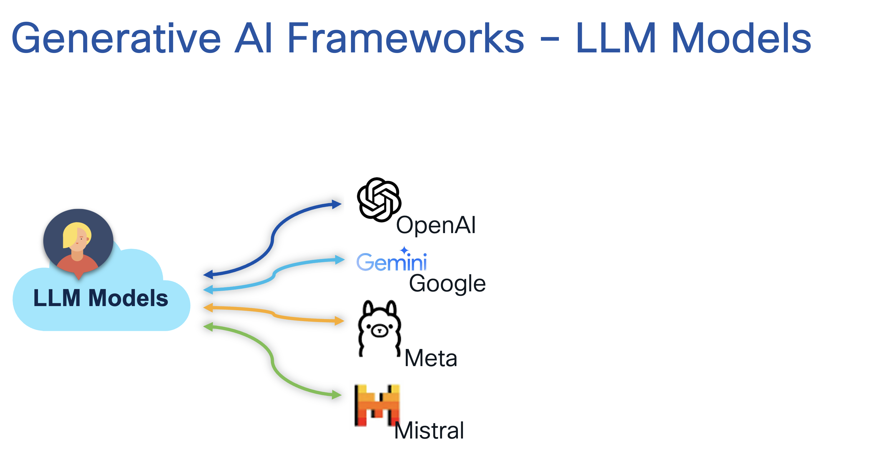{ loading=lazy }

However, effectively using these powerful LLMs in real-world scenarios involves more than just sending and receiving API requests. Challenges such as fine-tuning models, integrating them with third-party systems e.g. Webex, and ensuring they perform well in complex environments require more than what LLMs alone can offer. 

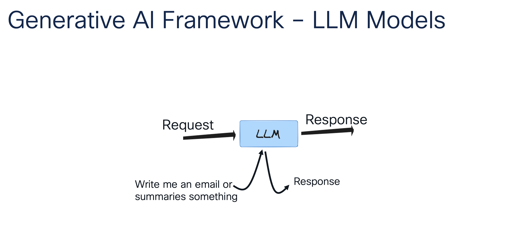{ loading=lazy }

This is where GenAI frameworks come into play, providing the essential infrastructure to bridge the gap between raw LLM capabilities and practical, scalable AI solutions. There are numerous frameworks available for use.

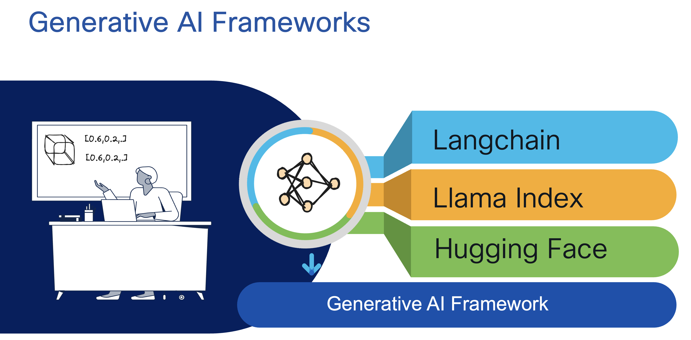{ loading=lazy }

The question of which framework to choose ultimately depends on your specific preferences and needs. Many of these frameworks have overlapping functionalities. In this section, we'll focus on 
<a href="https://python.langchain.com/v0.1/docs/get_started/introduction" target="_blank">LangChain</a>, exploring what it is and how it can be used to create AI-powered applications.

??? "Langchain"
        
    LangChain is an open-source framework that enables developers to integrate large language models (LLMs) with external data sources and computational resources. Available as a Python, JavaScript, or TypeScript package, it offers a versatile pipeline abstraction that can be used for various purposes, from creating AI enabled applications to managing data ingestion from external sources.

    While an LLM like (GPT or Gemini e.t.c) has impressive general knowledge, LangChain is essential for retrieving information from your own documents or fine-tuning models for specific tasks. It allows you to connect LLMs to your data sources, enabling actions like sending messages to a Webex Space. The process involves breaking your data or documents into smaller chunks and storing them in a vector database as embeddings. LangChain supports various vector stores, such as Chroma, Faiss, and Cassandra e.t.c making data retrieval and action-taking both efficient and seamless. <a href="https://python.langchain.com/v0.1/docs/get_started/introduction" target="_blank">More info on langchain can be found here.</a>


    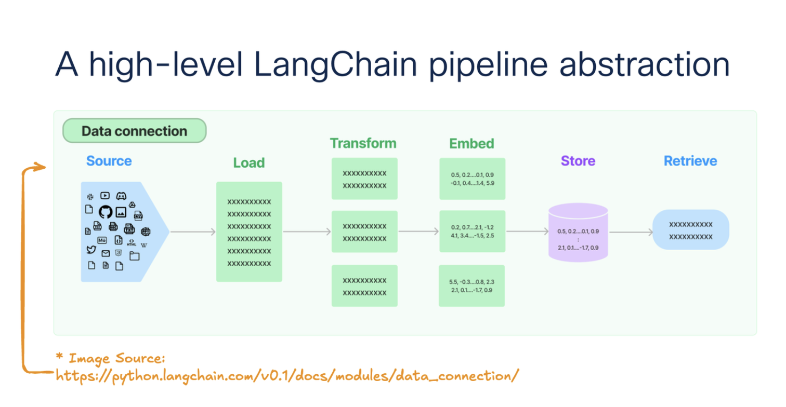{ loading=lazy }

    This below image outlines a very high-level LangChain pipeline, showing how data flows from various sources, gets loaded using specific loaders, and is transformed for further processing. Sources can be structured e.g (CSV, JSON) or unstructured (PDF, text, HTML), including online platforms like YouTube, GitHub, and Twitter. The loading stage involves selecting the right loader, which extracts content based on parameters like file paths or URLs. Once loaded, documents are split into pages and further chunked with overlap using a splitter (as mentioned in previous section). This structured processing is essential for effective retrieval and even improving the accuracy of retrieval-augmented generation (RAG) workflows.

    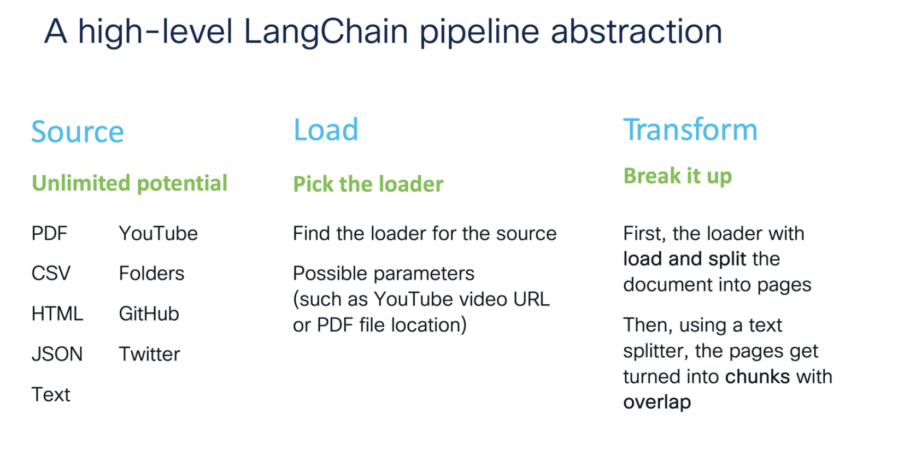{ loading=lazy }

    There are different text splitters in LangChain, which break down data into smaller chunks based on various rules like characters, tokens, HTML, Markdown, or semantics. The choice of splitter impacts how well related text stays together, affecting retrieval process.

    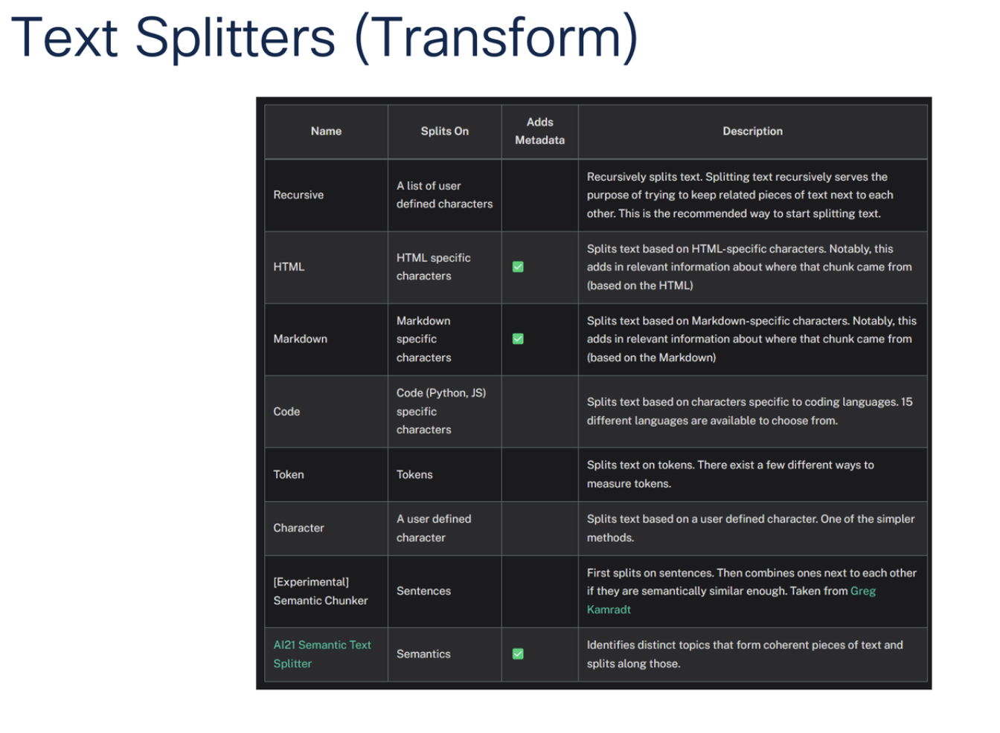{ loading=lazy }

    !!! important
        More info about Embeddings can be found in [Task4](../part-2/index.md#module-3)

    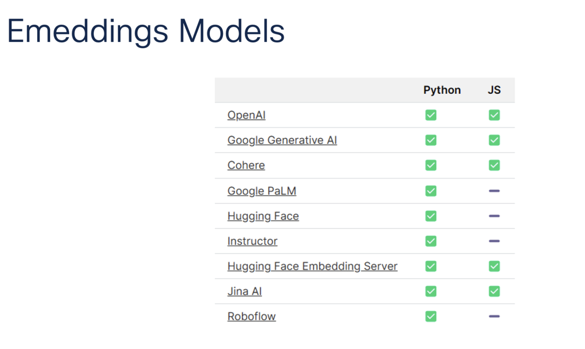{ loading=lazy }

    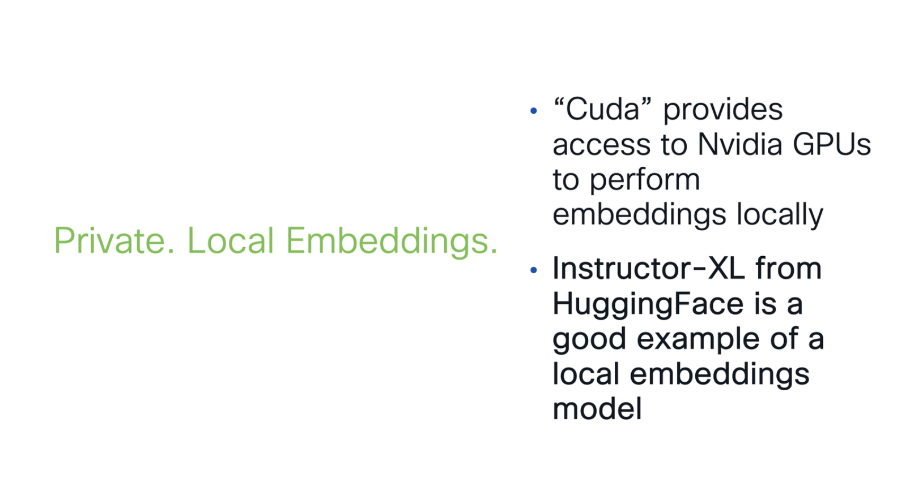{ loading=lazy }

    Below is a summary from a [Langchain blog](https://blog.langchain.dev/langchain-state-of-ai-2023/) that outlines the most commonly used LLMs, embeddings, and vector stores.

    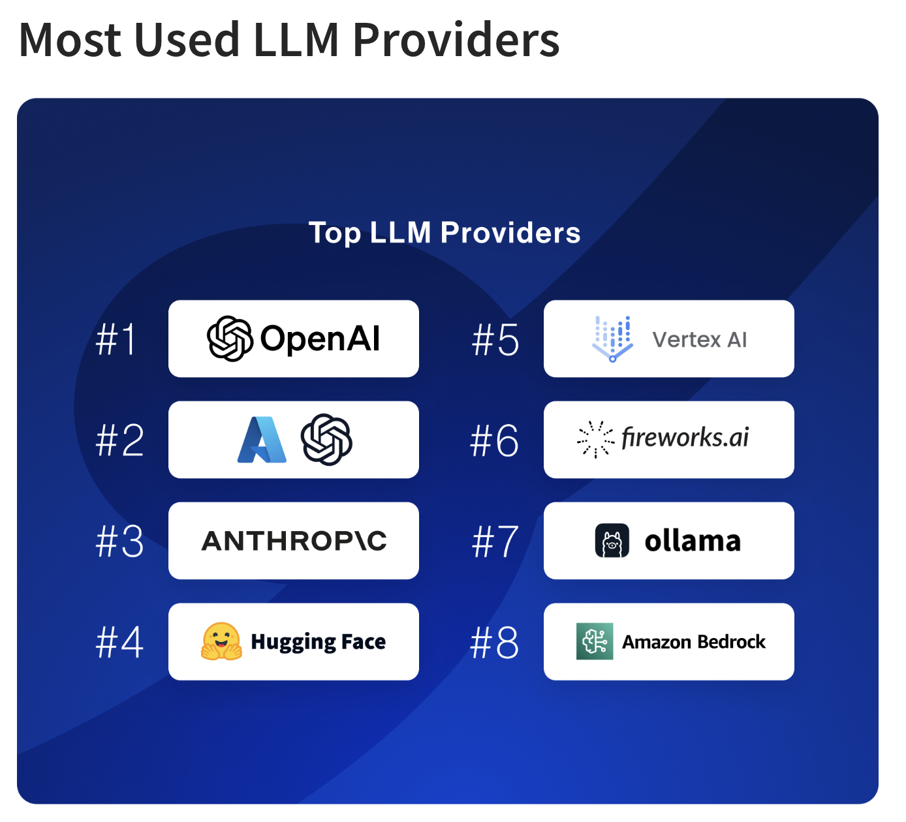{ loading=lazy }

    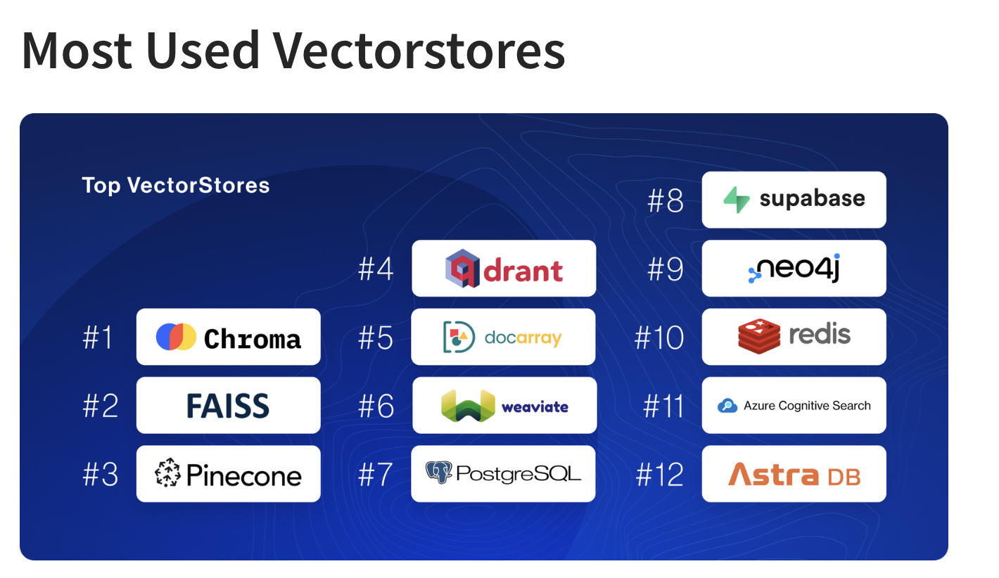{ loading=lazy }

    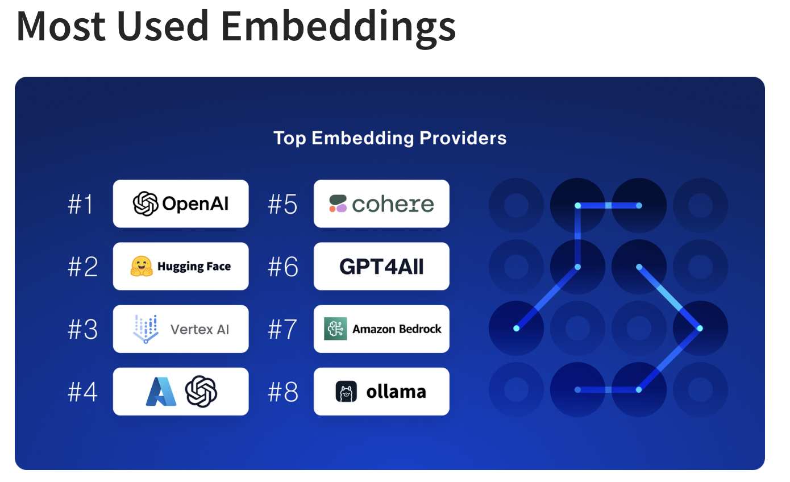{ loading=lazy }

    The beauty of Langchain lies in its ability to provide a comprehensive ecosystem, regardless of the LLM model you choose to work with. Within the Langchain ecosystem, there's a tool called Langsmith, which is designed for monitoring and debugging your applications, think of it as LLM ops. If you're building applications as APIs, Langchain offers Langserve (create services in the form of APIs). Additionally, the ecosystem includes agents, chains, retrievers, and LLM tools, making it a versatile platform for various NLP tasks.

    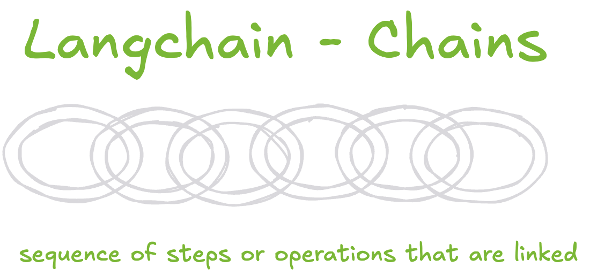{ loading=lazy }

    !!! note
        Chains are a sequence of steps or operations that are linked together to achieve a particular task. Each step in the chain can involve various processes, such as invoking a language model, performing a calculation, calling an external API, or manipulating data. Chains allow developers to structure these steps in a way that the output of one step becomes the input of the next, creating a pipeline of operations. </span>

    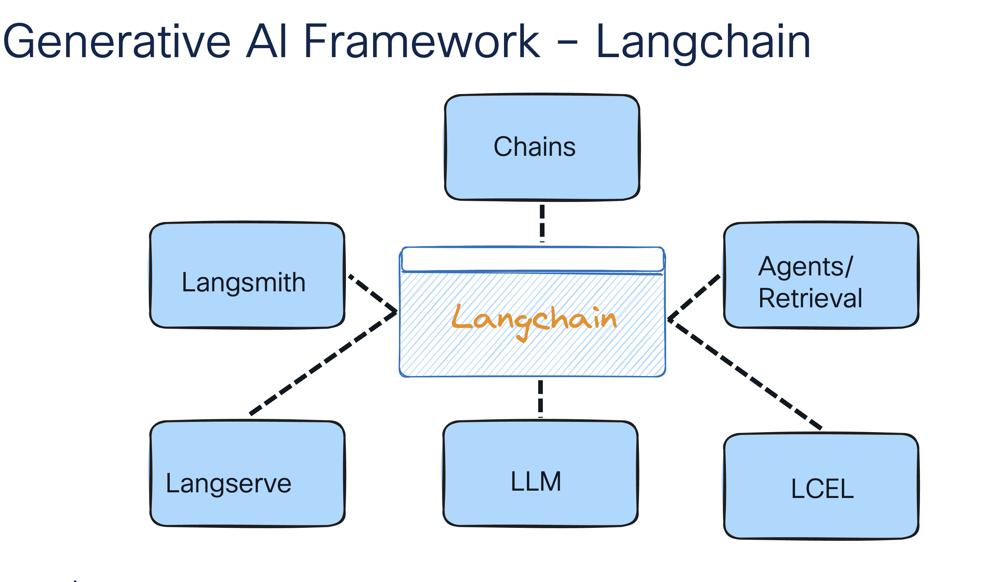{ loading=lazy }

    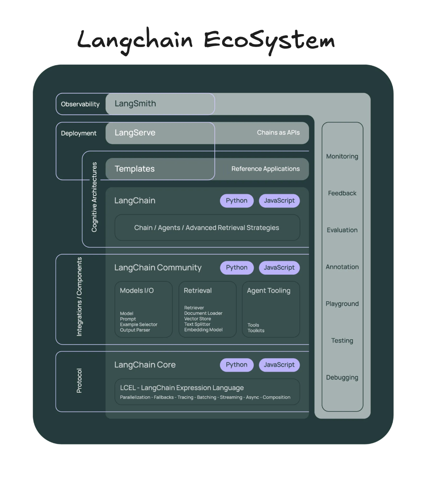{ loading=lazy }

    !!! important
        The above image was obtained from <a href="https://js.langchain.com/v0.1/docs/get_started/introduction" target="_blank">Langchain</a>

<p class="eyebrow sub">Module 1 · Task 1B</p>

### Langchain - UseCases { #module-1b data-toc-label="1b · Langchain - UseCases" data-task="1b" }


#### Labs


#### Building a simple LangChain Pipelines with Prompts, Chains, and Output Parsers


!!! important
    Log into the Lab Environment using Google Colab

{ loading=lazy }

* Open Google Colab and create a new notebook or use an existing one. Click on "File" > "New notebook". Please refer to the [following section](../index.md#module-1) to create Google Colab account.

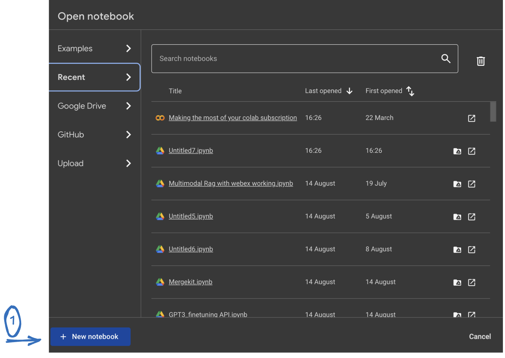{ loading=lazy }

* Make sure you are connected to a runtime. For this task, you can use the CPU as the runtime environment.

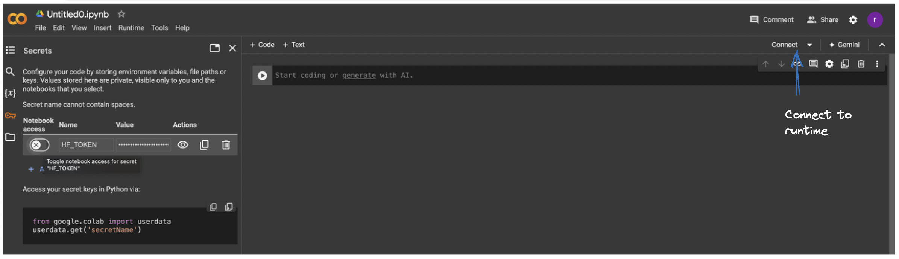{ loading=lazy }

##### Set OpenAI token


* Within your existing Google Colab notebook navigate to the new “Secrets” section in the sidebar.

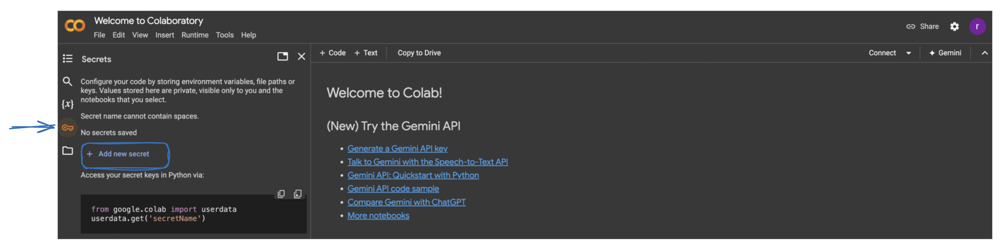{ loading=lazy }

* Click on “Add a new secret.” Enter the name example: OPENAI_API_KEY and value of the secret(the API key from .txt file). Note: The name is permanent once set. 

* The list of secrets is global across all your notebooks.

* Use the “Notebook access” toggle to grant or revoke access to a secret for each notebook.

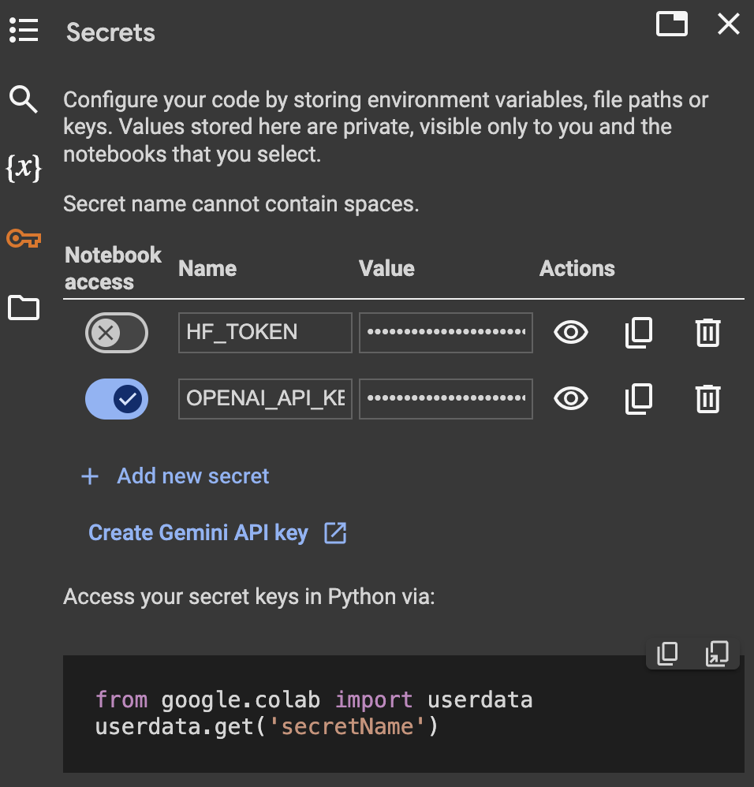{ loading=lazy }

###### Set Langchain tokens


!!! important
    Make sure you have created a Langchain account as explained in the "Getting Started with LangChain" section in [Task1](../index.md#module-1)
    or use the key provided in the .txt file called "LANGCHAIN API KEY" 
            
!!! note
    The LangChain API key is in your `.txt` file (labelled **LANGCHAIN API KEY**). 
    If you saved it in the **`$ keys`** panel earlier, click the copy button there to grab it quickly. 
    If you haven't saved it yet, open the **`$ keys`** panel (bottom-right) and paste it now you'll need it throughout this module.
                
* Copy your Langchain Key and save it 
            
!!! important
    You can  use the key that was sent in your .txt file

* Within your existing Google Colab notebook navigate again to the new “Secrets” section in the sidebar. Click on “Add a new secret.” Enter the name example: LANGSMITH_API_KEY and value of the secret(the API key created in Langchain or the one from your .txt file). 

{ loading=lazy }

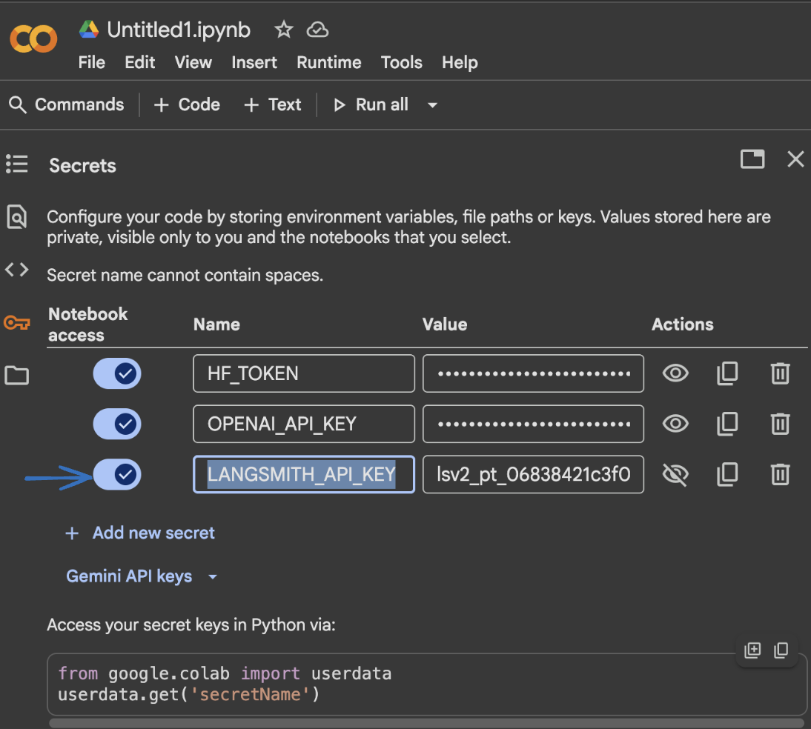{ loading=lazy }

* Let's install dependencies

```py linenums="1"
!pip install langchain langchain-openai
```

*  We will load secrets from Colab and set environment variables

```py linenums="1"

import os
from google.colab import userdata
os.environ['OPENAI_API_KEY']   = userdata.get('OPENAI_API_KEY')
os.environ['LANGSMITH_API_KEY'] = userdata.get('LANGSMITH_API_KEY')

# ✅ Set LangSmith tracing config as environment variables (so LangChain can read them)
os.environ['LANGSMITH_TRACING'] = "true"
os.environ['LANGSMITH_ENDPOINT'] = "https://api.smith.langchain.com"
os.environ['LANGSMITH_PROJECT']  = "AibyDesign"
```

* Initialize the OpenAI chat model

```py linenums="1"
from langchain_openai import ChatOpenAI
llm = ChatOpenAI(model="gpt-4o")
print(llm)
```

* Make a direct LLM call (quick sanity test)

 ```py linenums="1"
 result = llm.invoke("What is generative AI?")
 result
 ```
            
!!! important
    Now that we've made a call using the llm.invoke() method, LangSmith is actively tracing our request. This is useful for tracking and observing the flow of requests, responses, and any issues that might arise during execution. LangSmith can also be used for advanced debugging and logging.

    <b> What is Langsmith?</b>

    LangSmith is a tool integrated into LangChain that provides observability and traceability for LLMs (Large Language Models). It helps in tracking how data flows through different models, debugging issues, and analyzing model performance. LangSmith automatically captures and logs key information, such as the input, output, response time, and any intermediate steps or API calls made. It is especially useful in production systems to ensure everything is running smoothly.By logging the above API request (llm.invoke("What is generative AI?")), LangSmith will allow us to inspect and track it in detail. You'll be able to see both the input and the response from the model, any errors, and other diagnostic information in real time.

    After invoking the llm.invoke() call, we can head over to the <a href="https://smith.langchain.com/" target="_blank">LangSmith dashboard</a> to see the recorded trace.

    !!! note

        Make sure to log in using the Gmail option. If you're using the shared lab account (tmedemouserX@gmail.com), be aware that LangSmith logs can take up to 10 minutes to appear on the dashboard don't wait around for them. Continue with the rest of the lab and check back later. 
        A note on shared accounts: Since the lab Gmail accounts are used by multiple participants, you may find existing logs, traces, or projects from other sessions mixed in with yours. If you want a clean LangSmith experience with only your own logs, we'd recommend creating a free account using your personal Gmail at smith.langchain.com, generating a new API key, and replacing the LANGSMITH_API_KEY in your Colab Secrets with that key instead.
                
    Once logged in, click on the Tracing Projects tab in the sidebar. Here, you’ll see a list of all recent traces recorded by your LangChain application, including the project you created earlier, AibyDesign, and the trace corresponding to the request you just made with the question: "What is generative AI?".

    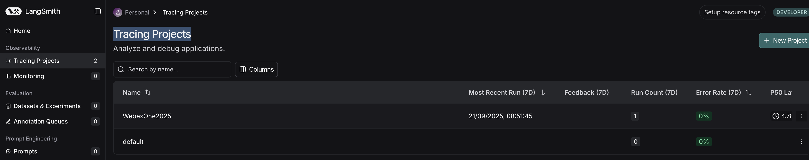{ loading=lazy }

    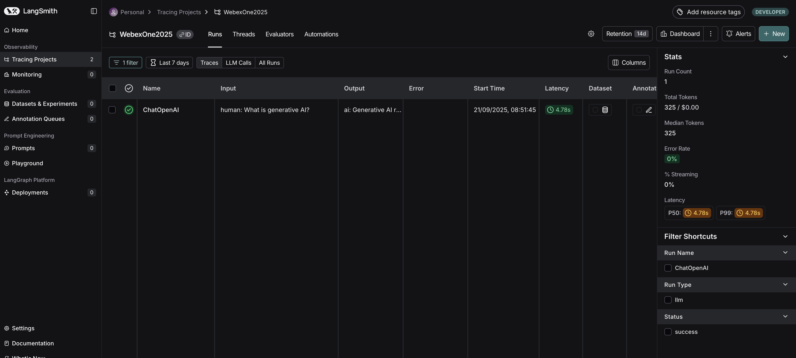{ loading=lazy }

    LangSmith also provides performance metrics such as response time, memory usage, cost  and any errors that occurred during the execution. This is helpful for debugging or optimizing model performance.

    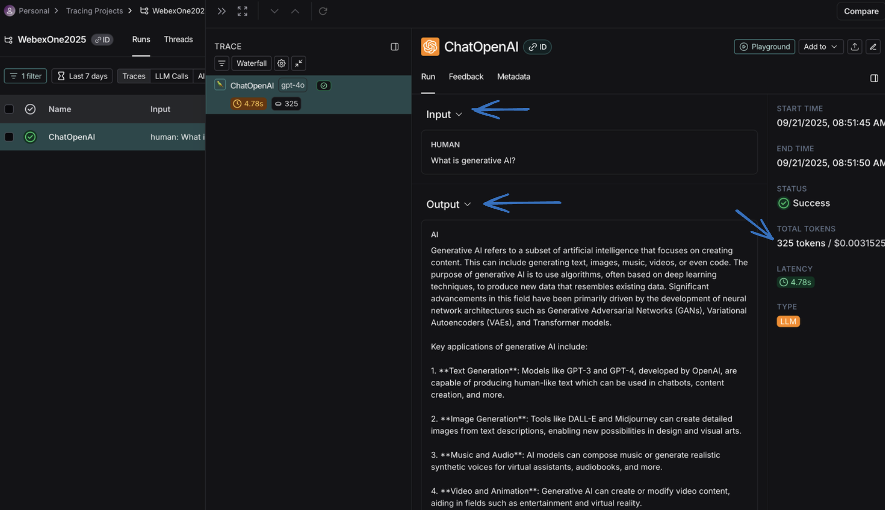{ loading=lazy }

    Now that you understand the basics of LangSmith, you can continue experimenting with other LangChain models, adjust your tracing configurations, and analyze how your models behave with different inputs. The LangSmith platform gives you detailed insights that can help you fine tune your application and improve performance.


* Now lets create a reusable chat prompt that builds a parameterized prompt with two roles (system and user). 

!!! note
    We will use ChatPromptTemplate.from_message as it allow us to build a full context with roles e.g systems or users

```py linenums="1"
from langchain_core.prompts import ChatPromptTemplate
prompt = ChatPromptTemplate.from_messages(
    [
        ("system", "You are an expert AI Engineer. Provide me answers based on the questions"),
        ("user", "{input}")
    ]
)
prompt
```

* Create a chain in LangChain using LCEL(Lang chain expression language). Traditionally, we’d have to write custom Python classes or functions to chain steps together. With LCEL, you can quickly build a workflow like Prompt → LLM → Output Parser. More info on LCEL can be found <a href="https://python.langchain.com/docs/concepts/lcel/" target="_blank">here.</a>

```py linenums="1"

chain = prompt | llm
response = chain.invoke({"input": "Can you tell me about LangSmith?"})
print(response)
```

* Now lets add an output parser (normalize to plain string)

```py linenums="1"
from langchain_core.output_parsers import StrOutputParser

output_parser = StrOutputParser()
chain = prompt | llm | output_parser

response = chain.invoke({"input": "Can you tell me about LangSmith?"})
print(response)

```        

* We can browse or log in to our LangSmith portal. At the top level you see a RunnableSequence, which represents the chain you built with the | operator. Inside the run, the nodes are shown in order: ChatPromptTemplate for formatting. ChatOpenAI for the model call. StrOutputParser for clean string. The interface also shows inputs, outputs, latency, token usage, cost, and run status. 

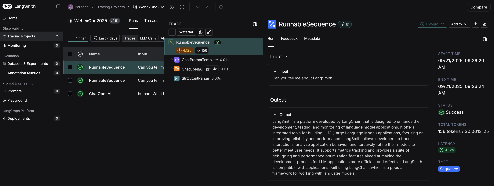{ loading=lazy }


!!! note 
    In this step we built a simple langChain workflow that connects our prompt to an OpenAI model and returns a clean, usable output. We created a reusable chat prompt and connected it to the gpt‑4o model using a LangChain chain, allowing us to pass in any question and get a response automatically. Finally, we added an output parser to convert the model’s response into a plain string. By the end of this step, we had a working chain that can take any user input, process it through our prompt and LLM, and return a neatly formatted answer.                           


###### Loading and Parsing Web Content with LangChain


In this section, we will build a retrieval pipeline using LangChain that can read information from a live webpage and answer questions based on its content
            
!!! important
    Log in to the lab environment using Google Colab. We highly recommend creating a new notebook in Colab for this.
                    
    Please ensure that, as per the previous step, your OPENAI_API_KEY and LANGSMITH_API_KEY are already defined in your Colab Secrets and enabled for this notebook as well. 

* Lets start by installing all the relevant libraries

```py linenums="1"
!pip install -U langchain langchain-openai langchain-community langchain-text-splitters langchain-classic beautifulsoup4 faiss-cpu
```

* Install relevant libraries

```py linenums="1"
import os
from google.colab import userdata
os.environ['OPENAI_API_KEY']   = userdata.get('OPENAI_API_KEY')
os.environ['LANGSMITH_API_KEY'] = userdata.get('LANGSMITH_API_KEY')

# ✅ Set LangSmith tracing config as environment variables (so LangChain can read them)
os.environ['LANGSMITH_TRACING'] = "true"
os.environ['LANGSMITH_ENDPOINT'] = "https://api.smith.langchain.com"
os.environ['LANGSMITH_PROJECT']  = "AibyDesign"
```

* In this step, we’ll load a sample webpage from developer.webex.com into LangChain for processing

```py linenums="1"
from langchain_community.document_loaders import WebBaseLoader
loader=WebBaseLoader("https://developer.webex.com/admin/docs/api/guides/partners-guide-to-using-the-webex-apis")
loader
```

* Let's load our doc

```py linenums="1"
docs=loader.load()
docs
```

* In this step, we will break our loaded webpage into smaller, overlapping text chunks using RecursiveCharacterTextSplitter. As mentioned earlier chunking ensures the content is easier to search and retrieve later, and the overlap helps preserve context across document boundaries.

```py linenums="1"
from langchain_text_splitters import RecursiveCharacterTextSplitter
text_splitter=RecursiveCharacterTextSplitter(chunk_size=1000,chunk_overlap=200)
documents=text_splitter.split_documents(docs)
documents
```

* We will now  initialize OpenAIEmbeddings, which allows us to convert each chunk  into a numerical vector and save into FAISS database

```py linenums="1"
from langchain_openai import OpenAIEmbeddings
embeddings=OpenAIEmbeddings()
```

```py linenums="1"
from langchain_community.vectorstores import FAISS
vectorstoredb=FAISS.from_documents(documents,embeddings)
vectorstoredb
```

* Let's query our database

```py linenums="1"
## Query From a vector db
query="What is a Managed Customer?"
result=vectorstoredb.similarity_search(query)
result[0].page_content
```

* LangChain will read our OPENAI_API_KEY from the environment and use this llm object to generate answers

```py linenums="1"
from langchain_openai import ChatOpenAI
llm=ChatOpenAI(model="gpt-4o")
```

* In this step, we will create a document chain that takes the retrieved documents, their text into a {context} placeholder, and then calls the LLM to produce an answer. The prompt explicitly instructs the model to answer only using the provided context, which helps keep responses grounded and reduces hallucinations

```py linenums="1"
## Retrieval Chain, Document chain
from langchain_classic.chains.combine_documents import create_stuff_documents_chain
from langchain_core.prompts import ChatPromptTemplate
from langchain_classic.chains.combine_documents import create_stuff_documents_chain
from langchain_core.prompts import ChatPromptTemplate

prompt = ChatPromptTemplate.from_template(
    """
Answer the following question based only on the provided context:
<context>
{context}
</context>

Question: {input}
"""
)
document_chain = create_stuff_documents_chain(llm, prompt)
document_chain
```

* lets now create our retriever (FAISS DB)

```py linenums="1"
retriever=vectorstoredb.as_retriever()
from langchain_classic.chains import create_retrieval_chain
retrieval_chain=create_retrieval_chain(retriever,document_chain)
```

* Lets invoke our model and get the answer

```py linenums="1"
## Get the response form the LLM
response=retrieval_chain.invoke({"input":"What is a Managed Customer?"})
```

```py linenums="1"
response['answer']
```

* In the LangSmith portal we can see the retrieval_chain run for the query “What is a Managed Customer?”. The retriever first searches the FAISS vector database using the embeddings we created and returns the most relevant document chunks from the Webex Partner Guide(Website). These retrieved documents are then passed into the document chain, where they are formatted into the prompt using the ChatPromptTemplate. The LLM (gpt-4o) is called with this prompt, and the output is parsed into a clean string using the StrOutputParser. The interface clearly shows the input question, the retrieved documents used as context, and the final answer generated by the LLM. It also provides runtime information such as latency, token usage, cost estimates, and run status. This trace confirms that the response was produced by grounding the LLM answer in the retrieved context, making it easy to debug.
            
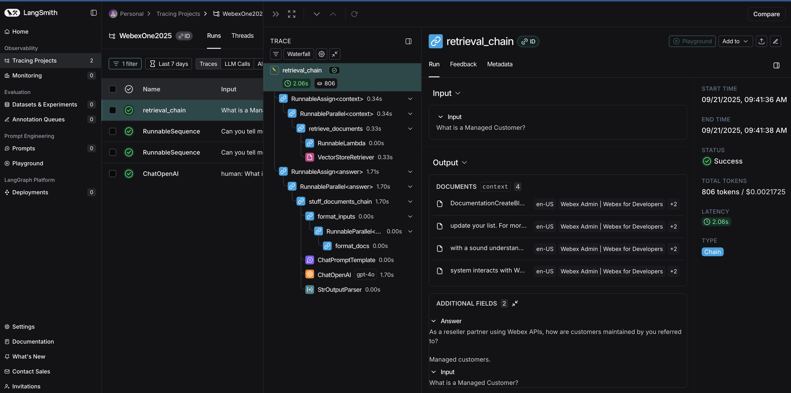{ loading=lazy }


!!! note 
    This concludes the section, and you should now have a clear understanding of how to create a pipeline using a retriever and invoke your chains.

###### UseCase-1


!!! important

        Make sure you have created a Langchain account as explained in the "Getting Started with LangChain" section in Task1 
        or use the Langchain API key that was provided in the .txt file. If you saved it in the **`$ keys`** panel, grab it from there.

###### Pre-requisite

            
Let's start building chatbot application using LangChain, I'll guide you through the basic steps. 

With LangChain, when creating an application, you have the flexibility to use either paid LLMs or open-source LLMs. One way to integrate open-source LLMs is through Hugging Face or Ollama, but since we're focusing on LangChain, we'll explore how this can be done within its ecosystem.

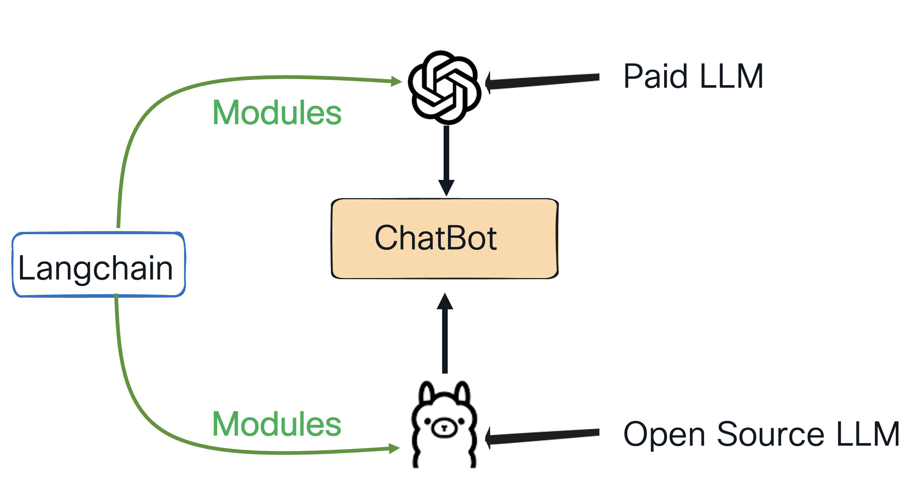{ loading=lazy }

We’ll build a chatbot using paid models (like OpenAI and Open Source models). LangChain provides modules that can seamlessly interact with both paid services and open-source models, allowing you to create versatile and powerful applications.

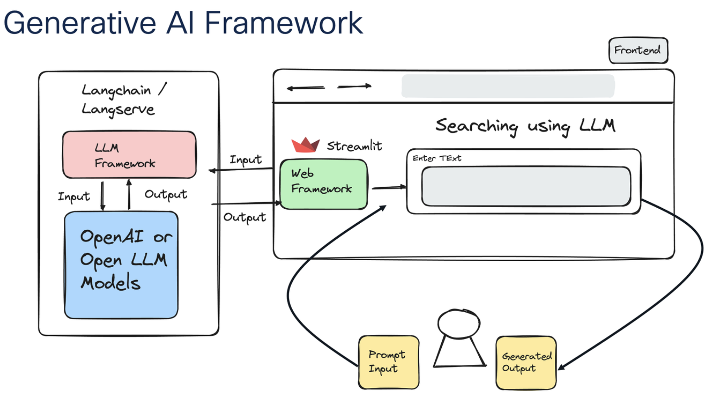{ loading=lazy }

!!! important

    In this example, we'll explore the use of Langchain and LangSmith, starting with the installation of essential libraries like langchain_openai, langchain, and langchain_core. We'll demonstrate how to leverage Langserve for managing large language models (LLM) operations. 
    Furthermore, I'll show you how to utilize Streamlit, a server-based application, to interactively visualize and interact with your code. Given the challenges of running Streamlit directly on Google Colab, we'll deploy NGROK to facilitate executing and accessing our code through a web interface.

###### Task 1


!!! important
    Log into the Lab Environment. Please create a new Google Colab notebook. 

{ loading=lazy }

* Open Google Colab and create a new notebook or use an existing one. Click on "File" > "New notebook". Please refer to the [following section](../index.md#module-1) to create Google Colab account.

{ loading=lazy }

* Make sure you are connected to a runtime. For this task, you can use the CPU as the runtime environment.

{ loading=lazy }

###### Set OpenAI token


* Within your existing Google Colab notebook navigate to the new “Secrets” section in the sidebar.

{ loading=lazy }

* Click on “Add a new secret.” Enter the name example: OPENAI_API_KEY and value of the secret(the API key in your .txt file). Note: The name is permanent once set. 

* The list of secrets is global across all your notebooks.

* Use the “Notebook access” toggle to grant or revoke access to a secret for each notebook.

{ loading=lazy }

###### Set Langchain tokens


!!! important
    Make sure you have created a Langchain account as explained in the "Getting Started with LangChain" section in [Task1](../index.md#module-1)
    or use the key provided in the .txt file. The LangChain API key is in your `.txt` file. If you saved it in the **`$ keys`** panel, grab it from there.
                                    
* Copy your Langchain Key and save it 
                                
!!! important
    You can also use the key that was sent in your .txt file

* Within your existing Google Colab notebook navigate again to the new “Secrets” section in the sidebar. Click on “Add a new secret.” Enter the name example: LANGCHAIN_API_KEY and value of the secret(the API key created in Langchain). 

{ loading=lazy }

{ loading=lazy }


###### Set NGROK


!!! important
    You can use the NGROK key that was sent in your .txt file at the start of the lab. Below steps for NGROK are for information only
                                    
    * Browse to <a href="https://ngrok.com/" target="_blank">NGROK</a> and click on Login. Ngrok is a reverse proxy application allowing cloud-based applications send notifications to your application which are running behind a firewall

    * I’ll be using the "Login with Google" option to access my account, but feel free to choose the login method that works best for you.

    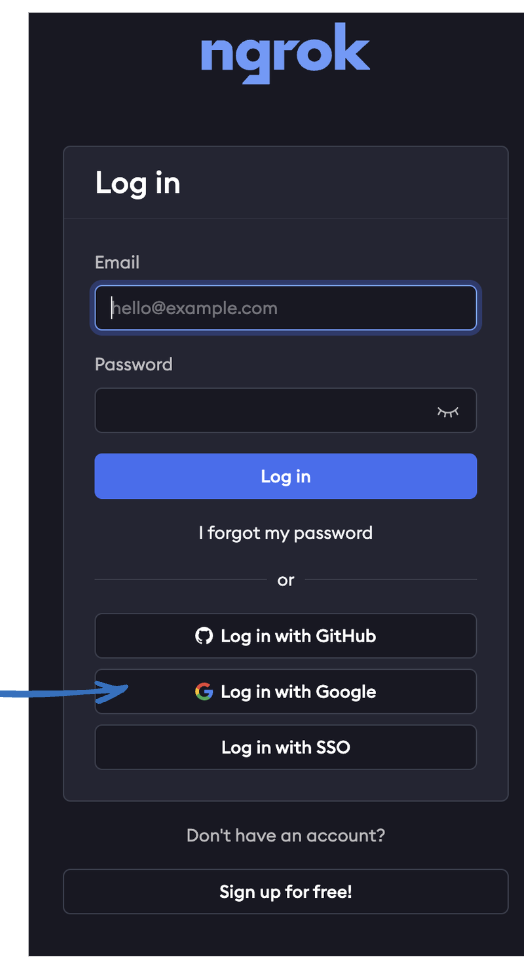{ loading=lazy }

    * Get your NGROK auth key. We will be using it in the later steps.

    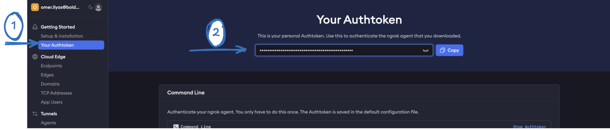{ loading=lazy }

    <span class="colour" style="color:red"> Note: Since we are using a free NGROK account, we can only run up to 3 tunnels simultaneously. If you need to terminate any active tunnels, please use the following steps </span>

    ```py
    !pkill ngrok
    ```

###### Configuration


* Lets start by installing all the necessary packages

```py linenums="1"
! pip install langchain_openai langchain langchain_core python-dotenv streamlit langchain_community langserve streamlit pyngrok ngrok langchain-classic
```

* We will import libraries

```py linenums="1"
from langchain_openai import ChatOpenAI
from langchain_core.prompts import ChatPromptTemplate
from langchain_core.output_parsers import StrOutputParser
import requests
import streamlit as st
import os
from dotenv import load_dotenv
from google.colab import userdata
from pyngrok import ngrok
import subprocess
import os
```

*  Lets start by configuring the environment variables. We will use and define Langserve for our LLM ops

```py linenums="1"
import os
from google.colab import userdata
os.environ['OPENAI_API_KEY']   = userdata.get('OPENAI_API_KEY')
os.environ['LANGSMITH_API_KEY'] = userdata.get('LANGSMITH_API_KEY')
# ✅ Set LangSmith tracing config as environment variables (so LangChain can read them)
os.environ['LANGSMITH_TRACING'] = "true"
os.environ['LANGSMITH_ENDPOINT'] = "https://api.smith.langchain.com"
os.environ['LANGSMITH_PROJECT']  = "AibyDesign"
```

??? important 
                                        
    <span class="colour" style="color:red"> Note: Due to the challenges of running Streamlit directly on Google Colab, we'll use NGROK to enable the execution and access of our code via a web interface. The code below is for your <b>understanding only</b> or if you're running it as Python packages in your own environment. To continue and run the code in this lab or on Google Colab, please proceed and copy the code from <b>Configuration1 section below. </b> </span>


    * (Optional Step for your understanding) As we creating a simple chatbot application lets create our prompt 

    ```py linenums="1" title="Optional Code"
    prompt=ChatPromptTemplate.from_messages(
        [
            ("system","You are a helpful Cisco assistant. Please respond to the user queries"),
            ("user","Question:{question}")
        ]
    )
    ```

    * (Optional Step for your understanding) Lets define Streamlit Framework

    ```py linenums="1" title="Optional Code"
    st.title('Langchain using OPENAI API')
    input_text=st.text_input("Search the topic you want")
    ```

    * (Optional Step for your understanding) We will initialize the Language Model and set-up the Output parser 

    ```py linenums="1" title="Optional Code"
    llm=ChatOpenAI(model="gpt-4o")
    output_parser=StrOutputParser()
    ```

    * (Optional Step for your understanding) Langchain offers features that allow us to connect various components into a seamless workflow, known as chains. So far, we have created a chat prompt template, initialized the LLM (Language Model), and set up an Output Parser. Now, let's combine all these elements.

    ```py linenums="1" title="Optional Code"
    chain=prompt|llm|output_parser
    ```

    * (Optional Step for your understanding) Lets give our input as question and pass it to our chain 

    ```py linenums="1" title="Optional Code"
    if input_text:
        response = chain.invoke({'question': input_text})
        st.write(response)
    ```

    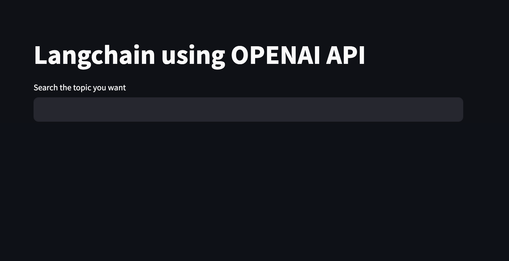{ loading=lazy }

!!! note
    Configuration 1 - Let's execute the Code from here

* Running Streamlit apps directly within Google Colab can be challenging due to the need for a continuous web interface, which is not natively supported in Colab's environment. To address this, we will use NGROK, which creates a secure tunnel to make the Streamlit app accessible via a web interface.

* The code will start by creating a Streamlit application using a prompt template, a language model (LLM), and an output parser. These components are combined into a chain to process user input and generate responses using  GPT-4o model. The app will prompt the user to input a query and then processes it through the chain, displaying the generated response in the Streamlit interface. We will save Streamlit app code to a file (app.py), and a subprocess is started to run the app.

!!! important
    Be sure to add your ngrok token before running the cell. Please enter your NGROK token in cell 43.

```py linenums="1"

streamlit_code = """
from langchain_openai import ChatOpenAI
from langchain_core.prompts import ChatPromptTemplate
from langchain_core.output_parsers import StrOutputParser
import requests
import streamlit as st
import os
from dotenv import load_dotenv

load_dotenv()
# Set up the prompt template
prompt = ChatPromptTemplate.from_messages(
    [
        ("system", "You are a helpful Cisco Live assistant. Please respond to the user queries"),
        ("user", "Question:{question}")
    ]
)

# Streamlit interface
st.title('Langchain using OPENAI API')
input_text = st.text_input("Search the topic you want")

# Initialize the OpenAI LLM
llm = ChatOpenAI(model="gpt-4o")
output_parser = StrOutputParser()

# Create the chain
chain = prompt | llm | output_parser

if input_text:
    response = chain.invoke({'question': input_text})
    st.write(response)
"""

# Save the streamlit app code to a file
with open("app.py", "w") as file:
    file.write(streamlit_code)

# Start the Streamlit app using subprocess
process = subprocess.Popen(['streamlit', 'run', 'app.py'])

# Start ngrok tunnel
ngrok.set_auth_token("Replace-with-your-ngrok-authtoken-created-above")  
public_url = ngrok.connect(8501, "http")  # Use http instead of specifying as a named argument
print(f"Your Streamlit app is live at: {public_url}")
```

!!! important
    Be sure to add your ngrok token before running the cell. Please enter your NGROK token in cell 43.

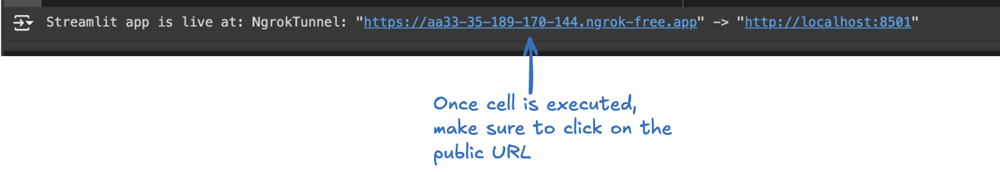{ loading=lazy }

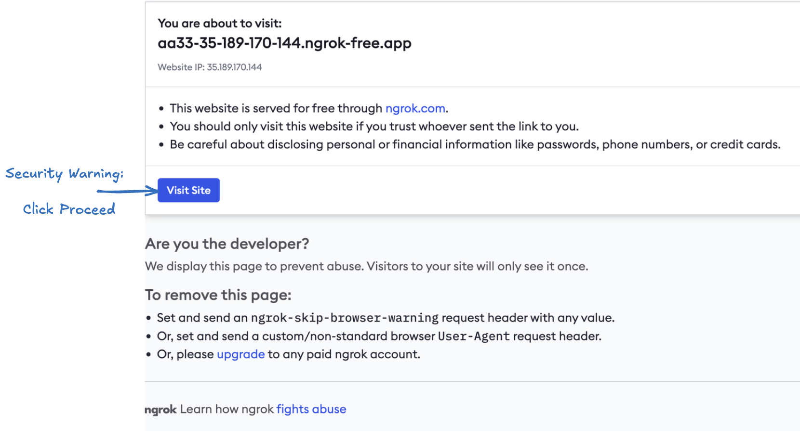{ loading=lazy }

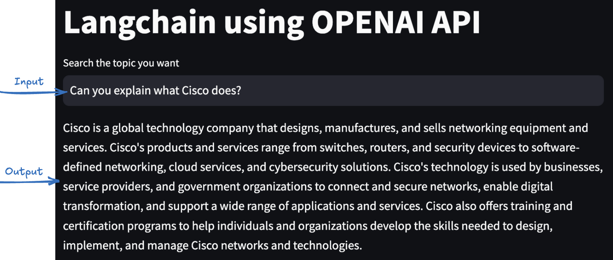{ loading=lazy }

!!! note
    Since we are using a free NGROK account, we can only run up to 3 tunnels simultaneously. If you need to terminate any active tunnels, please use the following steps

    ```py linenums="1" title="Optional Step in case you need to terminate NGROK"
    !pkill ngrok
    ```

* Since we're using <a href="https://smith.langchain.com/" target="_blank">LangSmith for llm-ops</a>, let's log in and explore its features there.

!!! note
    Make sure to log in using the same Gmail account(tmedemouserX) you used to sign in and create the API keys, as mentioned in Task 1.

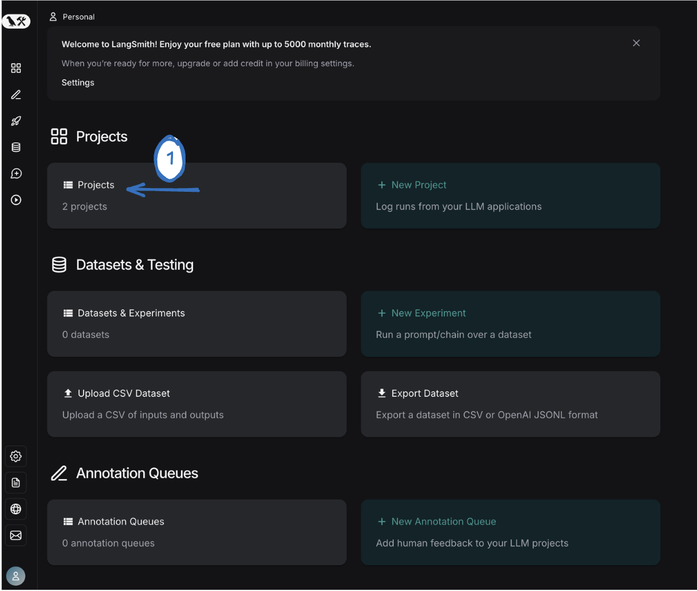{ loading=lazy }

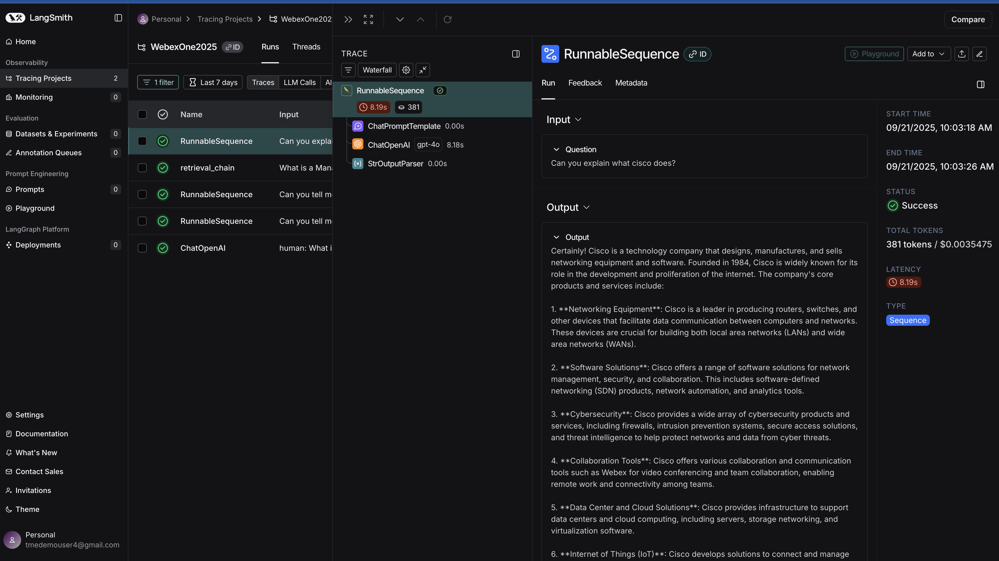{ loading=lazy }

This dashboard provides a summary of the performance, usage, and cost metrics for the "default" project within the last 7 days. It offers insights into how frequently the project has been run, the efficiency (in terms of error rates and latency), and the associated costs, helping users to monitor and optimize their LLM (Large Language Model) operations. By leveraging LangSmith’s observability tools, users can gain deeper insights into model behavior, fine-tune prompts, and improve overall system performance.

<div style="background-color:#fff3cd; padding:10px; border-left:6px solid #ffc107; font-weight:bold; font-size:18px; color:black;">
🚀 Enhancing Our Streamlit App to Send Messages to a Webex Space </div>
                        
!!! important
                                            
    Streamlit is an open-source Python library that makes it easy to create interactive, data-driven web applications. It allows users to build web apps for machine learning, data visualization, and data science projects without needing extensive web development knowledge. With Streamlit, you can quickly turn your Python scripts into interactive web interfaces by adding widgets like sliders, buttons, and charts, all using just Python code. It's an efficient way to visualize and share data insights in real time.</span>

!!! note
                                        
    We’ve seen how simple it is to interact with LLM and create an application using Langchain + Streamlit. Now, let’s take it a step further by modifying the application so that the responses are not only displayed in the Streamlit interface but are also sent directly to a specific Webex space.

!!! important
    Ensure you have your Webex Bearer Token and Space ID ready. If you don’t have them, please contact your lab proctor.
    To retrieve your Webex Bearer Token, follow the instructions in the "Pre-Requisites and Setup (Optional Step)" section under 🔐 Webex - Getting Bearer Tokens.

* let's modify our code to send the generated responses directly to a Webex space. This will enable real-time collaboration and communication with team members through Webex, enhancing the utility of our AI applications.

!!! important
    Lets terminate any active tunnels, before proceeding with the below code.

    ```py linenums="1"
    !pkill ngrok
    ```

!!! note
    Sometimes, Google Colab may have issues running modified code. As a best practice, if you're using the same Colab notebook, make sure to terminate any existing NGROK processes before restarting. Alternatively, consider creating a new notebook to avoid conflicts.

```py linenums="1"
! pip install langchain_openai langchain langchain_core python-dotenv streamlit langchain_community langserve streamlit pyngrok ngrok langchain-classic
```

*  Lets start by configuring the environment variables. We will use and define Langserve for our LLM ops

```py linenums="1"
import os
from google.colab import userdata
os.environ['OPENAI_API_KEY']   = userdata.get('OPENAI_API_KEY')
os.environ['LANGSMITH_API_KEY'] = userdata.get('LANGSMITH_API_KEY')

# ✅ Set LangSmith tracing config as environment variables (so LangChain can read them)
os.environ['LANGSMITH_TRACING'] = "true"
os.environ['LANGSMITH_ENDPOINT'] = "https://api.smith.langchain.com"
os.environ['LANGSMITH_PROJECT']  = "AibyDesign"
```

```py linenums="1"
from langchain_openai import ChatOpenAI
from langchain_core.prompts import ChatPromptTemplate
from langchain_core.output_parsers import StrOutputParser
import requests
import streamlit as st
import os
from dotenv import load_dotenv
from google.colab import userdata
from pyngrok import ngrok
import subprocess
import os
```
                                        

!!! important
    Before running the code, make sure to enter your webex_space_id and Bearer token in cells 18 and 19. Also, add your NGROK token in cell 71.

```py linenums="1"
# Create the Streamlit app code
streamlit_code = """
from langchain_openai import ChatOpenAI
from langchain_core.prompts import ChatPromptTemplate
from langchain_core.output_parsers import StrOutputParser
import requests
import streamlit as st
import os
from dotenv import load_dotenv
from google.colab import userdata
from pyngrok import ngrok
import subprocess
import os

load_dotenv()

# Webex setup
webex_access_token = "Your-Webex-Token"
webex_space_id = "Your-Space-ID"

# Function to send a message to Webex
def send_webex_message(content):
    url = "https://webexapis.com/v1/messages"
    headers = {
        "Authorization": f"Bearer {webex_access_token}",
        "Content-Type": "application/json"
    }
    payload = {
        "roomId": webex_space_id,
        "text": content
    }
    response = requests.post(url, headers=headers, json=payload)
    if response.status_code == 200:
        print("Message sent to Webex:", response.json())
    else:
        print("Failed to send message:", response.text)

# Set up the prompt template
prompt = ChatPromptTemplate.from_messages(
    [
        ("system", "You are a helpful Cisco Live assistant. Please respond to the user queries"),
        ("user", "Question:{question}")
    ]
)

# Streamlit interface
st.title('Langchain using OPENAI API')
input_text = st.text_input("Search the topic you want")

# Initialize the OpenAI LLM
llm = ChatOpenAI(model="gpt-4o")
output_parser = StrOutputParser()

# Create the chain
chain = prompt | llm | output_parser

if input_text:
    response = chain.invoke({'question': input_text})
    st.write(response)
    send_webex_message(response)
"""

# Save the streamlit app code to a file
with open("app.py", "w") as file:
    file.write(streamlit_code)

# Start the Streamlit app using subprocess
process = subprocess.Popen(['streamlit', 'run', 'app.py'])

# Start ngrok tunnel
ngrok.set_auth_token("Replace-with-your-ngrok-authtoken-created-above")  # Replace with your ngrok authtoken
public_url = ngrok.connect(8501, "http")  # Use http instead of specifying as a named argument
print(f"Your Streamlit app is live at: {public_url}")
```

!!! important
    Before running the code, make sure to enter your webex_space_id and Bearer token in cells 18 and 19. Also, add your NGROK token in cell 71.

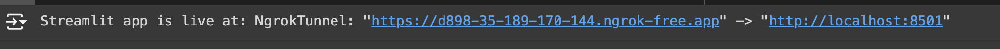{ loading=lazy }

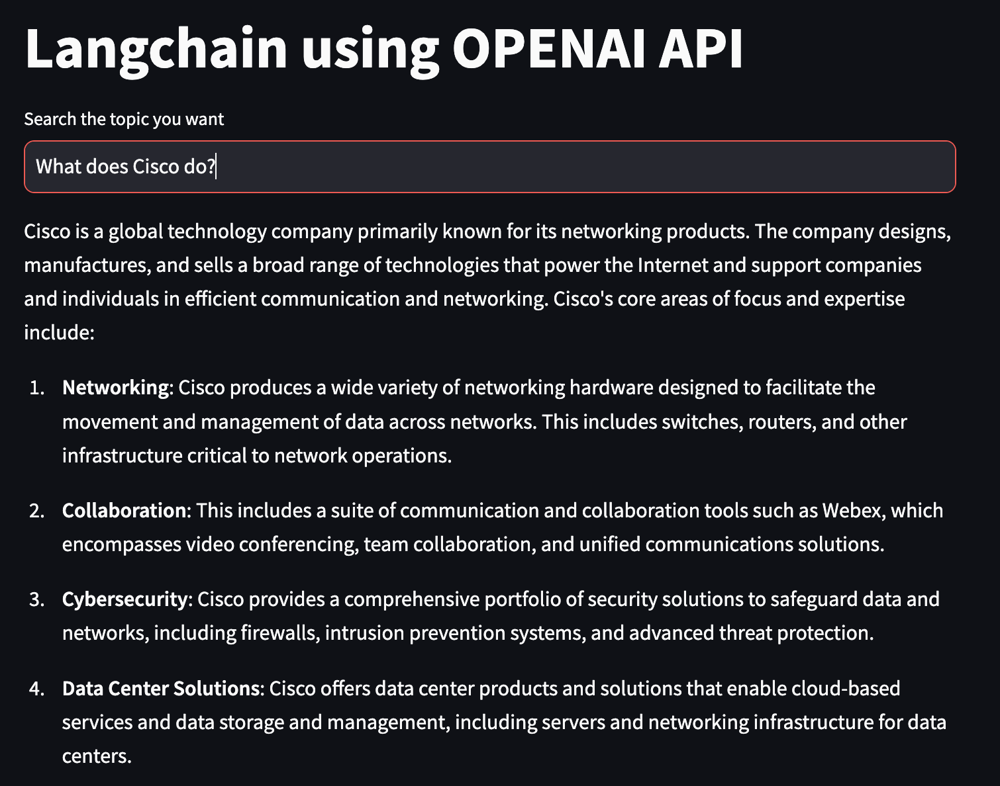{ loading=lazy }

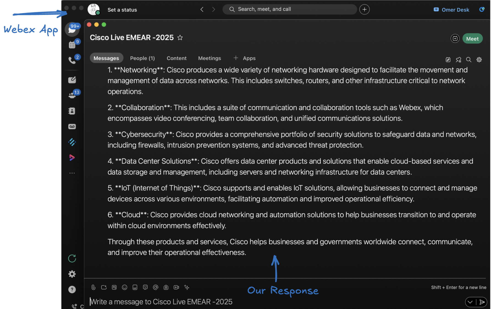{ loading=lazy }

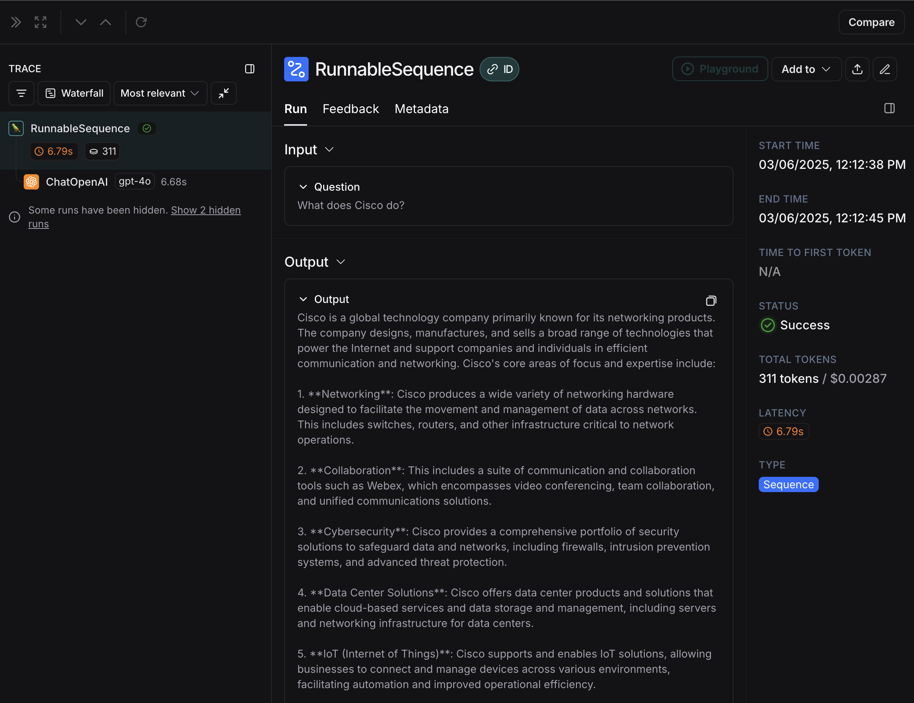{ loading=lazy }

??? note
                                        
    Building using Ollama Models(opensource) - OPTIONAL Source Code - For Informational Purpose Only

    <span class="colour" style="color:red"> Note: The code below will work only if you are running Ollama locally on your machine as explained in [Task1](../index.md#module-1)</span>

    In this example, we're leveraging LangChain to build an AI assistant using the LLama3 model, accessible through the Ollama API. The assistant is designed to help with queries and is implemented using Streamlit, which provides a user-friendly interface as shown above. 

    <span class="colour" style="color:red">Note:</span> Make sure you are running Ollama locally on your machine, as explained in [Task1](../index.md#module-1), to ensure the Llama3 model is properly accessible.

    ```py linenums="1" title="Optional Code"
    from langchain_openai import ChatOpenAI
    from langchain_core.prompts import ChatPromptTemplate
    from langchain_core.output_parsers import StrOutputParser
    from langchain_community.llms import Ollama
    import streamlit as st
    import os
    from dotenv import load_dotenv
    load_dotenv()
    ## Prompt Template
    prompt=ChatPromptTemplate.from_messages(
        [
            ("system","You are a helpful Cisco  assistant. Please respond to the user queries"),
            ("user","Question:{question}")
        ]
    )
    st.title('Langchain With LLAMA2 API')
    input_text=st.text_input("Search the topic you want")

    # ollama LLAma3 LLm 
    llm=Ollama(model="llama3:latest")
    output_parser=StrOutputParser()
    chain=prompt|llm|output_parser

    if input_text:
        st.write(chain.invoke({"question":input_text}))
    ```

    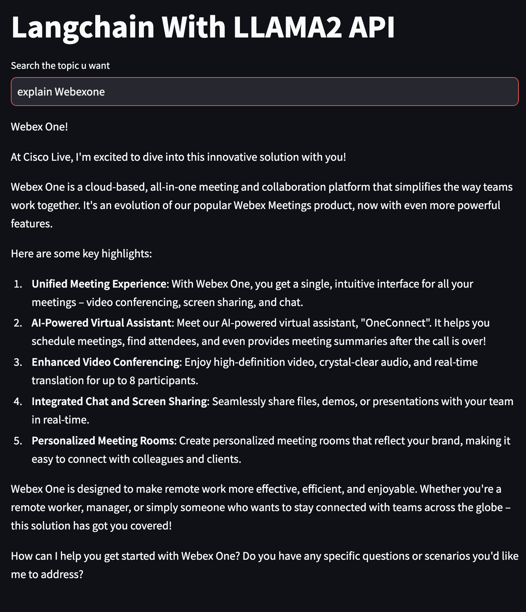{ loading=lazy }

    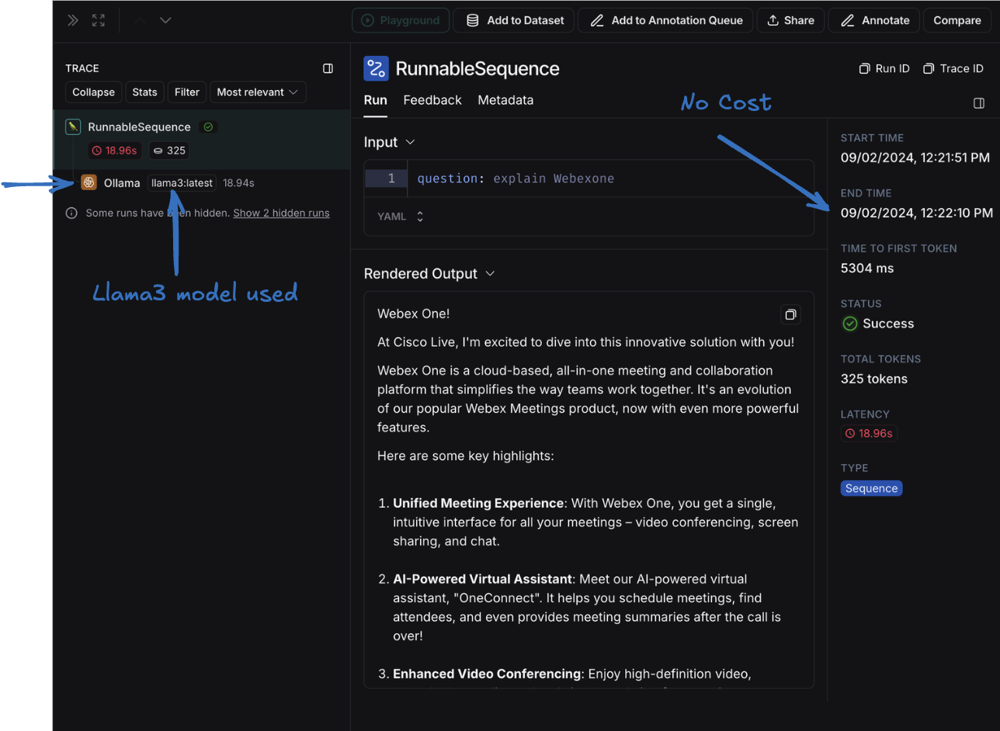{ loading=lazy }

###### UseCase-2


<b>Langchain - Advanced Rag - Chains and Retrievers</b>
                                            
In [Task5](../part-3/index.md#module-1), we explored the basics of a simple Retrieval-Augmented Generation (RAG) application, where we utilized similarity search to find and retrieve information from our database. While this approach is effective for specific, straightforward use cases, it does come with some limitations among them being lack of flexibility.

One of the drawbacks of relying solely on similarity search is that it doesn’t easily accommodate more complex workflows or integration with additional tools. It’s powerful for direct matches but can struggle when the task requires multi-step logic, advanced filtering, or a combination of different data sources.

LangChain’s <a href="https://python.langchain.com/v0.1/docs/modules/data_connection/retrievers/" target="_blank">retrievals</a> and <a href="https://python.langchain.com/v0.1/docs/modules/chains/" target="_blank">chains</a>, on the other hand, provide a more versatile and scalable framework. They enable the creation of sophisticated RAG applications by allowing you to define workflows that can incorporate multiple retrieval strategies, conditional logic, and integration with other LLM's or APIs.

Let’s now shift our focus towards creating an advanced RAG application by leveraging the capabilities of LangChain’s chains and retrievers. This will not only improve the flexibility and power of our application but also open up new possibilities for handling complex queries and delivering more refined results.

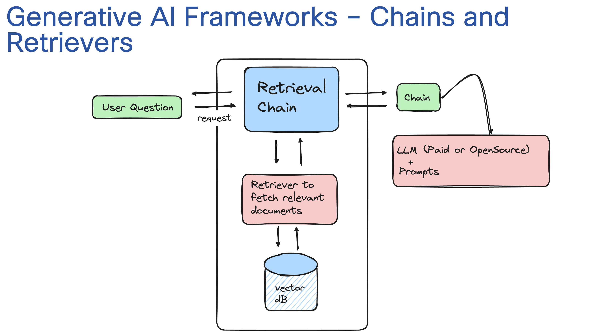{ loading=lazy }

!!! note
                                                
    **Chain: A chain in LangChain is like a sequence of tasks that you want to accomplish step by step.** 

    **Retriever: is like a search engine inside your application. Its job is to find and pull out the most relevant information from a vector database or a collection of documents.**

    **A retrieval chain is when you combine the power of both chains and retrievers.**

<b>Task 1: Log into the Lab Environment</b>

* Open Google Colab and start a new notebook, or you can use an existing one. Ensure that your OpenAI and LangChain tokens are already set up and activated for this notebook, as described in Use Case 1.

* Let's load our PDF files into Google Colab. For this example, we can use the article titled "Cisco Preferred Architecture for Webex Calling". You can  [download the  article here](../assets/static/webex_calling.pdf){:target="_blank" download="webex_calling.pdf"} as we will be using in the next step.

* Within Google Colab, Click on Folder and create a new folder called "data"

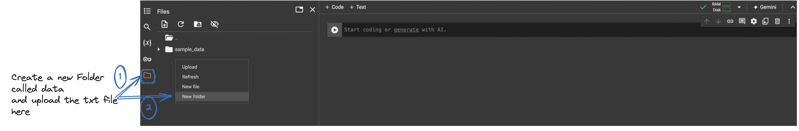{ loading=lazy }

* Click on [...], select Upload

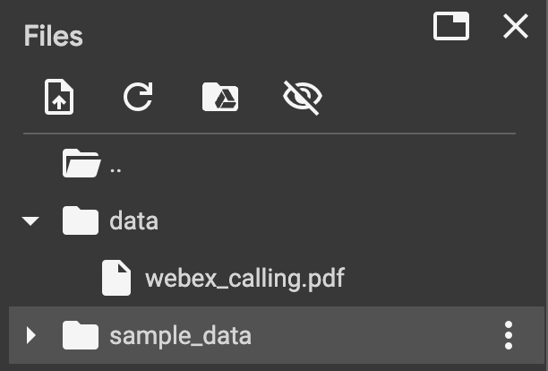{ loading=lazy }

* Choose your webex_calling.pdf file and click Open

<b>Configuration</b>

* Let's start by installing all the packages

```py linenums="1"
! pip install langchain_openai langchain langchain_core python-dotenv langchain_community langserve PyPDF chromadb langchain-classic
```

* Let's start by configuring the environment variables. We will use and define Langserve for our LLM ops

```py linenums="1"
import os
from google.colab import userdata
os.environ['OPENAI_API_KEY']   = userdata.get('OPENAI_API_KEY')
os.environ['LANGSMITH_API_KEY'] = userdata.get('LANGSMITH_API_KEY')
# ✅ Set LangSmith tracing config as environment variables (so LangChain can read them)
os.environ['LANGSMITH_TRACING'] = "true"
os.environ['LANGSMITH_ENDPOINT'] = "https://api.smith.langchain.com"
os.environ['LANGSMITH_PROJECT']  = "AibyDesign"
```

* We will import libraries

```py linenums="1"
from langchain_openai import ChatOpenAI
from langchain_core.prompts import ChatPromptTemplate
from langchain_core.output_parsers import StrOutputParser
import requests
import os
from dotenv import load_dotenv
from google.colab import userdata
```

If we examine the RAG pipeline, we typically need to follow these steps

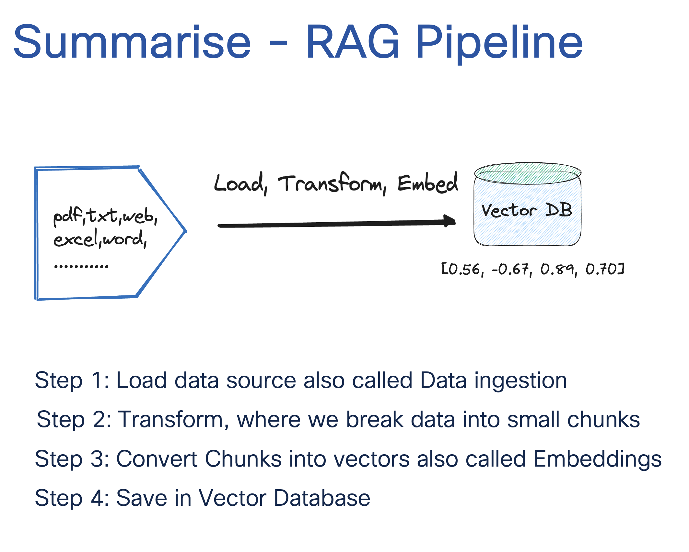{ loading=lazy }

* Let's load our data source

```py linenums="1"
from langchain_community.document_loaders import PyPDFLoader
loader=PyPDFLoader("/content/data/webex_calling.pdf")
docs=loader.load()
```

* We will do transformation to break data into smaller chunks

```py linenums="1"
from langchain_text_splitters import RecursiveCharacterTextSplitter
text_splitter=RecursiveCharacterTextSplitter(chunk_size=1000, chunk_overlap=200)
documents=text_splitter.split_documents(docs)
```

* We will now convert chunks into embeddings and store in Vector database e.g. Chroma

```py linenums="1"
from langchain_openai import OpenAIEmbeddings
from langchain_community.vectorstores import Chroma
db = Chroma.from_documents(documents,OpenAIEmbeddings())
```

* At this stage, I can query my vector database and retrieve information based on similarity search.

```py linenums="1"
query = "Where are Globally Distributed Datacenter?"
result = db.similarity_search(query)
print(result[0].page_content)
```

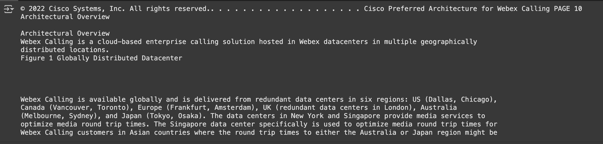{ loading=lazy }

* We will  now combine prompts with chains and retrievers to generate responses based on the prompts. Let's start by defining our LLM

```py linenums="1"
llm=ChatOpenAI(model="gpt-4o")
```

??? note
    <b>Optional</b> You can also use open source models like Ollama with the following code. Please note that this will not work in our lab since the model isn't running locally. This is for informational purposes only. If you'd like to try it locally, please speak with the proctor.

    ```
    from langchain_community.llms import Ollama 
    llm=Ollama(model="llama2") 
    ```

* Let's design our chat prompt templates instead of querying our database using similarity search. We'll be utilizing [langchain_core.prompts](https://api.python.langchain.com/en/latest/prompts/langchain_core.prompts.chat.ChatPromptTemplate.html) for this purpose.

```py linenums="1"
from langchain_core.prompts import ChatPromptTemplate
prompt= ChatPromptTemplate.from_template("""
                                        Answer the following question based only on the provided context. If no answer is available just say I dont know.
                                        <context>
                                        {context}
                                        </context>
                                        Question: {input}""")
```

* Let's create our Chain now. Chains are sequences of operations that process input to produce the desired output. We will use [create_stuff_documents_chain](https://python.langchain.com/v0.1/docs/modules/chains/)

```py linenums="1"
from langchain_classic.chains.combine_documents import create_stuff_documents_chain
document_chain=create_stuff_documents_chain(llm,prompt)
```

* Now, let's define our retrievers. As previously mentioned, a retriever is an interface that returns documents based on an unstructured query. It is broader in scope than a vector store, as it doesn't need to store documents, only to retrieve them. While vector stores can serve as the foundation for a retriever, there are other types of retrievers available as well. For more information, you can refer to the documentation <a href="https://python.langchain.com/docs/how_to/#retrievers" target="_blank">here</a>

```py linenums="1"
retriever=db.as_retriever()
retriever
```

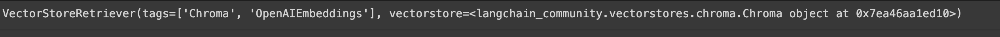{ loading=lazy }

* In this step, we'll set up a retrieval chain. This chain will start by taking a user inquiry and passing it to the retriever to fetch relevant documents. The retrieved documents, along with the original inputs, will then be sent to a language model (LLM) to generate a response. For further details on how to implement a retrieval chain, refer to the <a href="https://python.langchain.com/docs/versions/migrating_chains/" target="_blank">following doc</a>

```py linenums="1"
from langchain_classic.chains import create_retrieval_chain
retrieval_chain=create_retrieval_chain(retriever,document_chain)
```

* Now, let's combine our retriever and chain to generate responses:

```py linenums="1"
response=retrieval_chain.invoke({"input":" what are the bandwidth required on the internet access for Webex Calling"})
```

```
response['answer']
```

!!! note

    Let's jump into <a href="https://smith.langchain.com/" target="_blank">LangSmith</a> to review the logs.

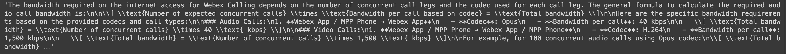{ loading=lazy }

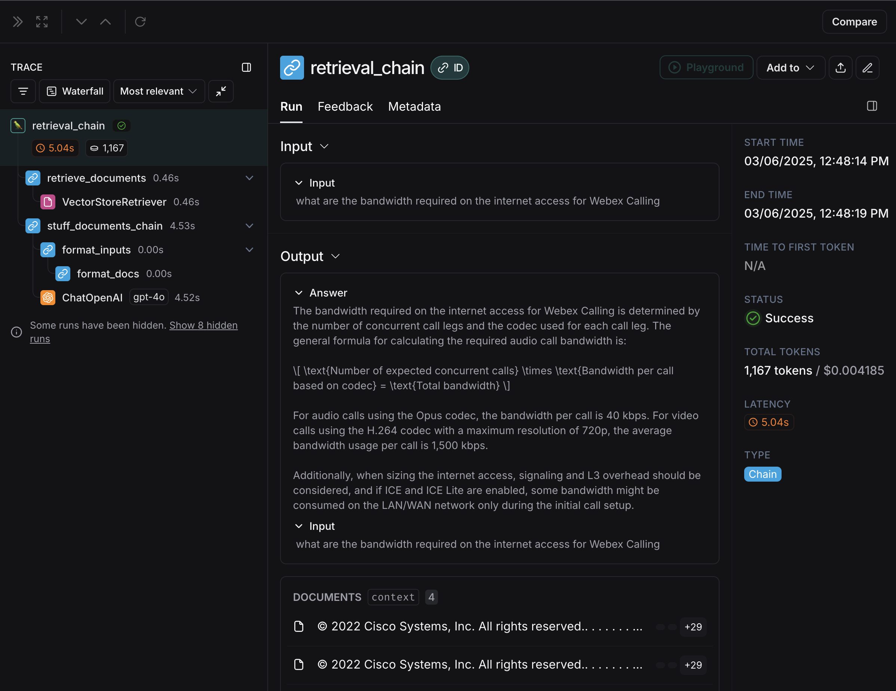{ loading=lazy }

<b>Summary</b>

In this lab, we've built an advanced Retrieval-Augmented Generation (RAG) system. The process begins with a user query, which is passed through a retrieval chain to fetch relevant documents from a vector database. These documents, along with the original query, are then processed by a Language Model (LLM) to generate a detailed and accurate response. This setup allows us to efficiently handle complex queries by combining the strengths of chains, retrieval and language models.

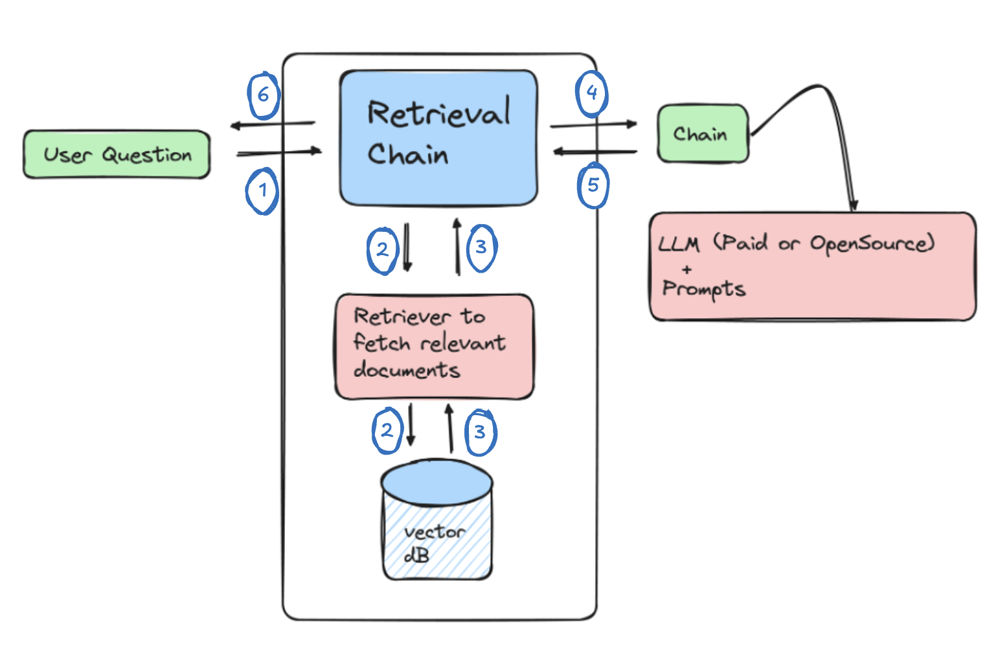{ loading=lazy }

###### UseCase-3

                                            
<b>Advanced Rag - Multisearch Agents RAG application </b>

If you recall in our previous use case, we discussed chains where we manually defined the sequence of actions to execute. However, the core concept behind <a href="https://python.langchain.com/v0.1/docs/modules/agents/" target="_blank">agents</a> is different. Instead of hardcoding the sequence of actions (as we do in chains), agents leverage a language model as a reasoning engine. This allows the model/agents to dynamically decide which actions to take and in what order.

In this context, <a href="https://python.langchain.com/v0.1/docs/modules/tools/" target="_blank">tools</a> play an essential role. Tools are like wrappers that the model can call upon to perform specific tasks, acting as interfaces between the agent and the outside world. By integrating tools with agents, the language model not only decides what action to take but also knows how to use the available tools to achieve the desired outcome. This flexible system allows agents to interact with different data sources or APIs dynamically, without the need for a fixed sequence of operations as seen in chains.


<b>Lab Configuration</b>

!!! note

    In this use case, we will build a system that leverages the power of agents combined with tools to create a flexible and dynamic environment. We will create multiple tools that interact with different data sources, including:

    * A Wikipedia-based tool for querying concise information.

    * A custom retriever tool that searches through a specific dataset or webpage example: (ThousandEyes API documentation).

    * An <a href="https://arxiv.org/" target="_blank">Arxiv-based tool</a> for retrieving AI research papers.

    * Custom PDF-based tool for extracting information from a document (Webex Calling Preffered Architecture).

We will combine these tools into an agent that can decide which tool to use based on the task at hand. Instead of manually defining the steps like in a chain, this agent will use a language model to reason and determine the right sequence of actions dynamically.

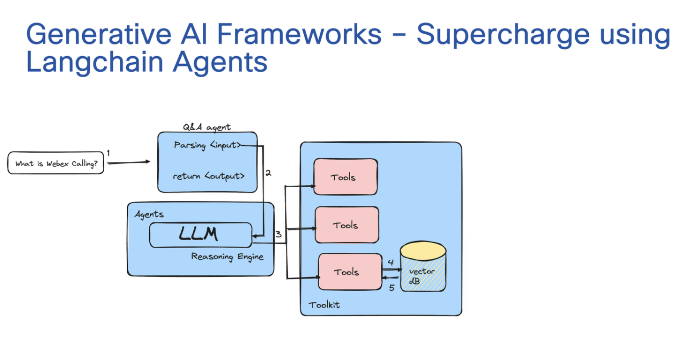{ loading=lazy }

By the end of the lab, you'll have an agent-driven system capable of dynamically selecting and using tools to perform complex tasks, like retrieving data from a variety of sources without the need for hardcoding specific steps.

{ loading=lazy }

<b>Task 1: Log into the Lab Environment</b>

* Open Google Colab and start a new notebook, or you can use an existing one. Ensure that your OpenAI and LangChain tokens are already set up and activated for this notebook, as described in Use Case 1 and Use Case 2.

* Let's load our PDF files into Google Colab. For this example, we can use the article titled "Cisco Preferred Architecture for Webex Calling". You can  [download the  article here](../assets/static/webex_calling.pdf){:target="_blank" download="webex_calling.pdf"} as we will be using in the next step.

* Within Google Colab, Click on Folder and create a new folder called "data"

{ loading=lazy }

* Click on [...], select Upload

{ loading=lazy }

* Choose your webex_calling.pdf file and click Open

<b>Configuration</b>

* Let's start by installing all the packages

```py linenums="1"
!pip install langchain_openai langchain langchain_core python-dotenv langchain_community langserve PyPDF chromadb arxiv wikipedia langchain-classic langchainhub 
```

*  We will configure the environment variables. We will use and define Langserve for our LLM ops

```py linenums="1"
import os
from google.colab import userdata
os.environ['OPENAI_API_KEY']   = userdata.get('OPENAI_API_KEY')
os.environ['LANGSMITH_API_KEY'] = userdata.get('LANGSMITH_API_KEY')
# ✅ Set LangSmith tracing config as environment variables (so LangChain can read them)
os.environ['LANGSMITH_TRACING'] = "true"
os.environ['LANGSMITH_ENDPOINT'] = "https://api.smith.langchain.com"
os.environ['LANGSMITH_PROJECT']  = "AibyDesign"
                                          
```


!!! important
                                                    
    We will be creating Tools (wrappers) around our data sources. Tools act as interfaces that can be used by agents, chains, or LLMs to interact with various data sources. Langchain provides built-in toolkits that allow us to easily create these wrappers and interact with data sources to extract data. In our lab guide, we will develop four different wrappers. The first wrapper tool will be built around <a href="https://python.langchain.com/v0.1/docs/integrations/tools/wikipedia/" target="_blank">Wikipedia</a>.

**Tool 1**

```py linenums="1"
from langchain_community.tools import WikipediaQueryRun
from langchain_community.utilities import WikipediaAPIWrapper
# I need only one result and 300 charectors- interacting with Wikipedia in this lab
api_wrapper = WikipediaAPIWrapper(top_k_results=1,doc_content_chars_max=300)
wiki = WikipediaQueryRun(api_wrapper=api_wrapper)
```

```py linenums="1"
wiki.run("history of cisco")
```

{ loading=lazy }

**Tool 2**

* Let's create a custom wrapper. Since this is my data, I won't be using predefined tools like I did for Wikipedia. Instead, I will define my own embeddings, vectors, and retrievers. In this Wrapper we will read API guide for ThousandEyes

```py linenums="1"
from langchain_community.document_loaders import WebBaseLoader
from langchain_community.vectorstores import Chroma
from langchain_openai import OpenAIEmbeddings
from langchain_text_splitters import RecursiveCharacterTextSplitter
from langchain_openai import ChatOpenAI
import os
os.environ["USER_AGENT"] = "Mozilla/5.0 (Windows NT 10.0; Win64; x64) AppleWebKit/537.36 (KHTML, like Gecko) Chrome/91.0.4472.124 Safari/537.36"

loader = WebBaseLoader("https://docs.thousandeyes.com/product-documentation/getting-started/getting-started-with-the-thousandeyes-api")
docs = loader.load()
documents = RecursiveCharacterTextSplitter(chunk_size=1000,chunk_overlap=200).split_documents(docs)
vectordb = Chroma.from_documents(documents,OpenAIEmbeddings())
retriever = vectordb.as_retriever()
retriever
```
* Lets create a custom retriever tool using Langchain to search through our TE dataset. More info on create_retriever_tool available <a href="https://api.python.langchain.com/en/latest/tools/langchain.tools.retriever.create_retriever_tool.html" target="_blank">here</a>

```py linenums="1"
# Use prompts from Hub for my retriver
from langchain_classic.tools.retriever import create_retriever_tool
retriever_tool=create_retriever_tool(retriever,"ThousandEyes_Search",
                    "Search for information about ThousandEyes APis. For any questions about APIs, you must use this tool!")
retriever_tool.invoke("How do I authenticate with the ThousandEyes API?")
```

{ loading=lazy }

**Tool 3**

* Arxiv is a free distribution service and an open-access archive where researchers from various fields, such as computer science, physics, and more, share their research papers.  In this section, we will create a tool that interfaces with Arxiv to search and retrieve research papers. The below code sets up a tool to query Arxiv and extract  results from the top research papers relevant to the query.

```py linenums="1"
from langchain_community.utilities import ArxivAPIWrapper
from langchain_community.tools import ArxivQueryRun
# I need only one result and 300 charectors- interacting with Arxiv in this lab
arxiv_wrapper=ArxivAPIWrapper(top_k_results=1, doc_content_chars_max=300)
arxiv=ArxivQueryRun(api_wrapper=arxiv_wrapper)
arxiv.name
```

**Tool 4**

* Let's create another custom wrapper for my PDF files. Since this is my data, I won't be using predefined tools like I did for Wikipedia and Arxiv. Instead, I will define my own embeddings, vectors, and retrievers, similar to how we did with the ThousandEyes API guide. We'll use the Webex Calling Preferred Architecture Guide, make sure it's uploaded according to the steps we've covered earlier.

```py linenums="1"
from langchain_community.document_loaders import PyPDFLoader
from langchain_text_splitters import RecursiveCharacterTextSplitter
from langchain_openai import OpenAIEmbeddings
from langchain_community.vectorstores import Chroma
loader=PyPDFLoader("/content/data/webex_calling.pdf")
docs=loader.load()
text_splitter=RecursiveCharacterTextSplitter(chunk_size=1000, chunk_overlap=200)
documents=text_splitter.split_documents(docs)
db = Chroma.from_documents(documents,OpenAIEmbeddings())
retriever1=db.as_retriever()
retriever1
```

* Lets create a custom retriever tool using Langchain to search through our PDF. More info on create_retriever_tool available <a href="https://api.python.langchain.com/en/latest/tools/langchain.tools.retriever.create_retriever_tool.html" target="_blank">here</a>.

```py linenums="1"
from langchain_classic.tools.retriever import create_retriever_tool
retriever_tool1=create_retriever_tool(retriever1,"Webex_Calling_Search",
                    "Search for information about Webex Calling. For any questions about Webex Calling, you must use this tool!")
retriever_tool1.invoke("Are webex calling data centres globally distributed?")
```

{ loading=lazy }

* We will combine all the tools/wrappers together now

```py linenums="1"
tools=[wiki,arxiv,retriever_tool,retriever_tool1]
```

* The next step is to query these tools, and that's where agents come in. Whenever I send a query to the LLM, it will search across all the available tools (Wiki, my custom retrieval tool, Arxiv, etc.) to find the most relevant source and provide the answer. Agents typically use the LLM to perform a sequence of actions. In this case, the LLM acts as a reasoning engine, determining which tool to use based on the query, searching the relevant sources, and delivering the most accurate response. Lets define our LLM 

```py linenums="1"
from dotenv import load_dotenv
from langchain_openai import ChatOpenAI
load_dotenv()
import os
os.environ['OPENAI_API_KEY']=os.getenv("OPENAI_API_KEY")
llm = ChatOpenAI(model="gpt-4o", temperature=0)
```

* Let's use the prompt from the hub. If you'd like to create your own custom prompt, feel free to do so as well! 

``` py linenums="1"
# Get prompts
from langchain_classic import hub
prompt = hub.pull("hwchase17/openai-functions-agent")
prompt.messages
```

!!! note

    <b>Optional/Information Only: </b> You can also use custom templates as shown
    ```py 
    from langchain_core.prompts import ChatPromptTemplate, SystemMessagePromptTemplate, HumanMessagePromptTemplate, MessagesPlaceholder
    # Custom prompt template
    custom_prompt = ChatPromptTemplate.from_messages([
        SystemMessagePromptTemplate.from_template(
            "You are a helpful assistant. If you can't find the information using the tools, please say so and apologize to the user."
        ),
        MessagesPlaceholder(variable_name="chat_history", optional=True),
        HumanMessagePromptTemplate.from_template("{input}"),
        MessagesPlaceholder(variable_name="agent_scratchpad")
    ])

    # View structure
    custom_prompt.messages
    ```


* As we are creating an agent that can interact with multiple tools by leveraging the OpenAI language model. The create_openai_tools_agent function combines the LLM, tools, and a prompt to form an agent. This agent will use the LLM as a reasoning engine to dynamically decide which tool to use based on the input query. It allows us to query Wikipedia, custom retrieval tools, Arxiv, and more, all within one unified system.

```py linenums="1"
from langchain_classic.agents import create_openai_tools_agent
agent=create_openai_tools_agent(llm,tools,prompt)
```

* Let's create an Agent Executor. It will use the previously defined agent and tools, allowing the agent to execute queries using the appropriate tool dynamically. The verbose=True option ensures that detailed output is provided during execution, helping to understand the agent's decision-making process as it selects and interacts with the tools.

```py linenums="1"
from langchain_classic.agents import AgentExecutor
agent_executor=AgentExecutor(agent=agent,tools=tools,verbose=True)
agent_executor
```

* Lets execute our code

```py linenums="1"
agent_executor.invoke({"input":"tell me about Webex Calling"})
```

{ loading=lazy }


```py linenums="1"
agent_executor.invoke({"input":"tell me about Getting Started with the ThousandEyes API"})
```

{ loading=lazy }

```py linenums="1"
agent_executor.invoke({"input":"tell me about cisco systems"})
```

{ loading=lazy }

``` py linenums="1"
agent_executor.invoke({"input":"tell me about research paper 2106.09685v2"})
```

{ loading=lazy }

* You can see all logs in Langsmith as well.

{ loading=lazy }

<b>Summary</b>

In this use case, we successfully built an AI-driven agent that dynamically interacts with multiple tools to retrieve and process information. Our agent can query Wikipedia for general knowledge, retrieve ThousandEyes API documentation using a custom
retriever tool, fetch AI research papers from Arxiv, and even extract insights from a Webex Calling Preferred Architecture PDF. Unlike static chains, this agent leverages a reasoning engine to decide which tool to use based on the query, making it more flexible and adaptive. Through this process, we explored key concepts such as integrating multiple data sources, utilizing vector databases for efficient retrieval, and understanding how LangChain’s toolkit enables dynamic decision making. Moving forward, we can expand this system by incorporating additional tools, optimizing retrieval strategies using retrieval augmented generation (RAG), and deploying the agent in real-world applications like customer support automation. This hands-on experience provided a
deeper understanding of how AI agents can streamline information retrieval and decision-making in complex environments. This concludes this <b>section</b>.

<p align="right"> 👉 This concludes the task. Click the next **Module** on the left to continue. </p>


<p class="eyebrow">Module 2</p>

## Groq and Open Source Models { #module-2 data-toc-label="Module 2 · Groq" }


<p class="eyebrow sub">Module 2 · Task 2A</p>

### Getting Started with Groq { #module-2a data-toc-label="2a · Getting Started with Groq" data-task="2a" }


#### Introduction


In the earlier tasks, we used OpenAI for inferencing, which delivers high-quality results but comes with associated usage costs. To access OpenAI's APIs, you must purchase credits and add a payment method (typically a credit card) to your account.

In this module, we introduce you to <a href="https://console.groq.com/docs/overview" target="_blank">Groq</a>, a high-performance platform designed for **LPU-based inferencing**. LPUs (Language Processing Units) are custom-built accelerators optimized for running large language models (LLMs) at lightning speed with minimal latency.

Groq offers blazing-fast inference with hosted open models like **GPT-OSS, Gemma, Mistral** and more, and it can serve as a **cost-effective, credit-free alternative** to traditional APIs when testing. We'll demo how to create a simple translation app using Groq to translate text from English to Spanish.

This module is intended to show that **multiple inference platforms exist**, each with its own advantages and model ecosystem.


<p class="eyebrow sub">Module 2 · Task 2B</p>

### Groq: LAB { #module-2b data-toc-label="2b · Groq: LAB" data-task="2b" }


!!! warning "Session Timeout"
    When using Google Colab, if your notebook is **idle for too long**, the session will **time out**, requiring you to **re-run all the cells from the start**.

!!! note
    Log in to the lab environment by opening a **new notebook** in Google Colab. Ensure you're connected to a runtime using a **CPU**. It is sufficient for this task.

---

**Step 1: Create a Groq Account & API Key**

* Create a Groq account by browsing to <a href="https://groq.com" target="_blank">groq.com</a>. Use your personal Gmail account to sign up or click on Start Building.

{ loading=lazy }

* Click on **Start Building**, then navigate to the **API Keys** section on the new page and create a key.

{ loading=lazy }

{ loading=lazy }

!!! tip "Save to Key Vault"
    Once your Groq API key is created, open the **`$ keys`** panel (bottom-right) and paste it under **Groq API Key**. You can also add it directly to Google Colab Secrets in the next step either way works.

* You can view the full list of models supported by Groq <a href="https://console.groq.com/docs/models" target="_blank">here</a>.

* We will be using the **GPT-OSS-20B** model for this task. However, feel free to browse the Groq model page and select any other supported model if you'd like to experiment.

{ loading=lazy }

---

**Step 2: Configure API Keys in Colab**

* In Google Colab, open the **Secrets** tab on the left. Click **Add new secret**, enter **GROQ_API_KEY** as the name, and paste your API key in the Value field. Make sure to toggle it on.

{ loading=lazy }

---

**Step 3: Install Dependencies**

```py linenums="1"
!pip install langchain langchain_groq langchain_core langchain_openai
```

---

**Step 4: Set Up API Keys & LangSmith Tracing**

Pull in the API keys from Colab Secrets and enable LangSmith tracing:

```py linenums="1"
import os
from google.colab import userdata
os.environ['OPENAI_API_KEY']   = userdata.get('OPENAI_API_KEY')
os.environ['LANGSMITH_API_KEY'] = userdata.get('LANGSMITH_API_KEY')
os.environ['GROQ_API_KEY'] = userdata.get('GROQ_API_KEY')

# Set LangSmith tracing config
os.environ['LANGSMITH_TRACING'] = "true"
os.environ['LANGSMITH_ENDPOINT'] = "https://api.smith.langchain.com"
os.environ['LANGSMITH_PROJECT']  = "AibyDesign"
```

!!! note
    OpenAI recently released two open-weight reasoning models (**GPT-OSS-20B** and **GPT-OSS-120B**) under the Apache 2.0 license. These are the first open models from OpenAI since GPT-2 in 2019. The 20B model achieves comparable performance to OpenAI's o3-mini on common benchmarks and can run on edge devices with just 16 GB of memory. Both models support **128K context windows**. More info: <a href="https://openai.com/index/introducing-gpt-oss/" target="_blank">OpenAI announcement</a> | <a href="https://openrouter.ai/openai/gpt-oss-20b" target="_blank">OpenRouter</a>

---

**Step 5: Initialize the Model**

We'll use Groq's inferencing engine to access the **openai/gpt-oss-20b** model for fast and cost-efficient responses via Groq's LPU hardware:

```py linenums="1"
from langchain_openai import ChatOpenAI
from langchain_groq import ChatGroq
model=ChatGroq(model="openai/gpt-oss-20b")
model
```

---

**Step 6: Simple Chat Interaction**

Create a simple translation using LangChain's SystemMessage and HumanMessage:

```py linenums="1"
from langchain_core.messages import HumanMessage,SystemMessage

messages=[
    SystemMessage(content="Translate the following from English to Spanish"),
    HumanMessage(content="Hello How are you?")
]

result=model.invoke(messages)
result
```

---

**Step 7: Parse the Output**

Use `StrOutputParser` to extract the clean text from the model's response:

```py linenums="1"
from langchain_core.output_parsers import StrOutputParser
parser=StrOutputParser()
parser.invoke(result)
```

---

**Step 8: Chain with LCEL**

Use **LCEL (LangChain Expression Language)** to chain the model and parser into a single pipeline:

```py linenums="1"
### Using LCEL- chain the components
chain=model|parser
chain.invoke(messages)
```

---

**Step 9: Dynamic Prompt Templates**

Define a reusable prompt template with placeholders for language and text:

```py linenums="1"
### Prompt Templates
from langchain_core.prompts import ChatPromptTemplate

generic_template="Translate the following into {language}:"

prompt=ChatPromptTemplate.from_messages(
    [("system",generic_template),("user","{text}")]
)
result=prompt.invoke({"language":"Spanish","text":"Hello"})
result.to_messages()
```

---

**Step 10: Full Pipeline**

Chain everything together: prompt + model + parser:

```py linenums="1"
##Chaining together components with LCEL
chain=prompt|model|parser
chain.invoke({"language":"Spanish","text":"Hello"})
```

---

**What We Did in This Module, and Why It Matters**

Throughout this lab, we've been using **OpenAI** as our inference provider GPT-4o for generation, OpenAI embeddings for vectorization. It works brilliantly, but it comes at a cost: API credits, a credit card on file, and a dependency on a single vendor.

In this module, we proved that **none of that is required**. We took the exact same LangChain patterns messages, chains, output parsers, prompt templates and swapped OpenAI for **Groq running an open-source model (GPT-OSS-20B)**. The code barely changed. The framework didn't change at all. And the results were fast, functional, and free(for testing).

**Why does this matter?**

* **No vendor lock-in** the LangChain abstraction means you can switch between OpenAI, Groq, Ollama, Hugging Face, or any other provider by changing one line of code
* **Open-source models are real** GPT-OSS-20B runs on 16GB of memory and performs comparably to o3-mini on common benchmarks. These aren't toy models anymore
* **Groq's LPU hardware** delivers inference speeds that rival or beat GPU-based solutions which matters when you're building real-time applications
* **Cost** for prototyping, testing, and many production use cases, you can now build AI applications without spending anything on inference

**How does this compare to what we've done before?**

| | Earlier Modules (OpenAI) | This Module (Groq + Open Source) |
|---|---|---|
| **Model** | GPT-4o (proprietary) | GPT-OSS-20B (open-source, Apache 2.0) |
| **Inference** | OpenAI API servers | Groq LPU hardware |
| **Cost** | Pay per token | Free tier available |
| **Framework** | LangChain | LangChain (identical) |
| **Code changes** | None | Changed one line (`ChatGroq` instead of `ChatOpenAI`) |

The point isn't that one is better than the other it's that you now know **both paths**. Use OpenAI when you need the latest capabilities. Use Groq and open-source models when you need speed, cost savings, or don't want vendor lock-in. The LangChain patterns you've learned work with all of them.

<p align="right"> 👉 This concludes the task. Click the next **Module** on the left to continue. </p>


<p class="eyebrow">Module 3</p>

## Hugging Face with OpenAI-Compatible APIs { #module-3 data-toc-label="Module 3 · Hugging Face" }


<p class="eyebrow sub">Module 3 · Task 3A</p>

### HuggingFace Inference Providers { #module-3a data-toc-label="3a · HuggingFace Inference Providers" data-task="3a" }

In the previous module, we used Groq directly as our inference provider we signed up for an account, grabbed an API key, and pointed LangChain at Groq’s endpoint. That works great when you know exactly which provider you want.

But what if you want to try the same model across different providers or switch between models without changing your code? This is where **Hugging Face’s Inference Providers** come in. Instead of integrating with each provider separately (Groq, AWS, Replicate, Together AI, etc.), Hugging Face gives you a **single, unified API** that routes your request to the right backend. You use one endpoint, one API key, and the same familiar OpenAI-compatible syntax Hugging Face handles the rest.

💡 You can also try out models interactively using the Hugging Face Playground at <a href="https://huggingface.co/playground" target="_blank">here</a>. It’s a great way to explore model behavior and capabilities before integrating them into code.


#### OpenAI


#### 🤖 OpenAI Compatibility


To make integration even easier, Hugging Face now supports <a href="https://platform.openai.com/docs/api-reference/chat/create" target="_blank">OpenAI compatible APIs.</a>. That means you can use familiar methods like:

```py linenums="1"

client.chat.completions.create(...)
client.embeddings.create(...)
```
    
It uses the same syntax as the OpenAI Python client, but the request is sent through Hugging Face’s API (👉 https://router.huggingface.co/v1) instead. Hugging Face then routes the call to the selected provider like LLaMA, Mixtral, or DeepSeek e.t.c allowing you to run different models with minimal changes to your existing code.

#### Lab - Inference Providers on Hugging Face

    
<a href="https://huggingface.co/inference/get-started" target="_blank">Hugging Face Inference Providers</a> unify 15+ model backends under a single, OpenAI‑compatible endpoint. You can go from prototype to production using the same consistent API without the need to manage any infrastructure.
    
{ loading=lazy }

##### 🧠 Understanding Hugging Face Router


When you use the Hugging Face Router (https://router.huggingface.co/v1), think of it as a proxy like endpoint, where  you're accessing an OpenAI-compatible API gateway that routes your request to a backend that actually performs the inference.

!!! note
    You don’t control or see directly which backend (or inference provider) is used by HuggingFace, HF decides based on the model and your usage plan.
        
###### LAB - Set Up OpenAI Compatible APIs on Hugging Face


* Open Google Colab and create a new notebook. Click on "File" > "New notebook".

* Let’s enable the Hugging Face API key. It’s required for inferencing. If you saved it in the **`$ keys`** panel earlier, click the copy button there to grab it quickly. Otherwise, you’ll find it in the `.txt` file you downloaded at the start of the lab. In Google Colab, open the “Secrets” tab on the left. Click “Add new secret”, enter **HF_TOKEN** as the name, and paste your API key into the Value field. Once added, make sure to toggle it on.

{ loading=lazy }

!!! note
    You can also browse <a href="https://huggingface.co/" target="_blank"> to </a> and log in using the tmedemouserX account you selected at the start of this lab. That means logging in as tmedemouserX@gmail.com.  
    If you choose to log in using your own Gmail account, do not use the API key from the .txt file provided. Instead, generate and use the API key from your own Hugging Face account.
            
* Install the required package

```py linenums="1"
!pip install openai
```

* Let's pull the API keys for HuggingFace

```py linenums="1"
import os
from google.colab import userdata
os.environ['OPENAI_API_KEY']   = userdata.get('OPENAI_API_KEY')
os.environ['LANGSMITH_API_KEY'] = userdata.get('LANGSMITH_API_KEY')
os.environ['HF_TOKEN'] = userdata.get('HF_TOKEN')

# ✅ Set LangSmith tracing config as environment variables (so LangChain can read them)
os.environ['LANGSMITH_TRACING'] = "true"
os.environ['LANGSMITH_ENDPOINT'] = "https://api.smith.langchain.com"
os.environ['LANGSMITH_PROJECT']  = "AibyDesign"
```

* As per instructions lets initialize the API client

```py linenums="1"
import os
from openai import OpenAI

client = OpenAI(
    base_url="https://router.huggingface.co/v1",
    api_key=os.environ["HF_TOKEN"],
  )  # make sure you have this set
```

* Lets run the model now. 
            
!!! note 
    You must include the provider in the model name using the :provider format for example: model-id:provider

* You can explore available models <a href="https://huggingface.co/models" target="_blank"> here</a>

* To check which inference providers support a model, search for example openai/gpt-oss-120b and open the model page on Hugging Face.

{ loading=lazy }

* In the top-right corner, click Deploy and select Inference API Providers.

{ loading=lazy }

* You'll see a list of supported providers for that model select Groq

{ loading=lazy }

* Let's make a chat completion request using a specific model we selected

```py linenums="1"
completion = client.chat.completions.create(
model="openai/gpt-oss-120b:groq",
messages=[
    {
        "role": "user",
        "content": "What is the capital of United kingdom?"
    }
        ],
    )

print(completion.choices[0].message)

```

!!! important "Hugging Face API credits"
    If you encounter the following error when running this exercise:

    ```text
    402: You have no remaining credits.
    Purchase pre-paid credits to continue using Inference Providers.
    ```

    This means your Hugging Face account has exhausted its available inference credits. As some of the accounts used in this lab have been active for quite some time, their available credits may already have been consumed.

    **What should you do?**

    If you're using a shared or previously provided account, we recommend creating your own Hugging Face account using your **personal email address**. Please refer to [Part 1 · Task 1c: Huggingface Hub, Creating Account](../index.md#module-1c) for instructions on creating an account and generating your API token.

    **Note:** A new free account may provide a limited inference allowance, subject to Hugging Face's current limits. Creating a new account does not guarantee sufficient credits for every exercise.

    If you continue to experience credit limitations, you can move on to the next exercise.

 <b>Summary</b>

In this task, we explored how Hugging Face provides OpenAI compatible APIs, allowing you to interact with a wide range of models like OpenAI, LLaMA, Mixtral, DeepSeek, and others using the same familiar interface as OpenAI’s Python client. In this section you have learned how to:

1. Set up your Hugging Face API key securely in Colab

2. Initialize the OpenAI-compatible client with Hugging Face’s router endpoint
            
3. Discover and select inference providers for different models
            
4. Perform a basic chat completion using a model hosted by a selected provider (like Groq)
            
This flexibility allows you to test and run various models seamlessly, without needing to change your codebase when switching providers. Let’s now move on to the next task where we put this into practice in a real world use case.

###### LAB2 - Multilingual Customer Support Bot


Now that we’ve seen how Hugging Face’s OpenAI compatible API works, let’s put it into action by building a real world application: a multilingual customer support bot 🤖. In today’s global environment, support teams often receive messages in various languages. Our bot will automatically detect the language of a customer’s message, translate it to English for internal processing, generate a helpful response, and then translate the reply back to the original language all powered by a high performance model like openai/gpt-oss-120b:groq. This hands-on example shows how you can combine Hugging Face, Groq, and LangChain to build scalable, language aware applications using a consistent API interface without needing to manage complex infrastructure.

!!! note
    Feel free to continue using the Google Colab notebook from the above task.

* Since we'll be detecting the language automatically, let's start by installing langdetect.

!!! note
    langdetect is a lightweight Python library that automatically detects the language of a given text. It supports over 50 languages and is based on Google's language-detection library. It's useful for multilingual applications where the input language isn't known in advance.

```py linenums="1"
!pip install langdetect
```

* In this step, we define a MultilingualSupportBot class that automates the customer support workflow. It uses langdetect to automatically identify the language of an incoming message, translates it into English, generates a helpful response using the Hugging Face OpenAI compatible API (via Groq), and then translates the reply back to the original language. This allows us to handle multilingual support seamlessly using a single model and consistent interface.

```py linenums="1"
from langdetect import detect
from openai import OpenAI
class MultilingualSupportBot:
    def __init__(self, api_key: str, model: str = "openai/gpt-oss-120b:groq"):
        self.client = OpenAI(
            base_url="https://router.huggingface.co/v1",
            api_key=api_key
        )
        self.model = model

    def detect_language(self, text: str) -> str:
        # Auto-detect language using langdetect
        lang_code = detect(text)
        # Optional: map code to full name
        lang_map = {
            "fr": "French",
            "es": "Spanish",
            "de": "German",
            "it": "Italian",
            "en": "English",
            "pt": "Portuguese",
            "ar": "Arabic"
        }
        return lang_map.get(lang_code, "English")

    def translate(self, text: str, source_lang: str, target_lang: str) -> str:
        response = self.client.chat.completions.create(
            model=self.model,
            messages=[
                {"role": "system", "content": "You are a translation assistant."},
                {"role": "user", "content": f"Translate this from {source_lang} to {target_lang}:\n\n{text}"}
            ]
        )
        return response.choices[0].message.content.strip()

    def generate_reply(self, english_text: str) -> str:
        response = self.client.chat.completions.create(
            model=self.model,
            messages=[
                {"role": "system", "content": "You are a helpful customer support assistant."},
                {"role": "user", "content": f"A customer said: '{english_text}'. How would you respond?"}
            ]
        )
        return response.choices[0].message.content.strip()

    def handle_customer_message(self, customer_msg: str) -> str:
        # 1. Detect language
        source_lang = self.detect_language(customer_msg)
        print(f"🌐 Detected language: {source_lang}")

        # 2. Translate to English
        english_text = self.translate(customer_msg, source_lang, "English")
        print(f"🔁 Translated to English: {english_text}")

        # 3. Generate support reply in English
        support_reply_english = self.generate_reply(english_text)
        print(f"💬 Support reply (EN): {support_reply_english}")

        # 4. Translate back to original language
        final_reply = self.translate(support_reply_english, "English", source_lang)
        print(f"🌍 Final reply in {source_lang}: {final_reply}")

        return final_reply
```
          
* Now that the bot class is defined, we can initialize it using our Hugging Face API key and pass in a customer message. The bot will automatically detect the language, handle translation and response generation, and return a final reply in the customer's original language all in one call.

!!! note
    Please feel free to change the message below to a language of your choice.

```py linenums="1"
import os
api_key = os.getenv("HF_TOKEN")  # or paste your key directly

bot = MultilingualSupportBot(api_key=api_key)

customer_message = "Hola, mi pedido no ha llegado todavía."  # Spanish
reply = bot.handle_customer_message(customer_message)

print("🧾 Reply to Customer:", reply)
```

###### LAB3 - Multilingual Customer Support Bot - USING LCEL


Now that we’ve seen how to build a multilingual support bot using Hugging Face’s OpenAI compatible API, we can combine everything we’ve learned in the previous tasks using LangChain Expression Language (LCEL) to streamline the logic. In this version, we refactor the bot to use modular LCEL chains by linking together prompt templates, the model, and an output parser using the | operator. This not only makes the code cleaner and easier to manage, but also enhances reusability, composability, and debugging. By chaining components like prompt | model | parser, we define a clear flow of data making it simple to plug in new prompts or swap out models without rewriting logic. This structure is ideal for production ready applications where consistency and maintainability are key.

!!! note
    Feel free to continue using the Google Colab notebook from the above task.
            
* ✅ Install dependencies first (if not already installed or working with a new notebook)
```py linenums="1"
!pip install langchain langchain_openai langchain_core langdetect
```

* Let's now bring everything together into a clean, modular design. This class uses Hugging Face’s OpenAI-compatible router to interact with open-source models like openai/gpt-oss-120b, and leverages LangChain’s Expression Language (LCEL) to connect prompts, models, and parsers into streamlined pipelines.

```py linenums="1"
from langdetect import detect
from langchain_openai import ChatOpenAI
from langchain_core.prompts import ChatPromptTemplate
from langchain_core.output_parsers import StrOutputParser

class MultilingualSupportBot:
    def __init__(self, api_key: str, model: str = "openai/gpt-oss-120b:groq"):
        # Set up model using Hugging Face Router (OpenAI-compatible API)
        self.model = ChatOpenAI(
            base_url="https://router.huggingface.co/v1",
            api_key=api_key,
            model=model
        )

        # Output parser
        self.parser = StrOutputParser()

        # Prompt for translation
        self.translation_prompt = ChatPromptTemplate.from_messages([
            ("system", "Translate the following from {source_lang} to {target_lang}:"),
            ("user", "{text}")
        ])

        # Prompt for generating customer support reply
        self.support_prompt = ChatPromptTemplate.from_messages([
            ("system", "You are a helpful customer support assistant."),
            ("user", "A customer said: '{english_text}'. How would you respond?")
        ])

        # LCEL chains
        self.translation_chain = self.translation_prompt | self.model | self.parser
        self.support_chain     = self.support_prompt     | self.model | self.parser

    def detect_language(self, text: str) -> str:
        lang_code = detect(text)
        lang_map = {
            "fr": "French",
            "es": "Spanish",
            "de": "German",
            "it": "Italian",
            "en": "English",
            "pt": "Portuguese",
            "ar": "Arabic"
        }
        return lang_map.get(lang_code, "English")

    def translate(self, text: str, source: str, target: str) -> str:
        return self.translation_chain.invoke({
            "source_lang": source,
            "target_lang": target,
            "text": text
        })

    def generate_reply(self, english_text: str) -> str:
        return self.support_chain.invoke({"english_text": english_text})

    def handle_customer_message(self, customer_msg: str) -> str:
        source_lang = self.detect_language(customer_msg)
        print(f"🌐 Detected language: {source_lang}")

        english_text = self.translate(customer_msg, source_lang, "English")
        print(f"🔁 Translated to English: {english_text}")

        support_reply = self.generate_reply(english_text)
        print(f"💬 Support reply (EN): {support_reply}")

        final_reply = self.translate(support_reply, "English", source_lang)
        print(f"🌍 Final reply in {source_lang}: {final_reply}")

        return final_reply

```

* Let's  initialize it using our Hugging Face API

```py linenums="1"
import os

# Set your Hugging Face token
api_key = os.getenv("HF_TOKEN")  # Or paste it directly as: "hf_..."

bot = MultilingualSupportBot(api_key=api_key)

# Try a Spanish input
customer_message = "Hola, mi pedido no ha llegado todavía."
reply = bot.handle_customer_message(customer_message)

print("🧾 Final Reply to Customer:", reply)

```


**What We Did in This Module, and How It Connects**

In the previous module, we went directly to Groq: signed up, got an API key, and pointed LangChain at their endpoint. That’s a perfectly valid approach when you know which provider you want.

In this module, we added a layer on top: **Hugging Face’s Inference Providers**. Instead of talking to Groq (or any provider) directly, we used Hugging Face’s router as a single gateway. Same models, same results, but now we can switch providers by changing a model string (`openai/gpt-oss-120b:groq`) instead of swapping out SDKs and endpoints.

We then put this to work by building a **multilingual customer support bot** that auto-detects language, translates to English, generates a response, and translates back, all through one consistent API. We built it twice: once with raw API calls, and once with LCEL chains to show how the same logic becomes cleaner and more composable.

The progression across the last few modules tells a story: **OpenAI (paid, proprietary) → Groq (free, open-source, direct) → Hugging Face (unified router, any provider)**. You now have three different ways to run inference, and the LangChain patterns stay the same across all of them.

This bot is just a starting point. You could integrate it into Webex to handle live multilingual chat, plug it into a contact center workflow, or use it for real-time translation in meetings. The building blocks are here. The use case is yours to decide.

<p align="right"> 👉 This concludes the task. Click **Conclusion** on the left. </p>


<p class="eyebrow">Wrap-up</p>

## Summary of Learning { #wrap-up data-toc-label="Wrap-up" }


<pre style="background:#0a0e1a; border-radius:16px; padding:2rem; margin:1.5rem 0; border:1px solid rgba(255,255,255,0.06); box-shadow:0 8px 30px rgba(0,0,0,0.3); font-family:monospace; line-height:1.4; font-size:0.6rem; text-align:center; overflow-x:auto;">
<span style="color:#6190ff;"> █████╗ ██╗</span>    <span style="color:#818cf8;">██████╗ ██╗   ██╗</span>    <span style="color:#22d3ee;">██████╗ ███████╗███████╗██╗ ██████╗ ███╗  ██╗</span>
<span style="color:#6190ff;">██╔══██╗██║</span>    <span style="color:#818cf8;">██╔══██╗╚██╗ ██╔╝</span>    <span style="color:#22d3ee;">██╔══██╗██╔════╝██╔════╝██║██╔════╝ ████╗ ██║</span>
<span style="color:#6190ff;">███████║██║</span>    <span style="color:#818cf8;">██████╔╝ ╚████╔╝</span>     <span style="color:#22d3ee;">██║  ██║█████╗  ███████╗██║██║  ██╗ ██╔██╗██║</span>
<span style="color:#6190ff;">██╔══██║██║</span>    <span style="color:#818cf8;">██╔══██╗  ╚██╔╝</span>      <span style="color:#22d3ee;">██║  ██║██╔══╝  ╚════██║██║██║  ╚██╗██║╚████║</span>
<span style="color:#6190ff;">██║  ██║██║</span>    <span style="color:#818cf8;">██████╔╝   ██║</span>       <span style="color:#22d3ee;">██████╔╝███████╗███████║██║╚██████╔╝██║ ╚███║</span>
<span style="color:#6190ff;">╚═╝  ╚═╝╚═╝</span>    <span style="color:#818cf8;">╚═════╝    ╚═╝</span>       <span style="color:#22d3ee;">╚═════╝ ╚══════╝╚══════╝╚═╝ ╚═════╝ ╚═╝  ╚══╝</span>

</pre>

<div style="text-align:center; margin-top:0.5rem;">
<style>
.flap-complete { display:inline-flex; gap:0; justify-content:center; }
.fc { display:inline-block; background:rgba(var(--ink-rgb),0.04); border:1px solid rgba(var(--ink-rgb),0.06); border-radius:2px; padding:0.2rem 0.35rem; margin:0 1px; font-family:monospace; font-size:0.8rem; font-weight:700; color:rgba(var(--ink-rgb),0.8); line-height:1.3; opacity:0; animation:fcFlip 0.08s ease forwards; }
.fc.space { background:none; border:none; min-width:0.5em; }
@keyframes fcFlip { 0%{opacity:0;transform:rotateX(90deg)} 60%{transform:rotateX(-10deg)} 100%{opacity:1;transform:rotateX(0)} }
</style>
<div class="flap-complete" id="flapComplete"></div>
<script>
(function(){
var text = "LAB COMPLETE";
var el = document.getElementById("flapComplete");
if(!el) return;
var chars = "ABCDEFGHIJKLMNOPQRSTUVWXYZ";
text.split("").forEach(function(ch, i){
  var span = document.createElement("span");
  span.className = "fc" + (ch===" "?" space":"");
  span.style.animationDelay = (i*60)+"ms";
  if(ch!==" "){
    var count=0, max=4+Math.floor(Math.random()*4);
    var iv=setInterval(function(){
      if(count>=max){span.textContent=ch;clearInterval(iv);return;}
      span.textContent=chars[Math.floor(Math.random()*chars.length)];
      count++;
    },50);
  }
  el.appendChild(span);
});
})();
</script>
</div>

---

**You made it.** This lab took you from the fundamentals of AI all the way through to building working multimodal search systems. Here's a look back at what you covered:

| Module | What You Learned |
|--------|-----------------|
| **Part 1 · Module 1**: Pre-Requisites | Set up Google Colab, API keys, Webex tokens, and your lab environment |
| **Part 2 · Module 1**: AI/ML Revolution | Explored the foundations of AI/ML and how they power modern GenAI systems |
| **Part 2 · Module 2**: Tokenization | Broke text into tokens and chunks, the first step in any NLP pipeline |
| **Part 2 · Module 3**: Embeddings & Vector DB | Converted text into vectors, stored them in ChromaDB, SingleStore & Pinecone, and performed semantic search |
| **Part 2 · Module 4**: Gemini Embedding 2 | Built a multimodal search engine using Google's latest embedding model across text, images, and audio |
| **Part 3 · Module 1**: Context Windows & RAG | Built a Retrieval Augmented Generation pipeline to ground LLM responses with real documents |
| **Part 3 · Module 2**: RAG through File Search | Used Gemini's managed File Search tool to build RAG without managing your own vector database |
| **Part 3 · Module 3**: Multimodal RAG | Extended RAG to work with images and visual data alongside text |
| **Part 4 · Module 1**: GenAI Frameworks | Explored popular frameworks for building AI-powered applications |
| **Part 4 · Module 2**: Groq & Open Source Models | Used Groq's LPU engine with open-source models like GPT-OSS for cost-free inference |
| **Part 4 · Module 3**: Hugging Face APIs | Used open-source models with OpenAI-compatible endpoints |

---

!!! tip "The Thread Connecting All of This"
    Every module built on the last. Tokenization feeds into embeddings. Embeddings feed into vector databases. Vector databases power RAG. And RAG is how you connect LLMs to your own data. Whether that's Cisco documentation, meeting recordings, or a library. The same patterns you practiced here are what production AI systems use every day.

---

**Where you take this next is up to you.** You now have the building blocks to connect AI with your workflows e.g. Webex, build intelligent assistants that search across your organization's data, or create bots that understand text, images, and voice in the same conversation. The concepts don't change only the scale.

---

<p style="text-align:center; font-family:monospace; font-size:0.75rem; color:rgba(var(--ink-rgb),0.4); margin-bottom:1rem;">
<span style="color:#34d399;">$</span> echo "Thank you for attending"
</p>

<p style="text-align:center; color:rgba(var(--ink-rgb),0.7);">
Thank you for taking the time to explore <strong>AI by Design</strong> with us. Your feedback helps make this better. Reach out anytime.
</p>

<p style="text-align:center; margin-top:1.2rem;">
<a href="mailto:oilyas@cisco.com" style="display:inline-block; padding:0.5rem 1.2rem; background:linear-gradient(135deg,#3b9eff,#6366f1); color:#fff; border-radius:8px; font-weight:600; font-size:0.85rem; text-decoration:none; margin:0.3rem;">Send Feedback</a>
<a href="https://www.linkedin.com/in/omerilyas4ccie/" target="_blank" style="display:inline-block; padding:0.5rem 1.2rem; background:rgba(var(--ink-rgb),0.04); border:1px solid rgba(var(--ink-rgb),0.12); color:rgba(var(--ink-rgb),0.65); border-radius:8px; font-weight:600; font-size:0.85rem; text-decoration:none; margin:0.3rem;">Connect on LinkedIn</a>
</p>


<a class="next-card" href="../">
  <span class="nc-k">Back to Part 1 · Lab guide</span>
  <span class="nc-t">AI by Design</span>
  <span class="nc-u">← Part 1</span>
</a>
